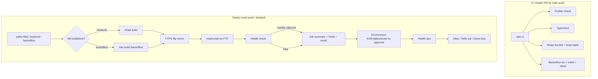

# GitHub Actions → DotRoll cPanel (kor.fejlesztesek.hu)

A repó két workflow-t futtat:

| Workflow   | Fájl                                                                               | Mikor                                                          |
| ---------- | ---------------------------------------------------------------------------------- | -------------------------------------------------------------- |
| **CI**     | [`.github/workflows/ci.yml`](../../.github/workflows/ci.yml)                       | Minden PR és `main` push                                       |
| **Deploy** | [`.github/workflows/deploy-cpanel.yml`](../../.github/workflows/deploy-cpanel.yml) | `main` push (csak érintett útvonal) + kézi `workflow_dispatch` |

A build **mindig a GitHub runneren** készül. A shared host csak futtatja a már feltöltött fát (Passenger / Setup Node.js App).

## Pipeline (áttekintés)



## FTP feltöltés (lokal és CI)

- Közös belépés: [`scripts/deploy/upload.sh`](../../scripts/deploy/upload.sh)
- Lokális wrapper (változatlan npm scriptek):
  - `npm run deploy` → [`scripts/ftp-deploy.sh`](../../scripts/ftp-deploy.sh) → `upload.sh backend`
  - `npm run deploy:backoffice` → [`scripts/ftp-deploy-backoffice.sh`](../../scripts/ftp-deploy-backoffice.sh) → `upload.sh backoffice`
- Env fájl minta: [`.env.deploy.example`](../../.env.deploy.example) (másold `.env.deploy:kor.fejlesztesek.hu` néven, **ne commitold**).

Biztonság:

- `--delete` csak a **build mappákban** (`dist/build`, backoffice `dist`).
- Kizárva: `.env`, rejtett fájlok, `public/uploads`.
- Deploy előtt (backend): távoli `dist/build` másolat `_deploy_backups/<UTC-stamp>/dist/build` alá (ha a tárhely kvóta engedi).

### Rollback

1. cPanel Fájlkezelő: `kor-szupatak/_deploy_backups/<stamp>/dist/build` → visszamásolás `kor-szupatak/dist/build` alá (vagy lftp mirror fordítva).
2. `tmp/restart.txt` frissítése az alkalmazás gyökerében, vagy Setup Node.js App **Restart**.
3. Ha a hiba kód-oldali: git revert + merge `main` (új deploy), vagy lokális `npm run deploy` a régi commit buildjével.

## Post-deploy: restart és NPM

DotRoll cPanelen a `WebApp` / `PassengerApps` UAPI üres listát ad (`data: []` / `{}`), ezért **nincs automatikus UAPI restart vagy `ensure_deps`**. A deploy ezt a két utat használja:

| Lépés | Módszer | Mikor |
| ----- | ------- | ----- |
| Passenger restart | FTP: `<app-root>/tmp/restart.txt` | Minden backend deploy után ([cPanel Passenger restart](https://support.cpanel.net/hc/en-us/articles/1500002443862)) |
| NPM Install | Manuális: Setup Node.js App → **Run NPM Install** | Ha a `package-lock.json` változott a deployban |

Lockfile változáskor a workflow:

1. Job summary-ba írja a cPanel kattintós lépéseket ([npm-install.md](../deploy/cpanel/npm-install.md)).
2. Trello / email értesítést küld.
3. Megáll a `KOR.fejlesztesek.hu` environment approvalnél, amíg az operátor elvégzi az NPM Install + Restartot.
4. Utána újra lefuttatja a health checket.

Ha a lockfile **nem** változott, de a health check elbukik, ugyanez a manuális gate fut (javítás / Restart után approval).

## GitHub Secrets és Variables

| Név                                                                        | Kötelező    | Hol van / megjegyzés                                            |
| -------------------------------------------------------------------------- | ----------- | --------------------------------------------------------------- |
| `FTP_HOST`                                                                 | deploy      | pl. `kor.fejlesztesek.hu`                                       |
| `FTP_USER`                                                                 | deploy      | pl. `node@fejlesztesek.hu`                                      |
| `FTP_PASS`                                                                 | deploy      | FTP jelszó                                                      |
| `FTP_REMOTE_DIR`                                                           | deploy      | pl. `kor-szupatak` (relatív a home-hoz)                         |
| `FTP_PORT`                                                                 | opcionális  | alap: `21`                                                      |
| `CPANEL_APP_ROOT`                                                          | post-deploy | pl. `node/kor-szupatak` (`tmp/restart.txt` célja)               |
| `TRELLO_KEY`                                                               | értesítés   | [Trello Power-Up / API Key](https://trello.com/power-ups/admin) |
| `TRELLO_TOKEN`                                                             | értesítés   | OAuth token (read/write)                                        |
| `TRELLO_LIST_ID`                                                           | értesítés   | Cél lista ID (URL-ben a board/list után)                        |
| `TRELLO_DONE_LIST_ID`                                                      | opcionális  | Sikeres deploy után ide mozgatja a kártyát                      |
| `SMTP_HOST`, `SMTP_PORT`, `SMTP_USER`, `SMTP_PASS`, `SMTP_FROM`, `SMTP_TO` | opcionális  | Email fallback                                                  |

**Repository variables** (Settings → Secrets and variables → Actions → Variables):

| Név                         | Alapértelmezés      |
| --------------------------- | ------------------- |
| `FTP_OVERRIDE_POLICY`       | `only-newer`        |
| `FTP_BACKOFFICE_REMOTE_DIR` | `public/backoffice` |

**Environment:** `KOR.fejlesztesek.hu` **Required reviewers**-rel (Settings → Environments → Configure).

A korábbi `CPANEL_HOST` / `CPANEL_USERNAME` / `CPANEL_API_TOKEN` / `CPANEL_WEBAPP_NAME` / `CPANEL_PASSENGER_APP_NAME` secretök és változók **nem kellenek** — törölhetők a repo settingsből.

## Trello kulcs, token, lista ID

1. [https://trello.com/app-key](https://trello.com/app-key) → **API Key** → `TRELLO_KEY`.
2. Ugyanott **Token** generálás → `TRELLO_TOKEN`.
3. Nyisd meg a cél listát a böngészőben; a lista ID a URL-ben: `.../list/<LIST_ID>` → `TRELLO_LIST_ID`.

## Automatizált vs manuális

| Lépés                                       | Automatizált                  | Manuális                                                                                                     |
| ------------------------------------------- | ----------------------------- | ------------------------------------------------------------------------------------------------------------ |
| `npm ci`, typecheck, tesztek, build         | CI / runner                   | —                                                                                                            |
| FTPS feltöltés                              | Actions                       | Lokális `npm run deploy*`                                                                                    |
| Passenger restart                           | FTP `tmp/restart.txt`         | cPanel Setup Node.js App **Restart** (aliasok is), ha a restart.txt nem elég                                 |
| `npm install` lockfile változáskor          | — (gate + summary)            | **Run NPM Install** + `nodevenv/.../node_modules` törlés ([npm-install.md](../deploy/cpanel/npm-install.md)) |
| Health `/_health`, `/admin`, `/backoffice/` | Script backoff                | Ha tartós hiba: env review, Neon, Cloudinary                                                                 |
| Deploy jóváhagyás manuális lépésnél         | `KOR.fejlesztesek.hu` environment | Reviewer a GitHubon                                                                                       |

## Workflow kézi futtatása

1. GitHub → **Actions** → **Deploy cPanel (kor.fejlesztesek.hu)** → **Run workflow**.
2. **target:** `auto` (paths-filter), `backend`, `backoffice`, vagy `both`.
3. **dry_run:** `true` → lftp `--dry-run`, nincs restart / health gate élesítés.

Egyes lépések lokálisan:

```bash
npm run format:check
npm test
npm run ci:backoffice
bash scripts/deploy/upload.sh backend .env.deploy:kor.fejlesztesek.hu --dry-run
bash scripts/deploy/health-check.sh   # DEPLOY_BASE_URL=...
```

## `main` branch protection

Részletes lépések: [`branch-protection.md`](./branch-protection.md).

## Kapcsolódó deploy dokumentáció

- [content-backoffice-kor.md](../deploy/content-backoffice-kor.md)
- [cpanel/npm-install.md](../deploy/cpanel/npm-install.md)
- [cpanel/alias/readme.md](../deploy/cpanel/alias/readme.md)
