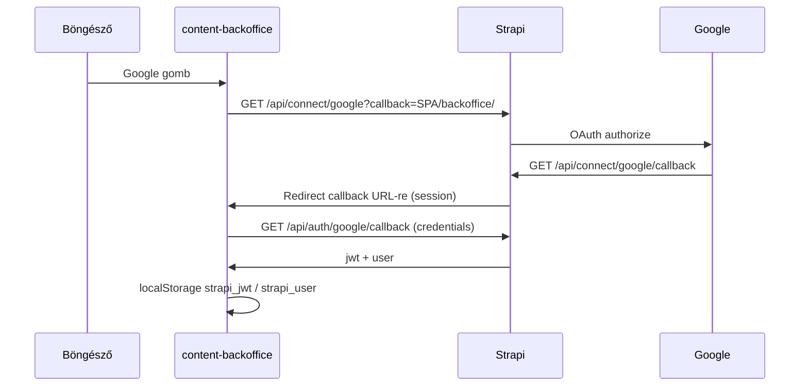

# Content backoffice — OAuth (Google) és Users & Permissions

Ez a dokumentum két réteget ír le:

1. **Strapi Users & Permissions** — beépített provider, grant, Advanced beállítások, admin által felvett userek.
2. **`apps/content-backoffice`** — login gomb, OAuth round-trip, JWT tárolás, profil (jelszócsere).

A Content API továbbra is ugyanazt a **Users & Permissions JWT**-t használja, mint a local (`/api/auth/local`) belépés. A backoffice **nem** használ Strapi Admin JWT-t.

Kapcsolódó deploy rövid jegyzet: [backoffice-google-oauth.md](./deploy/backoffice-google-oauth.md).

---

## 1. Strapi — Users & Permissions provider

### 1.1 Hol van a beállítás

| Hely | Mit csinál |
| --- | --- |
| **Admin → Settings → Users & Permissions → Providers → Google** | A grant store tartalmát mutatja (enabled, Client ID/Secret, Redirect URL a front-endre). A repó **bootstrap** és `config/plugins.ts` is írja ugyanezt; induláskor nem kell kézzel BE kapcsolni, ha az env megvan. |
| **Admin → Settings → Users & Permissions → Advanced settings** | Regisztráció, default role, egy e-mail / egy fiók, e-mail megerősítés. |
| **Admin → Content Manager → User** (Users & Permissions user) | Content user létrehozása: e-mail, **role** (`dataentry` / `editor`), jelszó. A Strapi ilyenkor **`provider: local`** rekordot hoz létre. |
| **`config/plugins.ts`** | `grant.google`: env-ből `GOOGLE_CLIENT_ID`, `GOOGLE_CLIENT_SECRET`, `BACKOFFICE_OAUTH_CALLBACK`. Callback URL validátor (engedélyezett origin + `/backoffice/` path). |
| **`src/index.ts` bootstrap** | `ensureGoogleOAuthGrant()` — grant store szinkron a configból. Content szerepekhez `plugin::users-permissions.auth.changePassword` jog. |

Titok és kliens ID **nem** kerül a repóba; env: gyökér `.env.example` (`GOOGLE_*`, `BACKOFFICE_OAUTH_CALLBACK`).

### 1.2 OAuth végpontok (Strapi host)

| Lépés | HTTP | Szerep |
| --- | --- | --- |
| Provider indítás | `GET /api/connect/google?callback=…` | Böngészőt Google-hoz, majd Strapi callbackre viszi. A `callback` query a **SPA visszatérési URL** (pl. `https://kor.fejlesztesek.hu/backoffice/`). |
| Google → Strapi | `GET /api/connect/google/callback` | Google Cloud Console **Authorized redirect URI** erre a Strapi URL-re mutasson (`{PUBLIC_URL}/api/connect/google/callback`). |
| JWT kiadás | `GET /api/auth/google/callback` | Sessionben megvan a grant válasz után Strapi **Content JWT** + user. A backoffice ezt hívja fetch-csel (`credentials: include`). |

A local belépés továbbra is: `POST /api/auth/local` (identifier + password).

### 1.3 Hogyan dönt a Strapi, ki léphet be Google-lel

A `plugin::users-permissions` provider szolgáltatás gyári logikája (a repó ezt Google-nél kiegészíti, lásd lent és az 1.4 részt):

1. Google profilból **e-mail** (kötelező, verified).
2. Megkeresi a usereket **e-mail** szerint.
3. Közülük a **`provider === 'google'`** sort — ha van, **bejelentkeztet** (role = admin által korábban adott role, ha már létezik a user).
4. Ha nincs google provider sor:
   - **`allow_register` (Enable sign-ups) = false** → hiba: *Register action is actually not available* — **új user nem jön létre**.
   - **`allow_register` = true** → **új user** jön létre `provider: google`, role = **Default role for authenticated users** (gyakran `authenticated`), **nem** automatikusan `dataentry` / `editor`.

**Egy e-mail / egy fiók** (`unique_email` = ON): ha már van **local** user ugyanazzal az e-maillel, és még nincs `google` sor, regisztráció BE mellett *Email is already taken*; regisztráció KI mellett *Register action is actually not available*.

**Admin UI user create** mindig **`provider: 'local'`** (Content Manager controller). Tehát:

- Admin: e-mail + jelszó + `dataentry` / `editor` → **local** belépés működik.
- Ugyanaz az e-mail **Google-lel** stock Strapi mellett **nem** kötődik automatikusan a meglévő local userhez — külön `google` provider sor kellene, amit az Admin normál űrlapja nem hoz létre.
- Ezért a repó felülírja a Google-belépést (`src/extensions/users-permissions/strapi-server.ts`, döntési logika: `src/oauth-link.ts`): ha nincs `google` provider sor, de pontosan **egy** user van ugyanazzal az e-maillel, akkor **őt** jelentkezteti be. Részletek: 1.4.

### 1.4 Advanced settings — ajánlott üzemeltetés (csak tagok)

Cél: **ne regisztrálhasson bárki** Google-lel; hozzáférést **admin adjon**.

| Beállítás | Ajánlott | Hatás |
| --- | --- | --- |
| **Enable sign-ups** | **OFF (KIKAPCSOL)** | Ismeretlen Google fiók **nem** kap új Content usert. |
| **One account per email address** | **ON (BEKAPCSOL)** | Egy e-mail = egy user rekord. |
| **Default role for authenticated users** | Mindegy, ha sign-ups OFF | Új user csak Adminban; ott **dataentry** / **editor**. |
| **Enable email confirmation** | **OFF** | Belső backoffice-nál általában elég. |

**Ma működő modell regisztráció OFF mellett:**

1. Admin létrehozza a usert (e-mail, role, jelszó) → tag **local** loginnal megy a backoffice-ba.
2. Ugyanez a tag a **Google** gombbal is beléphet, ha a Google-fiókja e-mail címe megegyezik az Adminban felvett e-maillel. Ugyanabba a user rekordba lép be, a **role változatlan** (`dataentry` / `editor`).
3. Ismeretlen e-mail Google-lel továbbra is: *Register action is actually not available* — új user **nem** jön létre.

**Hogyan működik az összekötés** (`src/oauth-link.ts`, `src/extensions/users-permissions/strapi-server.ts`):

- Csak a `google` providerre vonatkozik; a Google csak **ellenőrzött** (verified) e-mailt ad vissza, mást a Strapi elutasít.
- Az e-mail egyezés **kis- és nagybetűtől független**.
- Ha már van `provider: google` user ezzel az e-maillel, az nyer (gyári viselkedés).
- Ha nincs ilyen, és **pontosan egy** user van ezzel az e-maillel: belép ez a user, ha **nincs tiltva** (*blocked*), és — ha az *Enable email confirmation* be van kapcsolva — **megerősített**. Tiltott usernél: *Your account has been blocked by an administrator*; meg nem erősítettnél: *Your account email is not confirmed*.
- Ha **több** user is ugyanazzal az e-maillel szerepel (csak `unique_email` OFF mellett lehet), nincs belépés: *Register action is actually not available* (a szerver logban `warn` sor jelzi az okát).
- Ha **egyik** user sem egyezik, a gyári logika fut: regisztráció OFF → elutasítás, ON → új user a default role-lal.
- A user rekordot **nem** módosítja: a `provider` marad `local`, így a jelszavas belépés (`POST /api/auth/local`, ami `provider: local` szerint keres) és a profilon a jelszócsere is megmarad. Sikeres összekötéskor a logban: `OAuth google login linked to existing user id=…`.

**Ha sign-ups ON marad:** bárki Google-lel új usert kaphat (default role), ez **ellentmond** a „csak admin ad hozzáférést” célnek.

**Megvalósítva:** regisztráció OFF + admin által felvett e-mail → a Google login **ugyanahhoz a userhez** jut, role változatlan (lásd fent).

### 1.5 Role és JWT a backoffice számára

- A Content user **egy** Users & Permissions **role**-t kap (pl. `dataentry`, `editor`).
- A backoffice `GET /api/users/me?populate=role` → `role.type` → menü és route guard.
- Google és local login **ugyanazt a JWT mechanizmust** használja; a különbség csak a user rekord `provider` mezője és hogy van-e jelszó.

---

## 2. Content backoffice — implementált OAuth

### 2.1 Fájlok

| Fájl | Feladat |
| --- | --- |
| `src/login/LoginPage.tsx` | Google gomb; OAuth visszatérés után session callback, majd navigáció a fő oldalra. |
| `src/auth/googleLogin.ts` | `startGoogleLogin()`, `completeGoogleLoginFromSession()`, SPA callback URL (`/backoffice/`). |
| `src/auth/strapiAuthStorage.ts` | JWT + user a `ra-strapi` kulcsokba: `strapi_jwt`, `strapi_user`. |
| `src/auth/authProvider.ts` | `strapiAuthProvider` + `getPermissions`; profil / jelszócsere API. |
| `src/pages/profile/ProfilePage.tsx` | Jelszócsere űrlap csak ha `provider === 'local'`. |

### 2.2 Google login lépései (SPA)



1. **`startGoogleLogin()`** — `sessionStorage` jelzi a pending OAuth-ot; teljes oldalas redirect:  
   `{STRAPI_URL}/api/connect/google?callback={encodeURIComponent(origin + /backoffice/)}` (dev: `localhost:1337`, éles: page origin).
2. Strapi végigviszi a Google flow-t, session cookie a **Strapi originen** marad.
3. Visszaérkezés a login oldalra → **`completeGoogleLoginFromSession()`** — `GET /api/auth/google/callback`, `credentials: 'include'`.
4. **`persistStrapiAuthSession(jwt, user)`** — ugyanoda, mint local login.
5. React-admin `checkAuth` / `getPermissions` ugyanúgy működik.

**Lokális fejlesztés:** SPA `localhost:5173`, Strapi `localhost:1337` — cross-origin session cookie miatt a Google callback fetch **korlátozott** lehet. Élesben same origin (`kor.fejlesztesek.hu`) ez tipikusan rendben van.

### 2.3 Local login és profil (összehangban OAuth-tal)

| Funkció | Viselkedés |
| --- | --- |
| E-mail + jelszó | `ra-strapi` → `POST /api/auth/local` |
| Google | fenti flow |
| Profil jelszócsere | `POST /api/auth/change-password` — csak **`provider === 'local'`** |
| Google-only user | Profilon nincs jelszó űrlap |

---

## 3. Összefoglaló táblázat

| Kérdés | Válasz |
| --- | --- |
| Ki ad role-t? | **Admin** (User létrehozás / szerkesztés), nem a Google flow. |
| Tiltom a „bárki regisztrál Google-lel”? | Advanced: **Enable sign-ups OFF**. |
| Admin felvesz e-mail + role + jelszó — mehet utána Google? | **Igen**, ha a Google-fiók e-mailje megegyezik, és a user nincs tiltva: ugyanaz a user lép be, ugyanazzal a role-lal (repó override; stock Strapi ezt nem engedné). Local login is **marad**. |
| Kell-e Adminban Google provider kapcsoló? | **Nem** kötelező; env + bootstrap beállítja. Ellenőrzésre használható. |
| Hol a deploy URL lista? | [deploy/backoffice-google-oauth.md](./deploy/backoffice-google-oauth.md) |
| Hol vannak az adatkezelési tájékoztató és a felhasználási feltételek? | Strapi `static-page` gyűjtemény (hu/en), nyilvánosan: `/static/privacy-policy`, `/static/terms-of-service`, `/static/about`, angolul `?locale=en`. Forrás: [legal/README.md](./static/README.md) |

---

## 4. Env változók (Strapi gyökér)

```bash
GOOGLE_CLIENT_ID=...
GOOGLE_CLIENT_SECRET=...
# SPA redirect a grant-ben és OAuth után (trailing slash):
BACKOFFICE_OAUTH_CALLBACK=http://localhost:5173/backoffice/
# éles: https://kor.fejlesztesek.hu/backoffice/
PUBLIC_URL=http://localhost:1337   # Google Console Strapi callback ehhez igazodik
```

SPA: nincs Vite env; lokálon a Strapi origin fix `http://localhost:1337`, élesen a page origin.
