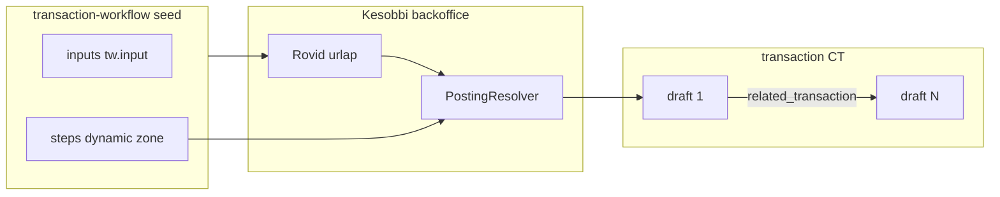
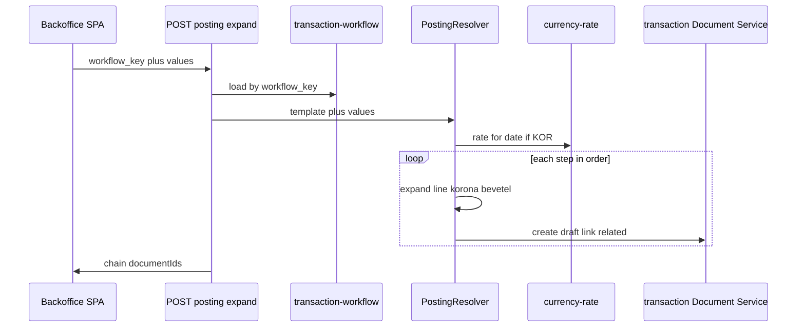

# Implementation plan: `transaction-workflow` content type

**Status:** draft (spec only — nincs Strapi séma a repóban)  
**Date:** 2026-10-28  
**Üzleti modell:** [Ügyletek](../transaction-workflow.md)  
**Backoffice v1:** [0001-content-backoffice-v1](../prd/0001-content-backoffice-v1.md) — az ügylet-CT és a resolver **v1 utáni**  
**Kapcsolódó séma:** [transaction](../src/api/transaction/content-types/transaction/schema.json), [transaction-type](../src/api/transaction-type/content-types/transaction-type/schema.json), [member](../src/api/member/content-types/member/schema.json)

Ez a fájl a **`transaction-workflow`** Strapi collection és komponensei szerződése, a kilenc mintaügylet seed katalógusa, valamint a későbbi **PostingResolver** modul működése. Kód ebből a dokumentumból még nem következik; implementációs PR-okra bontva hajtható végre (lásd [10. Implementációs fázisok](#10-implementációs-fázisok)).

A [transaction-workflow.md](../transaction-workflow.md) „Ügylet konfigurálása Strapi-ban” szakasza a belső nevet **`posting-workflow`**-ként említi; ez a terv **`transaction-workflow`** API nevet használ (ugyanaz a fogalom: admin katalógus rekord, felületen **Ügylet** / **Deal**).

---

## 1. Cél és nem-cél

### Cél

1. Egy Strapi **collection** (`transaction-workflow`), amely ügylettípusonként tárolja:
   - a rövid űrlap **beviteli mezőit** (`inputs`, ismétlődő komponens);
   - a könyvelési **lépés-sablont** (`steps`, dynamic zone).
2. **Seed** mind a [transaction-workflow.md](../transaction-workflow.md) Ügylet 1–9 fejezetére, hogy a resolver és a backoffice ne hardkódoljon üzleti logikát.
3. Egy későbbi **PostingResolver** modul, amely kitöltött mezőkből + sablonból **draft `transaction` sorok láncát** írja (`related_transaction`).

### Nem-cél (v1 határ)

- A v1 **kézi tranzakció** űrlap ([0001 plan](0001-content-backoffice-spa.md) 6. lépés) változatlan, amíg feature flaggel be nem kapcsol az ügylet-űrlap.
- Nincs külön „kitöltött ügylet példány” collection: a kitöltés csak a resolveren megy át; audit a generált `transaction` `entered_by` / `published_by` mezőin ([publish guard](../../.cursor/rules/strapi-publish-guard.mdc)).
- Negyedik lépésblokk-típus vagy olyan összeg-szabály, ami nem `copy_input` és nem `rate_from_huf`, **kódváltozás** (összhangban a [transaction-workflow.md](../transaction-workflow.md) admin modelljével).
- v1 PRD §8 (org ACL, Enterprise RBAC, stb.) — nem része.

---

## 2. Fogalomtár

| Fogalom | Jelentés |
| -------- | -------- |
| **Ügylet** (Deal) | Teljes gazdasági esemény; a felhasználó ezt látja a rövid űrlapon. |
| **Tranzakció** (Transaction) | Egy könyvelési sor: egy tartozik, egy követel, összeg, pénznem, szervezet. |
| **`transaction-workflow` rekord** | Admin katalógus: egy ügylettípus sablonja (`workflow_key`, `inputs`, `steps`). Nem draft/publish QA workflow. |
| **PostingResolver** | Szerveroldali modul: sablon + kitöltés → N db draft transaction. |

### Egysoros v1 vs rövid űrlap vs bontott sorok

A [Ügylet 1](../transaction-workflow.md#ügylet-1--tagi-befizetés-ingatlan-vásárlásra) három reprezentációja **nem ugyanaz**:

| Forrás | Mit mutat | Szerep |
| ------ | --------- | ------ |
| [214–216](../transaction-workflow.md) | `1520` ← `1101`, 2 080 000 HUF | A v1 űrlap **szimbolikus** egy soros összefoglalója; **nem** a `transaction-workflow` `inputs` modellje; a v1 debit szűrő (`/^5/`) nem is engedi a `1520` tartozikot. |
| [222](../transaction-workflow.md) | dátum, tag, befizetett összeg, vételár, illeték, ingatlan számla, leírás | A seedelt rekord **`inputs`** listája. |
| [226–236](../transaction-workflow.md) | 8 lépés (+ 2 lekötés blokk → +8 sor) | A **`steps`** + resolver **kimenete** (összesen 14 `transaction` draft). |



---

## 3. Collection: `api::transaction-workflow.transaction-workflow`

| Tulajdonság | Érték |
| ----------- | ----- |
| `kind` | `collectionType` |
| `collectionName` | `transaction_workflows` |
| `singularName` | `transaction-workflow` |
| `pluralName` | `transaction-workflows` |
| `displayName` (Admin) | Ügylet sablon / Deal template |
| `draftAndPublish` | **`false`** — katalógus, nem QA |

### 3.1 Fő attribútumok

| Mező | Strapi típus | Kötelező | Megjegyzés |
| ---- | ------------ | -------- | ---------- |
| `workflow_key` | `uid` vagy `string` (regex: `[a-z0-9-]+`) | igen | Stabil azonosító seedhez és API-hoz; **egyedi**. |
| `name` | `string` | igen | Admin címke, i18n alap (pl. „Tagi befizetés ingatlan vásárlásra”). |
| `description` | `text` | nem | Rövid magyarázat a rögzítőnek / adminnak. |
| `active` | `boolean` | igen, default `true` | Inaktív rekord nem jelenik meg a rövid űrlap választóban. |
| `sort_order` | `integer` | nem, default `0` | Menü sorrend (1…9 a mintaügyletekhez). |
| `inputs` | ismétlődő komponens `tw.input` | igen | Üres lista tiltott seednél. |
| `steps` | dynamic zone | igen | Komponensek: `tw.line`, `tw.korona-lekotes`, `tw.bevetel-forint`. |

**Jogosultság (javaslat):** sablon szerkesztés csak **Strapi Admin**; Content API `find` / `findOne` a `dataentry` és `editor` szerepnek (SPA űrlap + resolver olvasás). Create/update/delete a Content API-n **tilos** (vagy csak Admin JWT).

---

## 4. Komponensek (`src/components/tw/`)

Strapi 5 komponens névtér: **`tw`** (rövid prefix). Dynamic zone `steps` csak az alábbi három típust engedélyezi.

### 4.1 `tw.input` — beviteli mező definíció

Ismétlődő komponens a collection `inputs` mezőjén. **Nem** dynamic zone (minden mező ugyanaz az alak).

| Mező | Típus | Kötelező | Leírás |
| ---- | ----- | -------- | ------ |
| `key` | `string` | igen | Gép azonosító; regex `^[a-z][a-z0-9_]*$`; egy rekordon belül egyedi. |
| `label` | `string` | igen | Űrlap felirat (hu; később i18n plugin opcionális). |
| `kind` | enum | igen | Lásd alább. |
| `required` | `boolean` | default `true` | |
| `enum_options` | JSON vagy ismétlődő `{ value, label }` | ha `kind=enum` | Pl. bányászás `source`: `1100`, `1000`. |
| `account_code_prefix` | `string` | ha `kind=account_code_prefix` | Pl. `15` → választó `1510`/`1520`/`1530` számlák közül. |
| `default_organization` | relation → `organization` | nem | Alapértelmezett szervezet (pl. kincstár). |

**`kind` értékek**

| `kind` | Űrlap widget | Resolver érték |
| ------ | ------------ | -------------- |
| `date` | dátum | ISO dátum (árfolyam napja is lehet). |
| `text` | szöveg | `description` vagy szabad szöveg. |
| `decimal` | szám | Összeg / mennyiség. |
| `member` | tag választó | `member` `documentId` → `1101` / `1001` feloldás. |
| `organization` | szervezet fa | `organization` `documentId`. |
| `account` | számla választó | `account` `documentId`. |
| `account_code_prefix` | szűrt számla lista | Eszköz számla (`1510`/`1520`/`1530`). |
| `enum` | legördülő | Fix érték (pl. pénzeszköz kód). |

---

### 4.2 `tw.line` — egy könyvelési sor sablon

Egy blokk → resolver **1** db `transaction` draft.

#### Számla oldalak (`debit` / `credit`)

Mindkét oldalon ugyanaz a **`account_source`** enum:

| `account_source` | Feloldás |
| ---------------- | -------- |
| `fixed_account` | `debit_account` / `credit_account` relation → `api::account.account` |
| `input_account` | `input_key` → kitöltött mező `account` vagy `account_code_prefix` alapján |
| `member_tagi_1101` | Bemeneti `member` → [member-accounts.ts](../../src/member-accounts.ts) `account` (1101) |
| `member_sajat_1001` | Bemeneti `member` → `private_account` (1001) |

| Mező | Típus | Kötelező |
| ---- | ----- | -------- |
| `step_label` | `string` | nem | Admin / debug (pl. „Részjegy előírása”). |
| `debit_source` | enum | igen | |
| `debit_account` | relation | ha `fixed_account` | |
| `debit_input_key` | `string` | ha `input_account` | |
| `credit_source` | enum | igen | |
| `credit_account` | relation | ha `fixed_account` | |
| `credit_input_key` | `string` | ha `input_account` | |
| `amount_mode` | enum: `copy_input` \| `rate_from_huf` | igen | |
| `amount_input_key` | `string` | ha `copy_input` | |
| `currency_mode` | enum: `fixed` \| `HUF` \| `KOR` \| `resource_from_input` | igen | |
| `currency_type` | relation → `currency-type` | ha `fixed` / resource | EGG, FRUIT, stb. |
| `resource_input_key` | `string` | ha mennyiség inputból | Pl. `quantity_eggs`. |
| `organization_mode` | enum | igen | Lásd alább. |
| `organization` | relation | ha `fix` | |
| `organization_input_key` | `string` | ha `input` | |
| `transaction_type` | relation → `transaction-type` | igen | Utalás, Átvezetés, Bányászás, … |
| `description_template` | `string` | nem | `{description}` helyettesítés a kitöltés `description` mezőjével. |

**`organization_mode`**

| Érték | Jelentés |
| ----- | -------- |
| `kincstar` | `I/3. Pénzügyi Igazgatóság` (seed organization; resolver fix kód vagy env). |
| `input` | `organization_input_key` kitöltésből. |
| `fix` | `organization` relation a komponensen. |
| `asset_org_from_debit` | A sor tartozik számlájához kötött eszköz szervezete (pl. `1520` → Lakóterületek). |

---

### 4.3 `tw.korona-lekotes` — lekötés blokk

Egy blokk → resolver **4** db `transaction` ([lekötés blokk](../transaction-workflow.md#lekötés-blokk)); a `1900` sorok **implicit**, külön admin blokk nélkül.

| Mező | Típus | Leírás |
| ---- | ----- | ------ |
| `step_label` | `string` | Pl. „Lekötés, vételár”. |
| `huf_amount_input_key` | `string` | Forint fedezet összege (pl. `purchase_price`, `duty_amount`). |
| `huf_source_mode` | enum: `asset_huf_on_account` \| `treasury_cash` \| `treasury_bank` | Tagi úton: eszköz HUF értéke (`15xx` → `1900`); szövetkezeti úton: `1100`/`1000`. |
| `asset_account_input_key` | `string` | Ha `asset_huf_on_account`: melyik input számla (ingatlan). |
| `target_organization_mode` | enum: `asset_org_from_account` \| `fix` | Korona cél nyilvántartás. |
| `target_organization` | relation | Ha `fix`. |
| `transaction_type` | relation | Általában Átvezetés. |

**KOR összeg:** `rate_from_huf` — a bizonylat napján érvényes [currency-rate](../../src/api/currency-rate/content-types/currency-rate/schema.json) (HUF → KOR). Ha nincs árfolyam, resolver **hiba**, draft nem keletkezik.

A négy generált sor (sorrend fix):

1. HUF: `1900` ← fedezet forrás  
2. KOR: `1000` ← `1900` (kincstár)  
3. KOR: `1900` ← `1000` (kincstár)  
4. KOR: `1000` ← `1900` (eszköz projekt szervezete)

Számlák: `1900` és `1000` relation seedből; hiányzó `1900` → [9. Függőségek](#9-függőségek-és-nyitott-kérdések).

---

### 4.4 `tw.bevetel-forint` — forint bevétel két technikai sora

Egy blokk → resolver **2** db `transaction` ([forint bevétel](../transaction-workflow.md#forint-bevétel-korona-nélkül)).

| Mező | Típus | Leírás |
| ---- | ----- | ------ |
| `step_label` | `string` | |
| `huf_amount_input_key` | `string` | Pl. `sale_amount_huf`. |
| `cash_account` | relation | `1000` vagy `1100` (beérkezés). |
| `cash_organization_mode` | enum: `kincstar` \| `input` | Pénzeszköz sor szervezete. |
| `final_credit_account` | relation | `4000`, `1200`, stb. |
| `final_credit_organization_mode` | enum: `input` \| `fix` | Végleges sor szervezete. |
| `final_credit_organization` | relation | |
| `transaction_type_in` | relation | Készpénz / Utalás (1. sor). |
| `transaction_type_post` | relation | Átvezetés (2. sor). |

**1. sor:** pénzeszköz ← `1900` (beérkezés). **2. sor:** `1900` ← `final_credit_account` (végleges könyvelés).

---

### 4.5 JSON példák (Ügylet 1)

**`tw.input` (részlet a seed JSON-ból)**

```json
{
  "key": "member",
  "label": "Tag",
  "kind": "member",
  "required": true
}
```

**`tw.line` — 1. lépés, részjegy előírása**

```json
{
  "__component": "tw.line",
  "step_label": "Részjegy előírása",
  "debit_source": "member_tagi_1101",
  "credit_source": "fixed_account",
  "credit_account": "<documentId of 3000>",
  "amount_mode": "copy_input",
  "amount_input_key": "contribution_amount",
  "currency_mode": "HUF",
  "organization_mode": "kincstar",
  "transaction_type": "<documentId Átvezetés>"
}
```

**`tw.korona-lekotes` — 5. lépés, vételár lekötés**

```json
{
  "__component": "tw.korona-lekotes",
  "step_label": "Lekötés, vételár",
  "huf_amount_input_key": "purchase_price",
  "huf_source_mode": "asset_huf_on_account",
  "asset_account_input_key": "property_account",
  "target_organization_mode": "asset_org_from_account",
  "transaction_type": "<documentId Átvezetés>"
}
```

---

## 5. Összeg- és számlafeloldás

### 5.1 Összeg

| `amount_mode` | Szabály |
| ------------- | ------- |
| `copy_input` | Decimal a `amount_input_key` mezőből. |
| `rate_from_huf` | Ugyanabból a HUF összegből KOR: `floor(huf / rate)` vagy a projekt által választott kerekítés — **egy** konvenciót rögzíteni implementációkor (minta: 1 KOR = 100 Ft). |

A `currency-rate` lekérdezés: `valid_from <= transaction_date` szerint legutolsó HUF→KOR (vagy fordított, a seed definíció szerint).

### 5.2 Tag számlák

A `member` input → `member` rekord betöltése `account` + `private_account` populate-tel → [member-accounts.ts](../../src/member-accounts.ts). Hiányzó számla esetén resolver hiba (lifecycle pótolja induláskor).

### 5.3 Szervezet: kincstár

Fix organization: seedben `I/3. Pénzügyi Igazgatóság` — resolver `workflow_key`-től függetlenül ezt a csomópontot használja `kincstar` módnál (documentId cache bootstrap-ben).

### 5.4 Kimenet mezők transactionön

Minden generált sor:

- `date` ← kitöltés `date` input (vagy külön mező)
- `amount`, `currency_type`, `debit_account`, `credit_account`, `organization`, `transaction_type`
- `description` ← sablon + ügylet leírás
- `related_transaction` ← lánc (lásd 6. fejezet)
- `entered_key` opcionális: `{workflow_key}:{uuid}:{step_index}` idempotenciához

---

## 6. PostingResolver modul

### 6.1 Elhelyezés

**Ajánlás:** Strapi oldali service — pl. `src/api/posting/` custom route + `services/resolver.ts` — hogy `currency-rate`, tag számlák és account/org feloldás egy helyen legyen, publish middleware-rel konzisztensen.

Alternatíva (nem preferált): logika csak az SPA-ban — duplikált üzleti szabály, nehezebb tesztelni.

### 6.2 API

| Endpoint | Auth | Viselkedés |
| -------- | ---- | ---------- |
| `POST /api/posting/expand` | `dataentry`, `editor` | Bemenet → N draft transaction; **nem** publish. |
| `GET /api/transaction-workflows` | `dataentry`, `editor` | `active=true`, populate `inputs`, `steps`. |

**Request body (expand)**

```json
{
  "workflow_key": "member-property-deposit",
  "values": {
    "date": "2026-10-14",
    "member": "<member documentId>",
    "contribution_amount": 2080000,
    "purchase_price": 2000000,
    "duty_amount": 80000,
    "property_account": "<1520 documentId>",
    "description": "kovács.erika lakótelek"
  }
}
```

**Response:** `{ "transactions": [ { "documentId", "step_index" }, ... ], "chain_head": "<first documentId>" }`

### 6.3 Feldolgozás (szekvencia)



1. Sablon betöltés (`workflow_key`, `active`).
2. Validáció: kötelező `inputs`, típusellenőrzés.
3. Kontextus: member accounts, kincstár org, fix számlák relation populate.
4. `steps` **sorrendben**:
   - `tw.line` → 1× create draft
   - `tw.korona-lekotes` → 4× create draft
   - `tw.bevetel-forint` → 2× create draft
5. **`related_transaction` lánc:** az **első** létrehozott sor `related_transaction = null`. Minden **következő** sor `related_transaction` = **közvetlenül előző** sor `documentId` (egyenes lánc, nem csillag). Így az ügylet egy listán végigjárható.
6. **Atomi tranzakció:** egy expand hívás vagy minden sor létrejön draftként, vagy egyik sem (DB tranzakció / kompenzáló törlés hiba esetén).
7. Publish: **v1 editor út** — soronkénti Véglegesít, vagy későbbi **bulk publish** helper (külön ticket).

### 6.4 Hibakezelés

| Hiba | HTTP |
| ---- | ---- |
| Ismeretlen `workflow_key` | 404 |
| Inaktív sablon | 403 |
| Hiányzó kötelező input | 400 |
| Nincs currency-rate a napra | 422 |
| Hiányzó `1900` / tag számla | 422 |
| Publish guard megsértés expand közben | 403 (expand csak draftot ír; publish külön) |

---

## 7. Példa végigvezetés: Ügylet 1 (`kovács.erika`)

**Input (minta):** befizetett összeg 2 080 000 Ft, vételár 2 000 000 Ft, illeték 80 000 Ft, számla `1520`, szervezet Lakóterületek.

| # | Sablon blokk | Kimenet (tartozik ← követel) | Összeg | Pénznem |
| - | ------------ | ----------------------------- | ------ | ------- |
| 1 | `tw.line` | 1101 ← 3000 | 2 080 000 | HUF |
| 2 | `tw.line` | 1100 ← 1101 | 2 080 000 | HUF |
| 3 | `tw.line` | 1001 ← 1100 | 2 000 000 | KOR |
| 4 | `tw.line` | 1520 ← 1001 | 2 000 000 | KOR |
| 5 | `tw.korona-lekotes` | 4 sor (1900/1000) | 2 000 000 / 20 000 | HUF+KOR |
| 6 | `tw.line` | 1520 ← 2300 | 80 000 | HUF |
| 7 | `tw.korona-lekotes` | 4 sor | 80 000 / 800 | HUF+KOR |
| 8 | `tw.line` | 2300 ← 1100 | 80 000 | HUF |

**Összesen:** 6 + 8 + 1 = **14** draft `transaction`.

---

## 8. Seed katalógus: 9 rekord

Minden rekord: `active: true`, `sort_order` 1…9, `workflow_key` az alábbi táblázat szerint. A lépés táblák normatív forrása: [transaction-workflow.md](../transaction-workflow.md) megfelelő fejezete.

### 8.1 `member-property-deposit` — Ügylet 1

| `inputs` key | label | kind |
| ------------ | ----- | ---- |
| `date` | Dátum | date |
| `member` | Tag | member |
| `contribution_amount` | Befizetett összeg (részjegy) | decimal |
| `purchase_price` | Vételár | decimal |
| `duty_amount` | Illeték | decimal |
| `property_account` | Ingatlan számla | account_code_prefix (`15`) |
| `description` | Leírás | text |

| # | `steps` |
| - | ------- |
| 1–4 | `tw.line` (226–231 sorok) |
| 5 | `tw.korona-lekotes` (`purchase_price`) |
| 6 | `tw.line` (illeték aktiválás) |
| 7 | `tw.korona-lekotes` (`duty_amount`) |
| 8 | `tw.line` (NAV utalás) |

### 8.2 `cash-property-purchase` — Ügylet 2

| `inputs` | |
| -------- | --- |
| `date`, `purchase_price`, `duty_amount`, `description` | |

| `steps` | |
| ------- | --- |
| 1× line (1520←1000 vételár) + lekötés + illeték line + lekötés + utalás line | [297–303](../transaction-workflow.md) |

### 8.3 `egg-production-sale` — Ügylet 3

| `inputs` | |
| -------- | --- |
| `date`, `barn_organization`, `quantity_eggs`, `sale_amount_huf`, `description` | |

| `steps` | |
| ------- | --- |
| line (1300←4500, EGG) + `tw.bevetel-forint` + line (5600←1300, EGG) | [342–347](../transaction-workflow.md) |

Megjegyzés: a meglévő **Napi tojás** SPA workflow (`egg-daily-entry`) csak a keletkezés sort írja; ez az ügylet sablon a teljes eladási folyamatot fedi.

### 8.4 `fruit-harvest-sale` — Ügylet 4

| `inputs` | |
| -------- | --- |
| `date`, `harvested_kg`, `sold_kg`, `sale_amount_huf`, `description` (+ implicit/fix szervezet: gyümölcsfaliget) | |

| `steps` | |
| ------- | --- |
| line szüret (FRUIT) + bevetel-forint + line készletcsökkenés (sold_kg) | [394–399](../transaction-workflow.md) |

### 8.5 `property-acquisition-deposit` — Ügylet 5

| `inputs` | |
| -------- | --- |
| `date`, `deposit_amount`, `remaining_price`, `property_account`, `description` | |

| `steps` | |
| ------- | --- |
| 4× line/blokk: foglaló, fennmaradó, beszámítás, `tw.korona-lekotes` (teljes eszköz HUF) | [433–438](../transaction-workflow.md) |

### 8.6 `renovation-capitalization` — Ügylet 6

| `inputs` | |
| -------- | --- |
| `date`, `site_organization`, `contractor_amount`, `description` | |

| `steps` | |
| ------- | --- |
| line aktiválás + line utalás + `tw.korona-lekotes` | [474–478](../transaction-workflow.md) |

### 8.7 `agri-area-subsidy` — Ügylet 7

| `inputs` | |
| -------- | --- |
| `date`, `supported_area`, `awarded_amount`, `description` | |

| `steps` | |
| ------- | --- |
| line megítélés (1200←4200) + 2× line (bank→1900, 1900→1200) **vagy** line + `tw.bevetel-forint` a `final_credit_account=1200` paraméterrel | [514–518](../transaction-workflow.md) |

### 8.8 `administration-expense` — Ügylet 8

| `inputs` | |
| -------- | --- |
| `date`, `amount`, `description` | |

| `steps` | |
| ------- | --- |
| 2× line: 5440←2000, 2000←1100 | [560–563](../transaction-workflow.md) |

### 8.9 `mining` — Ügylet 9

| `inputs` | |
| -------- | --- |
| `date`, `member`, `amount`, `source` (enum 1100/1000), `description` | |

| `steps` | |
| ------- | --- |
| 1× line: 1001←source, Bányászás típus | [589–591](../transaction-workflow.md) |

---

## 9. Függőségek és nyitott kérdések

### 9.1 Seed / számlatükör előfeltételek

| Hiány a [transaction-workflow.md](../transaction-workflow.md) szerint | Érintett ügylet(ek) |
| ----------------------------------------------------------------------- | --------------------- |
| `1900` Átvezetés | 1, 2, 3, 4, 5, 6, 7 |
| `4500` Saját termelésű készletek | 3, 4 |
| `EGG` pénznem | 3 |
| `FRUIT` pénznem | 4 |
| Tojóól / tyúkól szervezetek | 3 |
| `currency-rate` HUF↔KOR | lekötés blokkok |

A `transaction-workflow` seed **után** vagy **párhuzamosan** pótolandó accounts / currency-types / organizations.

### 9.2 Seed szállítás (implementációs javaslat)

| Megközelítés | Előny |
| ------------ | ----- |
| **Bootstrap idempotens** (`src/index.ts`) | Komponens JSON bonyolult REST nélkül; `workflow_key` alapú upsert. |
| `database/seeders/http/kor/data/transaction-workflows/*.json` + httpyac | Verziózott adat, de Strapi 5 dynamic zone POST nehéz. |

Javasolt mappa (adatforrás, bootstrap olvassa): `database/seeders/http/kor/data/transaction-workflows/`.

### 9.3 Nyitott kérdések

- Bulk publish egy `related_transaction` láncra egy kattintással?
- `entered_key` generálás expand-nél kötelező-e az újraküldés ellen?
- Ügylet 7: három külön `tw.line` vs. `tw.bevetel-forint` 1200 zárással — seednél választani.
- Admin-only sablon szerkesztés vs. `editor` is módosíthatja?

---

## 10. Implementációs fázisok

| Fázis | Deliverable | Függőség |
| ----- | ----------- | -------- |
| **A** | Strapi CT + `tw.*` komponensek fájlok | — |
| **B** | Számlatükör pótlás (`1900`, …) | A |
| **C** | Bootstrap seed 9 rekord | A, B |
| **D** | PostingResolver + `POST /api/posting/expand` | A, C |
| **E** | Content API jog: workflow find; posting expand | D |
| **F** | Backoffice: dinamikus űrlap `inputs` alapján, registry | D, E |
| **G** | Feature flag + i18n Deal/Ügylet | F |
| **H** | Editor bulk publish lánc (opcionális) | v1 publish guard |

### Checklist (PR-okhoz)

- [ ] `src/api/transaction-workflow/` content-type + routes/controllers (read-only Content API)
- [ ] `src/components/tw/*.json` (4 komponens)
- [ ] `src/api/posting/` expand route + unit tesztek Ügylet 1-re
- [ ] Bootstrap seed 9 JSON
- [ ] `apps/content-backoffice` workflow driver + `BACKOFFICE_WORKFLOWS`
- [ ] Dokumentum frissítés: [transaction-workflow.md](../transaction-workflow.md) hivatkozás erre a planre

---

## Kapcsolódó fájlok (jelenlegi állapot)

| Útvonal | Szerep |
| ------- | ------ |
| [docs/transaction-workflow.md](../transaction-workflow.md) | Üzleti norma, minta táblák |
| [src/api/transaction/.../schema.json](../src/api/transaction/content-types/transaction/schema.json) | Resolver kimenet |
| [src/member-accounts.ts](../src/member-accounts.ts) | 1101 / 1001 feloldás |
| [apps/content-backoffice/src/workflows/registry.tsx](../../apps/content-backoffice/src/workflows/registry.tsx) | Mai workflow regiszter (egg-daily-entry) |
