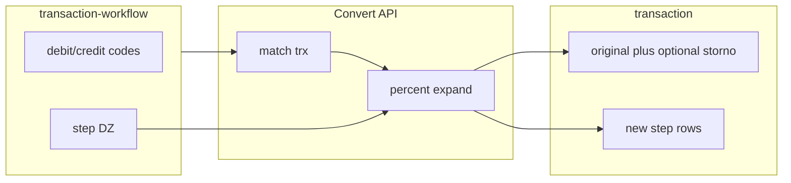
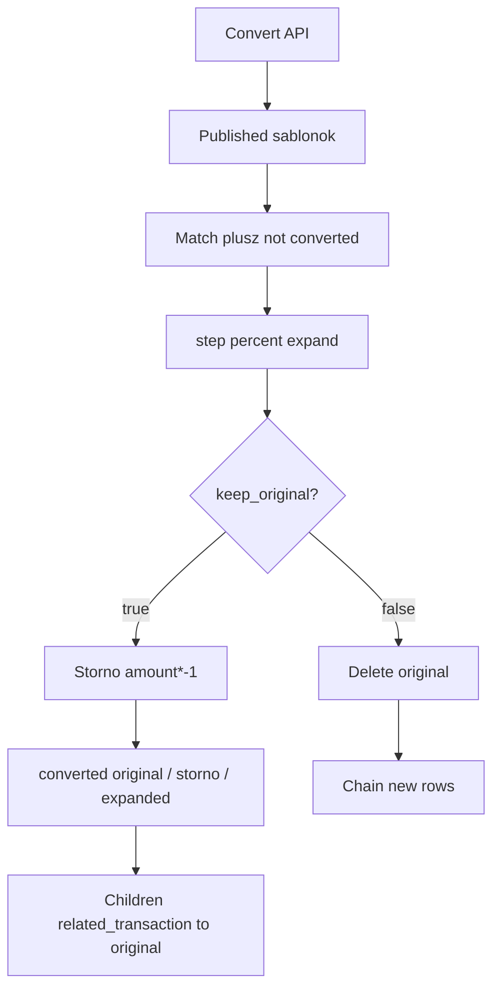

# Implementation plan: `transaction-workflow` content type

**Status:** draft (séma kézzel a repóban; Convert API és seed JSON még nincs)  
**Date:** 2026-10-29  
**Üzleti modell:** [Ügyletek](../transaction-workflow.md)  
**Backoffice v1:** [0001-content-backoffice-v1](../prd/0001-content-backoffice-v1.md) — a Convert API **v1 utáni**  
**Séma:** [transaction-workflow](../../src/api/transaction-workflow/content-types/transaction-workflow/schema.json), [workflow.step](../../src/components/workflow/step.json) (Related), [workflow.step-member-debit](../../src/components/workflow/step-member-debit.json), [workflow.step-member-credit](../../src/components/workflow/step-member-credit.json), [transaction](../../src/api/transaction/content-types/transaction/schema.json)

Ez a fájl a **`transaction-workflow`** katalógus szerződése, a **Convert** automáció, valamint a [transaction-workflow.md](../transaction-workflow.md) **Ügylet 1–9** seedelési utasításai. Fizikai seed JSON / httpyac ebben a planben **nincs**; az implementáló a 8. fejezet tábláiból építi a fájlokat.

---

## 1. Cél és nem-cél

### Cél

1. **Katalógus** `api::transaction-workflow.transaction-workflow`: fejléc match mezők + `step` dynamic zone (`workflow.step` | `workflow.step-member-debit` | `workflow.step-member-credit`).
2. **Seed** mind a kilenc mintaügyletre a [transaction-workflow.md](../transaction-workflow.md) alapján (lásd [8. Seed utasítások](#8-seed-utasítások-ügylet-1–9)).
3. **Convert** Strapi route/controller: még nem átalakított `transaction` sorok → sablon szerinti új sorok (`keep_original` storno vagy törlés).

### Nem-cél

- Rövid ügylet-űrlap, `inputs`, `workflow_key`, `active`, `sort_order`.
- Külön `tw.line` / `tw.korona-lekotes` / `tw.bevetel-forint` komponensek — a lekötés és forint-bevétel **explicit** `workflow.step` sorok.
- `POST /api/posting/expand` form body (kitöltött mezők → sorok).
- `configuration` JSON implementáció (mező fenntartott).
- v1 PRD §8.

---

## 2. Fogalomtár

| Fogalom | Jelentés |
| -------- | -------- |
| **Ügylet** | Teljes gazdasági esemény; a sablon `name` és a doc fejezet. |
| **Tranzakció** | Egy könyvelési sor. |
| **`transaction-workflow` rekord** | Admin sablon: match fejléc + `step` lista. |
| **Convert** | API: matcholt egysoros trx → storno/törlés + step-sorok. |
| **`converted_to_workflow`** | `transaction` enum `original` \| `expanded` \| `storno` (üres = kifejthető); Convert csak null sorokat vesz. |
| **`entered_key`** | `transaction` string; generált sorok idempotenciája (nem workflow kulcs). |
| **`steps_published`** | Sablon boolean; generált sorok published/draft; Convert override. |
| **`copy_receipt`** | Step boolean; forrás receiptjei a generált sorra. |

---

## 3. Collection és step (forrásigazság)

### 3.1 `api::transaction-workflow.transaction-workflow`

| Tulajdonság | Érték |
| ----------- | ----- |
| `collectionName` | `transaction_workflows` |
| `draftAndPublish` | **`true`** — Convert csak **published** sablont használ |
| `displayName` | Transaction-workflow (Admin; később Ügylet) |

| Mező | Típus | Kötelező | Megjegyzés |
| ---- | ----- | -------- | ---------- |
| `name` | string | igen | Seed / Admin címke |
| `debit_account_code` | integer 1000–9999 | igen | Match: forrás `debit_account.code` |
| `credit_account_code` | integer 1000–9999 | igen | Match: forrás `credit_account.code` |
| `transaction_type` | relation oneToOne → transaction-type | nem | Ha van: szigorú match |
| `currency_type` | relation oneToOne → currency-type | nem | Ha van: szigorú match |
| `keep_original` | boolean | nem, default `true` | Lásd 6. |
| `steps_published` | boolean | nem, default **`true`** | Generált step (+ storno) sorok `published` vs draft; Convert body felülírhatja |
| `configuration` | json | nem | Fenntartott |
| `step` | dynamic zone (három komponens, lásd 3.2) | igen, **min 1** | Sorrend = kifejtés sorrendje |

**Jogosultság (javaslat):** sablon szerkesztés Strapi Admin; Content API `find`/`findOne` `dataentry`+`editor`; create/update/delete Content API-n tilos. Convert endpoint: külön jog (pl. `editor` vagy admin token).

### 3.2 Step komponensek (dynamic zone)

Közös mezők minden komponensen: `description` (default `{1}`), `percent` (0–100, tört OK), `currency_type`, opcionális `organization`, opcionális `organization_from_original`, opcionális `transaction_type`, `copy_receipt`.

| Komponens UID | Admin név | Számlák |
| ---- | ---- | ---- |
| `workflow.step` | Step with Related accounts | `debit_account` + `credit_account` reláció (**required**) |
| `workflow.step-member-debit` | Step with Member as Debit | `member_account_code` (`1101`/`1001`) + `credit_account` reláció |
| `workflow.step-member-credit` | Step with Member as Credit | `member_account_code` (`1101`/`1001`) + `debit_account` reláció |

Generált összeg: `amount = source.amount * percent / 100`.

**Tagi feloldás:** member komponensnél a Convert a forrás trx azonos kódú oldalát (vagy a [member-accounts](../../src/member-accounts.ts) testvért) használja — **nem** seed documentId-t. Fix oldalon a relation `documentId` megy a generált sorra.

**`description` placeholder:** `{original.<mező>}` → forrás mező (üres forrás → üres string). Legacy `{1}` = `{original.description}`. Ismeretlen mező → üres. Seedben lépésnév szöveg is megengedett.

**`organization`:** opcionális. Fix reláció, vagy seed DSL `"{original.organization}"` → `organization_from_original: true` (Convert a forrás orgját másolja; üres forrás → üres). Üres step org + flag nélkül → generált sor orgja is üres (nincs automatikus fallback).

### 3.3 `transaction` érintett mezők

| Mező | Szerep |
| ---- | ------ |
| `converted_to_workflow` | enumeration `original` \| `expanded` \| `storno`, nem kötelező (null = kifejthető); Convert szűrő |
| `entered_key` | unique string; javaslat: `{originalDocumentId}:storno`, `{originalDocumentId}:step:{i}` |
| `related_transaction` / `related_transactions` | keep ág: gyerekek → eredeti; delete ág: új sorok lánca |

---

## 4. Match szabály

1. Sablon **published**.
2. Forrás `converted_to_workflow` üres / null.
3. `Number(debit_account.code) === debit_account_code` és ugyanez **credit**re (`account.code` string). Kód-alapú: minden tag `1101`/`1001` példánya matchel.
4. Ha a sablonon van `currency_type` documentId: egyezés kötelező.
5. Ha a sablonon van `transaction_type` documentId: egyezés kötelező.
6. Egy forrás-sorra **egy** sablon (ütköző fejléc → seed hiba; Convert 409).

A konverzió **egy** matcholt sorból indul; a doc teljes ügyletének minden kimeneti sora a `step` listában van.

---

## 5. Expand

Minden `step` sorrendben:

- `amount` = forrás × `percent` / 100  
- számlák: ha a step debit/credit account **kódja** `1101` vagy `1001` (vagy egyezik a forrás valamelyik oldalának kódjával tagi számlánál), a forrás trx megfelelő account példánya (ill. testvér a member-accounts-ból); egyébként a step relation  
- `currency_type`, `transaction_type` a stepről; `organization` a stepről, vagy `organization_from_original` esetén a forrásról (üres marad üres)  
- `date` ← forrás `date`  
- `description` ← step sablon (`{original.*}` / `{1}`)  
- **státusz:** `steps_published` a sablonról, kivéve ha a Convert request body felülírja (`steps_published?: boolean`)  
- **`copy_receipt`:** ha `true`, a forrás `receipts` reláció másolása a generált sorra; ha a forrásnak nem volt receiptje, üres  

A [lekötés](../transaction-workflow.md#lekötés-blokk) két könyvelési sora és a [forint bevétel](../transaction-workflow.md#forint-bevétel-korona-nélkül) két sora **külön** `workflow.step` elemek a seedben — nincs implicit kibontás.

---

## 6. `keep_original`

### `true` (seed default)

1. Storno: forrás mezők másolata, `amount * -1`.  
2. Új step-sorok.  
3. Storno + új sorok: `related_transaction` → **eredeti**.  
4. `converted_to_workflow: original` az **eredetin**, `storno` a **storno soron**, `expanded` a **step sorokon**.
5. A generált sorok státusza a `steps_published` (vagy Convert override) szerint. Az eredeti csak akkor published, ha a hét publish-mező mind kitöltött; hiányzó organization/számla esetén draft marad (`converted_to_workflow: original` mellett). Draft lépéseknél az eredeti draft marad / unpublish.

### `false`

1. Eredeti törlése. A forrás receiptjei csak azokra az új sorokra kerülnek, ahol `copy_receipt: true` (különben a receipt orphan / előtte átkötés — implementáció: ha van receipt és egyetlen step sem `copy_receipt`, 422 vagy az első stepre másolás; **default:** első `copy_receipt: true` step, ha nincs ilyen és volt receipt → 422).  
2. Csak új step-sorok; `related_transaction` lánc (első `null`, többi az előzőre); `converted_to_workflow: expanded` a step sorokon.

---

## 7. Convert API

| Elem | Javaslat |
| ---- | -------- |
| Hely | `src/api/transaction-workflow/` custom route + controller/service |
| Endpoint | pl. `POST /api/transaction-workflows/convert` |
| Auth | `editor` (vagy Admin); nem publikus |
| Body | opcionális: `workflowDocumentId`, `transactionDocumentId`, **`steps_published`** (override a sablon defaultján) |

Hibák: nincs published sablon (noop/404), nincs match (200 üres), hiányzó account/org / tagi testvér (422), `entered_key` ütközés (409), `keep_original: false` + receipt orphan (422).

---

## 8. Seed utasítások (Ügylet 1–9)

### 8.0 Általános szabályok

**Normatív forrás:** [docs/transaction-workflow.md](../transaction-workflow.md) Ügylet 1–9.  
**Cél CT:** `api::transaction-workflow.transaction-workflow` + három step komponens.

1. Egy ügylet = **egy** published sablon rekord (**első PR: mind a 9 ügylet** seedelve). Ahol a percent 0–100 mellett más pénznemű / nagyobb összegű lépés kell (3, 4), **második** sablon is megengedett (lásd 8.3–8.4).  
2. Fejléc kódok = a doc **egysoros match** T←K párja (fejezetenként rögzítve alább).  
3. `keep_original: true`, `steps_published: true`, `configuration: null` default a speceknél.  
4. Opcionális fejléc `currency_type` / `transaction_type`: csak ha a matchot szűkíteni kell (alább jelezve).  
5. Minden könyvelési kimeneti sor → megfelelő step `__component` (related / member-debit / member-credit); `copy_receipt` default `false` (első bizonylatos stepnél `true` ha a minta ügyletnél van receipt).  
6. Lekötés blokk → **2** step; forint bevétel → **2** step.  
7. `percent` ∈ [0, 100], tört OK = `minta_lépés_összeg / minta_forrás_összeg * 100`. KOR lépésnél a minta **korona** összeg a számláló. Seed ≥ 6 tizedes.  
8. Seed JSON `debit_code`/`credit_code`: ha az egyik tagi (`1101`/`1001`) → member-debit vagy member-credit + `member_account_code`; ha egyik sem → related mindkét account lookup. Org / currency / type név/kód lookup.  
9. `step.min` = **1** (séma). Ügylet 9 egy steppel seedelhető.

**Szállítás:**

| Elem | Utasítás |
| ---- | -------- |
| Mappa | `database/seeders/http/kor/data/transaction-workflows/` |
| HttpYac | `common/11-transaction-workflows.http` — `npm run seed:http:kor:transaction-workflows:local` |
| Upsert kulcs | `name` + `debit_account_code` + `credit_account_code` (insert-only) |
| Előfeltétel | [Számlatükör-rések](../transaction-workflow.md#számlatükör-rések): `1900`, `4500`, `EGG`, `FRUIT`, Tojóól org, stb. |
| Publish | `POST …?status=published` |

---

### 8.1 Ügylet 1 — Tagi befizetés ingatlan vásárlásra

**Doc:** [Ügylet 1](../transaction-workflow.md#ügylet-1--tagi-befizetés-ingatlan-vásárlásra)  
**name:** `Tagi befizetés ingatlan vásárlásra`  
**Match:** `debit_account_code: 1520`, `credit_account_code: 1101`  
**Fejléc currency/type:** üres (HUF egysoros)  
**Forrás mintaösszeg:** 2 000 000  

Lekötés vételár (2 step) a [lekötés blokk](../transaction-workflow.md#lekötés-blokk) szerint; fedezet forrás az eszköz HUF (`1520` → `1900`), majd KOR vissza az eszközre (`1520` ← `1900`).

| # | description | percent (≈) | Tartozik | Követel | Pénznem | Szervezet | Típus |
| - | ----------- | ----------- | -------- | ------- | ------- | --------- | ----- |
| 1 | Részjegy előírása | 100 | 1101 tag | 3000 | HUF | I/3. Pénzügyi Igazgatóság | Átvezetés |
| 2 | Bejövő tagi utalás | 100 | 1100 | 1101 tag | HUF | I/3. Pénzügyi Igazgatóság | Utalás |
| 3 | Stróman (vételár) | 100 | 1001 tag | 1100 | KOR | I/3. Pénzügyi Igazgatóság | Átvezetés |
| 4 | Telek vételár | 100 | 1520 | 1001 tag | KOR | I/4.11.1.1 Lakóterületek | Átvezetés |
| 5 | Lekötés 1 HUF fedezet | 100 | 1900 | 1520 | HUF | I/4.11.1.1 Lakóterületek | Átvezetés |
| 6 | Lekötés 2 KOR | 1 | 1520 | 1900 | KOR | I/4.11.1.1 Lakóterületek | Átvezetés |

Percent ellenőrzés: HUF lábak 100%; KOR: 20 000 / 2 000 000×100 = 1.

---

### 8.2 Ügylet 2 — Készpénzes belterületi ingatlan vásárlás

**Doc:** [Ügylet 2](../transaction-workflow.md#ügylet-2--készpénzes-belterületi-ingatlan-vásárlás)  
**name:** `Készpénzes belterületi ingatlan vásárlás`  
**Match:** `1520` ← `1000`  
**Forrás mintaösszeg:** 800 000 (vételár)  

| # | description | percent | Tartozik | Követel | Pénznem | Szervezet | Típus |
| - | ----------- | ------- | -------- | ------- | ------- | --------- | ----- |
| 1 | Telek vételár | 100 | 1520 | 1000 | HUF | Lakóterületek | Készpénz |
| 2 | Lekötés 1 HUF fedezet | 100 | 1900 | 1520 | HUF | Lakóterületek | Átvezetés |
| 3 | Lekötés 2 KOR | 1 | 1520 | 1900 | KOR | Lakóterületek | Átvezetés |

---

### 8.3 Ügylet 3 — Tojás keletkezése és eladása

**Doc:** [Ügylet 3](../transaction-workflow.md#ügylet-3--tojás-keletkezése-és-eladása)  
**name:** `Tojás keletkezése és eladása`  
**Match:** `1300` ← `4500`  
**Fejléc `currency_type`:** EGG (szigorú match a Napi tojás sorokra)  
**Forrás mintaösszeg:** 30 (EGG)  

**`percent` 0–100:** EGG forrásból (30) nem jön ki 6000 HUF. **Két sablon:** (A) EGG keletkezés+készletcsökkenés; (B) HUF eladás (forint bevétel 2 step).

**Sablon A:**

| # | description | percent | Tartozik | Követel | Pénznem | Szervezet | Típus |
| - | ----------- | ------- | -------- | ------- | ------- | --------- | ----- |
| 1 | Keletkezés | 100 | 1300 | 4500 | EGG | Tojóól | Átvezetés |
| 2 | Készletcsökkenés | 100 | 5600 | 1300 | EGG | Tojóól | Átvezetés |

**Második sablon (eladás HUF), name:** `Tojás eladás forint` — match `1000`←`1900` (vagy a beérkezés páros), forrás 6000; step: beérkezés 100% + értékesítés 100% (`1900`←`4000`).

---

### 8.4 Ügylet 4 — Gyümölcs szürete és piaci eladása

**Doc:** [Ügylet 4](../transaction-workflow.md#ügylet-4--gyümölcs-szürete-és-piaci-eladása)  
**name:** `Gyümölcs szürete és piaci eladása`  
**Match:** `1300` ← `4500`, fejléc currency **FRUIT**  
**Forrás mintaösszeg:** 80  

Ugyanaz a `percent` 0–100 korlát, mint 8.3 → **két sablon**.

**Sablon A (FRUIT):**

| # | description | percent | Tartozik | Követel | Pénznem | Org | Típus |
| - | ----------- | ------- | -------- | ------- | ------- | --- | ----- |
| 1 | Szüret | 100 | 1300 | 4500 | FRUIT | gyümölcsfaliget | Átvezetés |
| 2 | Készletcsökkenés | 62.5 | 5600 | 1300 | FRUIT | gyümölcsfaliget | Átvezetés |

**Sablon B** (`Gyümölcs eladás forint`): match beérkezés T←K, forrás 25 000; forint bevétel 2 step, 100% + 100%.

---

### 8.5 Ügylet 5 — Ingatlan szerzése

**Doc:** [Ügylet 5](../transaction-workflow.md#ügylet-5--ingatlan-szerzése)  
**name:** `Ingatlan szerzése`  
**Match:** `1530` ← `1100` (teljes vételár összefoglaló; `percent` 0–100 miatt nem a foglaló 2 000 000)  
**Forrás mintaösszeg:** 10 000 000  

Steps:

| # | description | percent | Tartozik | Követel | Pénznem | Org | Típus |
| - | ----------- | ------- | -------- | ------- | ------- | --- | ----- |
| 1 | Foglaló | 20 | 1400 | 1100 | HUF | Lakóterületek | Utalás |
| 2 | Fennmaradó | 80 | 1530 | 1100 | HUF | Lakóterületek | Utalás |
| 3 | Beszámítás | 20 | 1530 | 1400 | HUF | Lakóterületek | Átvezetés |
| 4 | Lekötés 1 HUF fedezet | 100 | 1900 | 1530 | HUF | Lakóterületek | Átvezetés |
| 5 | Lekötés 2 KOR | 1 | 1530 | 1900 | KOR | Lakóterületek | Átvezetés |

---

### 8.6 Ügylet 6 — Felújítás

**Doc:** [Ügylet 6](../transaction-workflow.md#ügylet-6--felújítás)  
**name:** `Felújítás`  
**Match:** `1500` ← `2000`  
**Forrás mintaösszeg:** 1 500 000  

| # | description | percent | Tartozik | Követel | Pénznem | Org | Típus |
| - | ----------- | ------- | -------- | ------- | ------- | --- | ----- |
| 1 | Aktiválás | 100 | 1500 | 2000 | HUF | Állattenyésztés | Átvezetés |
| 2 | Utalás | 100 | 2000 | 1100 | HUF | Állattenyésztés | Utalás |
| 3 | Lekötés 1 HUF fedezet | 100 | 1900 | 1500 | HUF | Állattenyésztés | Átvezetés |
| 4 | Lekötés 2 KOR | 1 | 1500 | 1900 | KOR | Állattenyésztés | Átvezetés |

---

### 8.7 Ügylet 7 — Területalapú agrár támogatás

**Doc:** [Ügylet 7](../transaction-workflow.md#ügylet-7--területalapú-agrár-támogatás)  
**name:** `Területalapú agrár támogatás`  
**Match:** `1200` ← `4200`  
**Forrás mintaösszeg:** 400 000  

| # | description | percent | Tartozik | Követel | Pénznem | Org | Típus |
| - | ----------- | ------- | -------- | ------- | ------- | --- | ----- |
| 1 | Megítélés | 100 | 1200 | 4200 | HUF | Termőterületek | Átvezetés |
| 2 | Kincstári jóváírás | 100 | 1100 | 1900 | HUF | I/3. Pénzügyi Igazgatóság | Utalás |
| 3 | Követelés zárása | 100 | 1900 | 1200 | HUF | Termőterületek | Átvezetés |

---

### 8.8 Ügylet 8 — Adminisztráció

**Doc:** [Ügylet 8](../transaction-workflow.md#ügylet-8--adminisztráció)  
**name:** `Adminisztráció`  
**Match:** `5440` ← `2000`  
**Forrás mintaösszeg:** 80 000  

| # | description | percent | Tartozik | Követel | Pénznem | Org | Típus |
| - | ----------- | ------- | -------- | ------- | ------- | --- | ----- |
| 1 | Számla | 100 | 5440 | 2000 | HUF | I/3. Pénzügyi Igazgatóság | Átvezetés |
| 2 | Utalás | 100 | 2000 | 1100 | HUF | I/3. Pénzügyi Igazgatóság | Utalás |

---

### 8.9 Ügylet 9 — Bányászás

**Doc:** [Ügylet 9](../transaction-workflow.md#ügylet-9--bányászás)  
**name:** `Bányászás`  
**Match:** `1001` ← `1100`  
**Fejléc `transaction_type`:** Bányászás (szigorú)  
**Forrás mintaösszeg:** 50 000  

A Homály kiadások **nem** részei ennek a sablonnak.

| # | description | percent | Tartozik | Követel | Pénznem | Org | Típus |
| - | ----------- | ------- | -------- | ------- | ------- | --- | ----- |
| 1 | Bányászás | 100 | 1001 tag | 1100 | HUF | I/3. Pénzügyi Igazgatóság | Bányászás |

Két forrás (`1100` vs `1000`) = **két** sablon ugyanazzal a step listával, eltérő `credit_account_code` (egy step elég, `min: 1`).

---

## 9. Függőségek és döntések

### 9.1 Seed előfeltételek

| Hiány | Ügylet |
| ----- | ------ |
| `1900` | 1–7 |
| `4500`, `EGG`, Tojóól | 3 |
| `FRUIT` | 4 |

(A Convert **nem** számol `currency-rate`-et: a KOR összeg a `percent` × forrás `amount`.)

### 9.2 Rögzített döntések (implementáció)

| Kérdés | Döntés |
| ------ | ------ |
| `percent.max` | **100** marad; tört percent OK |
| `step.min` | **1** |
| Tagi `1101`/`1001` | Member-debit / member-credit komponens + `member_account_code`; expand **forrás trx / member testvér** |
| Kimenet státusz | Sablon `steps_published` default `true`; Convert body override |
| Első PR scope | **Mind a 9 ügylet** seed + Convert API |
| Receipt | Step `copy_receipt`; másolja a forrás receiptjeit a generált sorra |

### 9.3 Maradék finomság (defaultolható)

- Ütköző sablon fejléc → 409  
- `{original.*}` / `{1}` → forrás mezők; üres → üres; `organization_from_original`  
- Admin UI a Convert híváshoz (opcionális fázis E)  

---

## 10. Implementációs fázisok

| Fázis | Deliverable |
| ----- | ----------- |
| **A** | Séma: `steps_published`, `copy_receipt`, `step.min: 1` (kész / igazítva) |
| **B** | Seed JSON **1–9** (+ szükség szerint 3/4 második HUF sablon) + `1900`/EGG/FRUIT pótlás + publish |
| **C** | Convert route/controller + tesztek (8 + 1 + tagi 1101) |
| **D** | Content API jogok |
| **E** | Convert UI a backoffice-ban: [0003](./0003-transaction-workflow-backoffice.md) (`steps_published` override továbbra sem cél) |

### Checklist

- [ ] Seed specek JSON a 8. fejezetből (összes ügylet)  
- [ ] `1900` / EGG / FRUIT pótlás  
- [ ] Convert API + `converted_to_workflow` / storno / `copy_receipt` / `steps_published`  
- [ ] Unit: Ügylet 8, Ügylet 1, Ügylet 9 (1 step), tagi számla kód-match  
- [ ] Doc hivatkozások naprakészek  

---

## Kapcsolódó fájlok

| Útvonal | Szerep |
| ------- | ------ |
| [docs/transaction-workflow.md](../transaction-workflow.md) | Üzleti norma + Strapi konverzió |
| [0003-transaction-workflow-backoffice.md](./0003-transaction-workflow-backoffice.md) | Backoffice Convert gombok (editor + match) |
| [transaction-workflow/schema.json](../../src/api/transaction-workflow/content-types/transaction-workflow/schema.json) | Sablon CT |
| [workflow/step.json](../../src/components/workflow/step.json) | Related accounts step |
| [workflow/step-member-debit.json](../../src/components/workflow/step-member-debit.json) | Member as Debit |
| [workflow/step-member-credit.json](../../src/components/workflow/step-member-credit.json) | Member as Credit |
| [transaction/schema.json](../../src/api/transaction/content-types/transaction/schema.json) | `converted_to_workflow`, `entered_key` |
