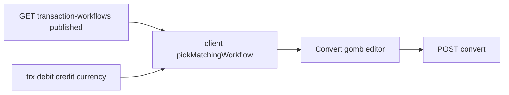

# Implementation plan: Transaction-workflow backoffice Convert

**Status:** in progress (backoffice Convert UI implemented; Human verification pending)  
**Date:** 2026-10-30  
**Üzleti modell:** [Ügyletek](../transaction-workflow.md)  
**Convert / katalógus szerződés:** [0002-transaction-workflow-content-type](./0002-transaction-workflow-content-type.md)  
**Backoffice SPA:** [0001-content-backoffice-spa](./0001-content-backoffice-spa.md), skill `.cursor/skills/content-backoffice-spa`  
**Convert API:** [`POST /api/transaction-workflows/convert`](../../src/api/transaction-workflow/routes/convert.ts) — handler [`transaction-workflow.convert`](../../src/api/transaction-workflow/controllers/transaction-workflow.ts), logika [`src/transaction-workflow/convert.ts`](../../src/transaction-workflow/convert.ts)

Egy másik agent ezt a fájlt hajtja végre. A v1 PRD §8 és a külön ügylet-űrlap **nem** része. A Convert szerver és a seedelt sablonok a [0002](./0002-transaction-workflow-content-type.md) szerint már léteznek; ez a plan csak a **content-backoffice** UI-t köti rá.

---

## Hogyan kell végrehajtani

- Egyszerre egy számozott lépés. A lépés feladatai közül csak a még üres négyzetek kerülnek kódba.
- A lépés végén az agent kipipálja a saját négyzeteit, és **megáll** a Human sor előtt. A Human négyzetet nem pipálja ki, és a következő lépést nem kezdi el.
- Ha a próba bukik, a következő agent ugyanennek a lépésnek a javítását csinálja, nem a következőt.
- Az SPA marad az `apps/content-backoffice` alatt. Strapi gyökér `package.json` / React Admin függőség nem változik.
- Az azonosító a `documentId`. Guesser nincs.

Lokálisan: Strapi `http://localhost:1337`, SPA `http://localhost:5173/backoffice/`. Előfeltétel: published `transaction-workflow` sablonok (`npm run seed:http:kor:transaction-workflows:local`) és működő Convert endpoint.

---

## 1. Cél és nem-cél

### Cél

1. A backoffice **észleli**, ha egy egysoros tranzakció (lista / review / create űrlap) egyezik egy **published** `transaction-workflow` sablon fejlécével.
2. **Csak `editor`** szerepnél megjelenik egy **Ügylet kifejtése** (Convert) gomb; kattintásra `POST /api/transaction-workflows/convert`.
3. A `dataentry` **sem** gombot, **sem** egyezés-jelzést nem kap (a szerver convert action is csak editor: `EDITOR_ONLY_CONTENT_ACTIONS`).

### Nem-cél

- Külön ügylet-űrlap, `inputs`, workflow CRUD a SPA-ban.
- `steps_published` override a Convert body-ban (sablon default marad).
- Bulk convert a listán (egy sor / egy gomb).
- Convert jog bővítése `dataentry`-re.
- v1 PRD §8.

---

## 2. Fogalomtár

| Fogalom | Jelentés |
| -------- | -------- |
| **Match** | Kliens: published sablon fejléc ↔ trx `debit_account.code` / `credit_account.code` (+ opcionális `currency_type` / `transaction_type` documentId); `converted_to_workflow` üres / null. Ugyanaz a szabály, mint a szerver [`workflowMatchesTransaction`](../../src/transaction-workflow/convert.ts) / [`pickMatchingWorkflow`](../../src/transaction-workflow/convert.ts). |
| **Convert gomb** | Csak `permissions === 'editor'` **és** pontosan egy match. Több sablon → nincs gomb (szerver 409). |
| **Convert hívás** | `POST /api/transaction-workflows/convert` body: `{ transactionDocumentId, workflowDocumentId }`. |

---

## 3. API szerződés (SPA)

### 3.1 Katalógus

| Elem | Érték |
| ---- | ----- |
| Endpoint | `GET /api/transaction-workflows?status=published` |
| Jog | `find` — `dataentry` és `editor` (bootstrap); a SPA **csak editor** sessionben hívja a gombhoz |
| Populate | `currency_type` (legalább `documentId`), `transaction_type` (legalább `documentId`). A `step` dynamic zone **nem** kell a matchhez. |
| Mezők a matchhez | `documentId`, `name`, `debit_account_code`, `credit_account_code`, `currency_type`, `transaction_type` |

### 3.2 Convert

| Elem | Érték |
| ---- | ----- |
| Endpoint | `POST /api/transaction-workflows/convert` |
| Auth | Content JWT; scope `api::transaction-workflow.transaction-workflow.convert` (**csak editor**) |
| Body | `{ "transactionDocumentId": "<docId>", "workflowDocumentId": "<docId>" }` |
| Siker | `{ data: [ { transactionDocumentId, workflowDocumentId, stornoDocumentId?, createdDocumentIds } ] }` |
| Hibák | 400 hiányzó id; 404 nincs published sablon; 409 több sablon / `entered_key`; 422 hiányzó account/org/receipt policy; 403 ha nem editor |

A SPA **nem** küld `steps_published` mezőt.

### 3.3 Tranzakció lista / show populate

A meglévő [`transactionPopulate`](../../apps/content-backoffice/src/data/transactionList.ts) mellett a sorokon legyen elérhető:

- `converted_to_workflow` (enum: `original` \| `expanded` \| `storno`, vagy üres)
- `debit_account.code`, `credit_account.code` (már tipikusan megvan)
- `currency_type.documentId` (már megvan)
- `transaction_type` — ha a sablon szigorú típust kér; a v1 űrlapon nincs típusmező, ezért a match csak akkor szűkít, ha a sablonon van `transaction_type` **és** a trx-en is megvan ugyanaz a documentId. Üres trx típus + sablon típus → **nincs** match (szerverrel egyező).

---

## 4. Kliens modulok

### 4.1 Match helper — [`transactionList.ts`](../../apps/content-backoffice/src/data/transactionList.ts)

- Bővítsd a `StrapiTransaction` / `TransactionRow` típust: `converted_to_workflow?: 'original' | 'expanded' | 'storno' | null`, opcionális `transaction_type?: { documentId?: string } | null`.
- Exportálj tiszta függvényeket (másold a szerver szabályt, ne importáld a Strapi `src/transaction-workflow` csomagot az SPA-ba):
  - `workflowMatchesTransaction(workflow, transactionLike)` — kódok + opcionális currency/type + `converted_to_workflow` üres
  - `pickMatchingWorkflow(workflows, transactionLike)` — 0 → `null`; 1 → sablon; >1 → `null` (UI: nincs gomb; opcionális konzol/`notify` warning)
- Vitest: [`transactionList.test.ts`](../../apps/content-backoffice/src/data/transactionList.test.ts) vagy külön `transactionWorkflowMatch.test.ts` — kód egyezés, converted kizárás, currency szűkítés, több sablon → null.

### 4.2 HTTP — új pl. [`transactionWorkflow.ts`](../../apps/content-backoffice/src/data/transactionWorkflow.ts)

Mint a [`transactionPublish.ts`](../../apps/content-backoffice/src/data/transactionPublish.ts) / bulk-quantity fetch:

- `fetchPublishedWorkflows(httpClient, strapiUrl)` → sablon tömb (pagination ha kell, pageSize elég nagy / lapozás).
- `convertTransaction(httpClient, strapiUrl, { transactionDocumentId, workflowDocumentId })` → POST JSON body.
- `strapiHttpClient` + `STRAPI_URL` ugyanaz a minta, mint a dataProviderben / `BackofficeConfigProvider`-ben.
- Exportált wrapper a UI-nak (mint `publishTransaction` a dataProviderből), hogy a gombok ne építsenek URL-t maguknak.

### 4.3 Katalógus hook — pl. `useTransactionWorkflowCatalog`

- Csak ha `usePermissions()` → `editor` (különben üres lista, nincs fetch).
- Egyszer betölti a published sablonokat (session / provider cache OK; ne listánként soronként).
- `matchFor(row | formSnapshot)` → `WorkflowTemplate | null` a `pickMatchingWorkflow`-val.

---

## 5. UI helyek

Minden gomb: **Confirm** előtt (mint [`TransactionBulkApproveButton`](../../apps/content-backoffice/src/pages/transactions/TransactionBulkApproveButton.tsx)) — a kifejtés storno + több step sort hoz létre. Confirm szöveg tartalmazza a sablon `name` értékét.

Siker után: `notify` + `refresh()` (lista / show); Create után navigálás a listára (`redirect="list"` vagy `useRedirect`).

### 5.1 Lista — [`TransactionList.tsx`](../../apps/content-backoffice/src/pages/transactions/TransactionList.tsx)

- Új oszlop / mező a `TransactionOpenField` mellett: Convert gomb.
- Látható, ha: `permissions === 'editor'` **és** `pickMatchingWorkflow` nem null **és** `converted_to_workflow` üres.
- `dataentry` / nem match / már converted: sem gomb, sem címke.
- `stopPropagation` a kattintáson (mint az Open gombnál).
- Hívás: `convertTransaction` a sor `documentId` + match `documentId`.

### 5.2 Review — [`TransactionReviewEditor.tsx`](../../apps/content-backoffice/src/pages/transactions/TransactionReviewEditor.tsx)

- A Review eleve `editor` + draft. A Convert gomb a **FinalizeSection** mellett / felette (külön `Button`, nem helyettesíti a Véglegesítet).
- Feltétel: match + üres `converted_to_workflow`.
- Convert **nem** követeli a publishot; draft soron is hívható. A sablon `steps_published` dönt a generált sorok státuszáról.
- Convert után `refresh()` — eredeti → `original`, storno → `storno`, stepek → `expanded`, a gomb eltűnik; a generált sorok státusza a `steps_published` szerint. Az eredeti csak akkor published, ha a hét mező ki van töltve (organization opcionális a draft Expandnál, mint Mentésnél).
- Lista: `converted_to_workflow` **multiselect** (`none` / `expanded` / `storno` / `original`); alapértelmezés és Szűrők törlése: `none` + `expanded` (`original` és `storno` rejtve).

### 5.3 Create — [`TransactionCreate.tsx`](../../apps/content-backoffice/src/pages/transactions/TransactionCreate.tsx)

- Csak `permissions === 'editor'`.
- Form watch: `debit_account`, `credit_account`, `currency_type` (és ha van, `transaction_type`). A account selectből a katalógus `code` mezőjét használd a matchhez (a ReferenceInput értéke `documentId` — oldd fel az account listából / `useAccountCatalog` + currency documentId).
- Ha van egyértelmű match: második gomb a toolbarban / űrlap alján: **Mentés és ügylet kifejtése**.
  1. Confirm
  2. Meglévő draft create (ugyanaz a transform / receipt_cards út, mint a SaveButton)
  3. `convertTransaction` az új `documentId`-dal + workflow `documentId`
  4. Siker → lista; hiba → notify (a draft megmaradhat — jelezd)
- `dataentry` Create: változatlan (nincs match UI, nincs Convert gomb).

---

## 6. i18n

[`hu.ts`](../../apps/content-backoffice/src/i18n/hu.ts) és [`en.ts`](../../apps/content-backoffice/src/i18n/en.ts) — `app.*` kulcsok, mindkét katalógusban:

| Kulcs (javaslat) | hu példa |
| ---------------- | -------- |
| `transactions_convert` | Ügylet kifejtése |
| `transactions_convert_save` | Mentés és ügylet kifejtése |
| `transactions_convert_title` | Ügylet kifejtése: %{name} |
| `transactions_convert_body` | A tranzakcióból a sablon szerinti sorok készülnek (storno / lépések). Folytatod? |
| `transactions_convert_confirm` | Kifejtés |
| `transactions_convert_done` | Az ügylet kifejtve. |
| `transactions_convert_error` | Az ügylet kifejtése nem sikerült. |
| `transactions_convert_ambiguous` | Több ügylet-sablon is illik erre a tranzakcióra. |

---

## 7. Lépések

### 1. Match helper + típusok

- [x] `StrapiTransaction` / `TransactionRow`: `converted_to_workflow`, opcionális `transaction_type`
- [x] `workflowMatchesTransaction` + `pickMatchingWorkflow` a `transactionList.ts`-ben (vagy közvetlen export onnan)
- [x] Vitest: kód match, converted kizárás, currency, ambiguous → null
- [x] A lista/show fetch továbbra is visszaadja a `converted_to_workflow` mezőt (Strapi attributes; külön populate nem kell skalárhoz)

- [ ] **Human:** A Vitest lefut (`apps/content-backoffice` teszt script). Egy unit eset mutatja: 1520/1101 + üres converted → match; `original` / `expanded` → nincs match. Ha igen, pipáld ki, és indítsd a 2. lépést.

### 2. HTTP + katalógus hook

- [x] `transactionWorkflow.ts`: `fetchPublishedWorkflows`, `convertTransaction`
- [x] `useTransactionWorkflowCatalog` (vagy Provider): csak editor fetch; `matchFor`
- [x] dataProvider / export wrapper a convert híváshoz, ha a publish mintát követitek

- [ ] **Human:** Editor JWT-vel a Network tabon `GET …/transaction-workflows?status=published` 200 és sablonok. Convert POST Postman/httpyac nélkül is: a helper unit/mock teszttel ellenőrizhető. dataentry sessionben a hook **nem** hívja a katalógust. Ha igen, pipáld ki, és indítsd a 3. lépést.

### 3. Lista Convert gomb

- [x] `TransactionList.tsx`: gomb a Open mellett, editor + match
- [x] Confirm → convert → notify + refresh
- [x] i18n kulcsok (legalább a listához szükségesek) hu + en

- [ ] **Human:** Editor belép, seedelt ügylet páros (pl. Ügylet 1: debit `1520`, credit `1101`) egysoros, még nem converted soron megjelenik az **Ügylet kifejtése**. dataentry ugyanarra a sorra **nem** látja. Confirm után stepek `expanded`, storno `storno`, eredeti `original`, a gomb eltűnik; a lista alapból nem mutatja az `original` és `storno` sorokat. Ha igen, pipáld ki, és indítsd a 4. lépést.

### 4. Review Convert gomb

- [x] `TransactionReviewEditor.tsx`: gomb a Finalize mellett, match + nem converted
- [x] Convert után refresh; Finalize külön marad

- [ ] **Human:** Editor draft review-n matcholt soron Convert működik; converted után nincs gomb. Véglegesít továbbra is külön. Ha igen, pipáld ki, és indítsd az 5. lépést.

### 5. Create „Mentés és ügylet kifejtése”

- [x] `TransactionCreate.tsx`: editor + form match → második gomb
- [x] Confirm → draft create → convert → lista
- [x] dataentry Create UI változatlan
- [x] Account `code` feloldás a matchhez dokumentálva a kódban (rövid komment OK)

- [ ] **Human:** Editor Create: 1520←1101 (vagy más seedelt pár) kitöltve megjelenik a Mentés és ügylet kifejtése; sikeres út után a listán az eredeti converted + új sorok. dataentry Create-en nincs ilyen gomb. Ha igen, pipáld ki — a plan kész.

---

## 8. Kész, ha

- Editor: lista + review + create Convert út működik published sablon match esetén.
- dataentry: sem match UI, sem Convert gomb, sem convert API hívás a SPA-ból.
- Vitest a match helperre zöld.
- Nincs `steps_published` a Convert body-ban.
- Doc linkek: ez a fájl hivatkozva a [0002](./0002-transaction-workflow-content-type.md), [transaction-workflow.md](../transaction-workflow.md), [docs/readme.md](../readme.md) felől.

---

## Kapcsolódó fájlok

| Útvonal | Szerep |
| ------- | ------ |
| [convert.ts route](../../src/api/transaction-workflow/routes/convert.ts) | Convert endpoint |
| [convert.ts logika](../../src/transaction-workflow/convert.ts) | Match / expand (szerver forrásigazság) |
| [transactionList.ts](../../apps/content-backoffice/src/data/transactionList.ts) | Típusok + kliens match |
| [TransactionList.tsx](../../apps/content-backoffice/src/pages/transactions/TransactionList.tsx) | Lista gomb |
| [TransactionReviewEditor.tsx](../../apps/content-backoffice/src/pages/transactions/TransactionReviewEditor.tsx) | Review gomb |
| [TransactionCreate.tsx](../../apps/content-backoffice/src/pages/transactions/TransactionCreate.tsx) | Create mentés+convert |
| [src/index.ts](../../src/index.ts) | `EDITOR_ONLY` convert jog |
| [0002 plan](./0002-transaction-workflow-content-type.md) | Katalógus + Convert API |
