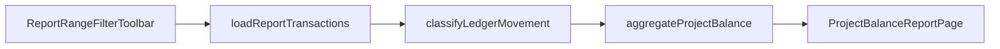

# Implementation plan: Projektek egyenlege riport és drill-down

**Status:** implemented  
**Date:** 2026-11-10  
**Kapcsolódó:** [ADR 0001 — React Admin content UI](../adr/0001-react-admin-content-ui.md), [Ügyletek](../transaction-workflow.md)  
**Érintett kód:** [`apps/content-backoffice/src/pages/reports/projectBalance/`](../../apps/content-backoffice/src/pages/reports/projectBalance/), [`ProjectBalanceReportPage.tsx`](../../apps/content-backoffice/src/pages/reports/ProjectBalanceReportPage.tsx), [`transactionList.ts`](../../apps/content-backoffice/src/data/transactionList.ts), [`reportDateRange.ts`](../../apps/content-backoffice/src/pages/reports/shared/reportDateRange.ts), seed [`backoffice-features.json`](../../database/seeders/http/kor/data/backoffice-features.json)

A **Projektek egyenlege** backoffice riport projektenként (Strapi `organization`) aggregálja a könyvelt tranzakciókat **termelés** (bevétel jellegű) és **beruházás** (költség / CAPEX jellegű) összegekre. A riportból kattintással a **Tranzakciók** listára lehet ugrani, ugyanazzal a szűrési szerződéssel, mint a menüből induló listánál (`filter` + `displayedFilters` query).

---

## 1. Cél

1. Új riport: `/backoffice/reports/project-balance`, feature kapcsoló: `project-balance` (kor, edizone seedben bekapcsolva).
2. Időszak, közzététel (közzétett / piszkozat / mind), opcionális projekt szűrő, pénznemenként KPI + oszlopdiagramok + táblázat.
3. **Drill-down:** táblázat cellák és mindkét BarChart oszlop → `/transactions` előre kitöltött szűrővel.
4. A tranzakciólista értse a riportból jövő **pénznem kód** és **termelés/beruházás láb** szűrőket.

## 2. Nem-cél (v1)

- Backend aggregáció (a riport kliens oldalon tölt és összesít; biztonsági lapozási cap).
- Új Strapi content type vagy publish szabály változás.
- KPI csempék drill-downja (csak diagram + tábla).
- Külön „project_balance_leg” mező a listában — a láb szűrő kliens oldali, a `classifyLedgerMovement` mintával.

## 3. Riport adatfolyam



- **Fetch:** [`projectBalance.fetch.ts`](../../apps/content-backoffice/src/pages/reports/projectBalance/projectBalance.fetch.ts) — Content API, `DEFAULT_CONVERTED_FILTER`, max **500** oldal (100 sor/oldal).
- **Osztályozás:** [`projectBalance.classify.ts`](../../apps/content-backoffice/src/pages/reports/projectBalance/projectBalance.classify.ts) — 5xx/15xx + követel oldali pénz/készlet → beruházás; 4xxx + 12xx/19xx/kincstár → termelés; import / fordított 4xxx/1xxx minták.
- **Aggregáció:** [`projectBalance.aggregate.ts`](../../apps/content-backoffice/src/pages/reports/projectBalance/projectBalance.aggregate.ts) — projekt × pénznem időszaki és halmozott összegek, időbeli history bucket.

## 4. Drill-down szerződés

Központi építő: [`drilldown.ts`](../../apps/content-backoffice/src/pages/reports/projectBalance/drilldown.ts) → `buildTransactionsDrilldownUrl`.

| Riport kontextus         | Lista `filter` mezők                                                         |
| ------------------------ | ---------------------------------------------------------------------------- |
| Projekt                  | `organization` = documentId                                                  |
| Pénznem                  | `currency_type` = kód (pl. `HUF`)                                            |
| Időszak (period)         | `date_gte` + `date_lte` a preset határaihoz                                  |
| Total (halmozott oszlop) | csak `date_lte` = preset `to`, **nincs** `date_gte`                          |
| Közzététel               | `preview` → `status: published`, `draft` → `draft`, `all` → kihagyva         |
| Láb                      | `project_balance_leg`: `revenue` \| `cost` (profit / projekt név: nincs láb) |
| Convert                  | `converted_to_workflow`: `DEFAULT_CONVERTED_FILTER`                          |

**UI viselkedés**

| Elem                       | Navigáció                                                               |
| -------------------------- | ----------------------------------------------------------------------- |
| Projekt név                | period, minden láb                                                      |
| Termelés / Beruházás cella | period + megfelelő láb                                                  |
| Profit cella               | period, láb szűrő nélkül                                                |
| Total cella                | cumulative (`date_lte` only)                                            |
| Projektenkénti diagram     | period + kattintott sorozat                                             |
| Időbeli diagram            | a kattintott bucket + kattintott sorozat; toolbar projekt szűrő átkerül |

Időbeli bucket határok: `startDateOfPeriod` / `boundsForPeriodBucket` a [`reportDateRange.ts`](../../apps/content-backoffice/src/pages/reports/shared/reportDateRange.ts) modulban.

## 5. Tranzakciólista bővítés

[`transactionList.ts`](../../apps/content-backoffice/src/data/transactionList.ts):

- `buildTransactionFilters`: `currency_type` → Strapi `filters.currency_type.code.$eq`.
- `assembleTransactionList`: `project_balance_leg` → kliens szűrés `classifyLedgerMovement` alapján (nem megy Strapi felé).

## 6. Tesztek

- `drilldown.test.ts` — URL / filter JSON.
- `reportDateRange.test.ts` — bucket határok.
- `transactionList.test.ts` — láb + pénznem Strapi map.
- Meglévő: `projectBalance.classify.test.ts`, `projectBalance.aggregate.test.ts`.

Futtatás:

```bash
npm test --prefix apps/content-backoffice
```

## 7. i18n

Kulcsok: `app.project_balance.*` (hu/en). Drill-down tooltip: `app.project_balance.drilldown.hint`.

## 8. Manuális ellenőrzés

1. `npm run dev:all` — riport menü, adat betöltés időszakra.
2. „Mind” közzététel, ha piszkozatok is kellenek a listában.
3. Táblázat / diagram kattintás → tranzakciólista szűrői egyeznek a riporttal (projekt, dátum, pénznem).
4. Termelés láb: csak bevétel mintájú sorok maradnak a listán.

## 9. Későbbi munka

- Ha a 500×100 cap gyakran talál: szerver oldali aggregáció vagy szűkített export.
- Lista szűrő sáv: `currency_type` és láb megjelenítése `displayedFilters` alapján (opcionális UX).
