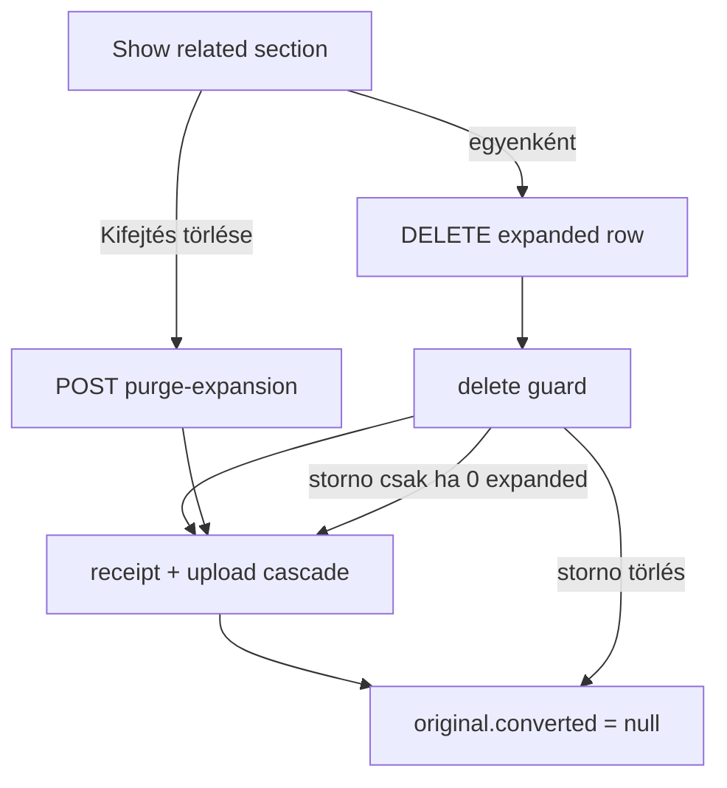

# Implementation plan: Controller role és kifejtés-törlés

**Status:** done (első slice)  
**Date:** 2026-11-10  
**Kapcsolódó:** [PRD 0002 — Content Backoffice v2](../prd/0002-content-backoffice-v2.md), [Ügyletek](../transaction-workflow.md), [v1 discardDraft](../prd/0001-content-backoffice-v1.md)  
**Érintett kód:** [`src/index.ts`](../../src/index.ts), [`src/publish-guard.ts`](../../src/publish-guard.ts), új `src/transaction-delete/`, [`apps/content-backoffice/src/auth/roles.ts`](../../apps/content-backoffice/src/auth/roles.ts), [`RelatedTransactionsSection.tsx`](../../apps/content-backoffice/src/pages/transactions/RelatedTransactionsSection.tsx), [`TransactionShow.tsx`](../../apps/content-backoffice/src/pages/transactions/TransactionShow.tsx)

Új Users & Permissions role (`controller` / Kontroller): teljes editor-jog + transaction/receipt törlés. A backoffice Show related szekcióban egyelőre csak a kifejtett (`expanded`) és storno sorok törlése (soronként / egyben). A szerver őrzi a `converted_to_workflow` szabályokat.

---

## 1. Cél

1. Bootstrap: `controller` role, editor-szuperkészlet + `delete` + `purgeExpansion`.
2. Publish / convert / discard: `editor` és `controller` egyaránt (editor-like).
3. Szerver: `original` nem törölhető; `expanded` igen; `storno` csak ha nincs sibling `expanded`; storno törlésekor `original.converted_to_workflow → null`; `null` (nem kifejtett) törölhető.
4. SPA Show: expanded soronkénti törlés + **Kifejtés törlése** (összes expanded + storno); draft/published; publishednél erős Confirm; receipt (+ upload) cascade.
5. Követelmény a [v2 PRD](../prd/0002-content-backoffice-v2.md)-be (§3.7 + backlog).

## 2. Nem-cél (első slice)

- Lista oldali törlés gombok.
- Részleges multi-select checkbox UI (storno csak üres expanded mellett; részleges expanded = soronkénti delete).
- `original` törlése a UI-ból (API-n a reset utáni `null` sor törölhető, de Show ezt még nem vezeti ki).
- Enterprise RBAC / audit log bővítés.

## 3. Döntések (rögzítve)

| Téma     | Döntés                                                                                         |
| -------- | ---------------------------------------------------------------------------------------------- |
| Név      | `controller` / Kontroller                                                                      |
| Jog      | Editor összes joga + általános törlés                                                          |
| Státusz  | Draft és published; published Confirm figyelmeztetéssel                                        |
| Cascade  | Receipt + upload, mint a [`discard-service`](../../src/transaction-discard/discard-service.ts) |
| UI helye | Csak TransactionShow related szekció                                                           |
| Docs     | v2 PRD (v1 lezárva)                                                                            |

## 4. API

Ne bízzuk a kliensre az „előbb minden expanded → storno → reset” szekvenciát.

1. **U&P:** `controller` = közös content actionök + editor-only (`discardDraft`, convert, convertPreview) + `api::transaction.transaction.delete` + `api::receipt.receipt.delete` (+ upload destroy, ha a cascadehez kell).
2. **Delete őr:** Document Service middleware vagy delete elé kötött szolgáltatás a `converted_to_workflow` szabályokra (`original` tiltás; storno csak 0 expanded mellett; storno után original null).
3. **Bulk:** `POST /api/transactions/:id/actions/purge-expansion` (`purgeExpansion`) — `:id` az original/szülő; atomikusan törli az összes expanded + storno childöt (receipt cascade), majd `converted_to_workflow: null` az originalon.
4. **Egyes expanded:** `DELETE` + őr + közös receipt cascade helper.

## 5. Backend lépések

- [`src/index.ts`](../../src/index.ts): `usersPermissionsRoles` + `CONTROLLER_ONLY` (vagy ezzel egyenértékű) action lista; az `ensureUsersPermissionsRoles` a `controller` role-t is létrehozza. Publish/convert/discard: **editor és controller**.
- [`src/publish-guard.ts`](../../src/publish-guard.ts) (+ tesztek): `actor.roleType === 'editor'` helyett editor-like (`editor | controller`), hogy a controller publisholhasson / auditot kapjon.
- Új `src/transaction-delete/` (discard minta):
  - `assertController` (vagy ezzel egyenértékű role check) ahol kell
  - `deleteTransactionWithReceipts(documentId)`
  - `purgeExpansion(originalDocumentId)`
  - hibák: 403/404; storno tiltás ha van expanded; original delete tiltás
- Route/controller: `purge-expansion` custom action; scope a bootstrapban a `controller` role-ra.
- Unit tesztek fake Strapi-val ([backend-testing skill](../../.cursor/skills/backend-testing/SKILL.md)): expanded ok; original 403; storno expanded mellett 403; storno után original null; purge sorrend + cascade.

## 6. Backoffice SPA

- [`roles.ts`](../../apps/content-backoffice/src/auth/roles.ts): `controller` a `CONTENT_ROLES`-ba; `isEditorLike`, `canPurgeExpansion` (ne szórva `=== 'editor'`).
- Minden editor-kapu (`RoleGuard`, menü, review, convert, bulk approve, leave confirm, workflow catalog, App routes): controller = editor-like.
- i18n: `app.roles.controller` hu/en.
- Related szekció ([`RelatedTransactionsSection`](../../apps/content-backoffice/src/pages/transactions/RelatedTransactionsSection.tsx) / Accordion), `controller` only:
  - soronkénti Törlés `expanded` sorokon
  - **Kifejtés törlése** → `purgeExpansion` (összes expanded + storno); részleges multi-select checkbox az első slice-ban nem kell (lásd §2)
  - published: Confirm figyelmeztetéssel; draft: egyszerűbb Confirm
- Vitest a role helperökre és a törlésgomb láthatóságára ([frontend-testing skill](../../.cursor/skills/frontend-testing/SKILL.md)).

## 7. Dokumentáció (implementációkor)

- v2 PRD új **§3.7 Controller role és kifejtés-törlés**: role, jog, szerver szabályok, Show UI, cascade, published Confirm; backlog sor a §10 táblába.
- Skill/rule rövid frissítés a harmadik role-ról: [`strapi-publish-guard`](../../.cursor/skills/strapi-publish-guard/SKILL.md), [`content-backoffice-spa`](../../.cursor/skills/content-backoffice-spa/SKILL.md).

## 8. Feladatok

1. v2 PRD §3.7 + backlog.
2. Bootstrap `controller` role (editor jogok + delete + purgeExpansion).
3. publish-guard és discard: editor-like.
4. Delete/purge-expansion service + őr + cascade + tesztek.
5. SPA roles helpers, editor-like kapuk, i18n.
6. TransactionShow related UI: expanded sor törlés + Kifejtés törlése + Confirm.

## 8a. Javítás (2026-11-10): csoportos törlés nem-original szülőnél

**Hiba:** a **Kifejtés törlése** gomb csak akkor jelent meg, ha a csoportban volt `original`. Bulk-rögzítésből (pl. tojás napi rögzítés horgonya) származó csoportban, ahol csak egyes lábak `expanded`-ek, csak a soronkénti szöveges „Törlés” látszott a „Megtekintés” mellett — nem volt egyértelmű, mit töröl, és nem lehetett egyszerre törölni.

**Javítás:**

- Szerver: `purgeExpansion(:id)` bármely szülőre működik, ha van `expanded`/`storno` gyereke (különben 409); reset csak `original` szülőnél.
- SPA: `purgeExpansionPlan(items, record)` (szülő = a megjelenített rekord, ha vannak gyerekei, különben a `related_transaction`); a szekció tetején magyarázó szöveg + **Kifejtett sorok törlése (N)**; soronként kuka ikon tooltippel; a Confirm listázza a törlendő sorokat.
- Tesztek: backend horgony-purge; Vitest plan helper + bulk-csoport purge.
- Soronkénti törlés (felhasználói döntés, 2026-11-10): kuka minden soron, de azonnal csak `expanded`; storno / original / nem kifejtett sor csak ha nincs több `expanded` a csoportban, az original a storno után (`relatedRowDeleteState`). Tiltott sor: disabled ikon + tooltip az okkal. Szerver: `original` törölhető, ha nincs `expanded`/`storno` gyereke.
- Megtekintés-zavar: gyerekes sor Show-ja eddig csak a gyerekeit listázta (önmagát és a szülőt nem), és a `getOne` rekord numerikus ID-je (`entryId`) hiányzott („—”). Most: szülő + saját sor + gyerekek, a `entryId` fallbackkel.

**Miért volt csak az 1954 `expanded`:** `expanded` értéket csak a Convert ír ([`convert-service.ts`](../../src/transaction-workflow/convert-service.ts)); a bulk tojás-űrlap új sorai `null`-lal jönnek létre. A bulk mentés duplikátum-keresése ([`duplicateFetch.ts`](../../apps/content-backoffice/src/workflows/bulk-quantity/duplicateFetch.ts)) dátum + szervezet + pénznem + tartozik/követel számla alapján talál meglévő sort, `converted_to_workflow` szűrés nélkül, és találat esetén azt **frissíti** (`saveTransactionDraft`). A bevétel-láb (`1000` → `4000`, HUF, Tyúktartás) pontosan egyezik a „Tojás eladás forintért” workflow 3. lépésével, így egy korábbi Convert által létrehozott `expanded` sort írt felül: leírás, összeg és `related_transaction` (→ bulk horgony) változott, a `converted_to_workflow: expanded` megmaradt. A tojás- és kp-láb a tag saját számláját (`1002`) használja, a workflow `1001`-et, ezért ott nem volt egyezés → új `null` sor. Javítási javaslat (nyitott): a duplikátum-keresés csak `converted_to_workflow: null` sorokat vegyen figyelembe.

## 9. Kész, ha

- Bootstrap létrehozza a `controller` role-t a helyes permissionökkel.
- Controller tudja az editor flow-kat (create/review/publish/convert/discard).
- Expanded törölhető; original nem; storno csak expanded nélkül + reset.
- Show-n látszik a soronkénti és a teljes kifejtés törlés; published Confirm.
- Receipt cascade működik.
- v2 PRD friss; unit tesztek zöldek.
