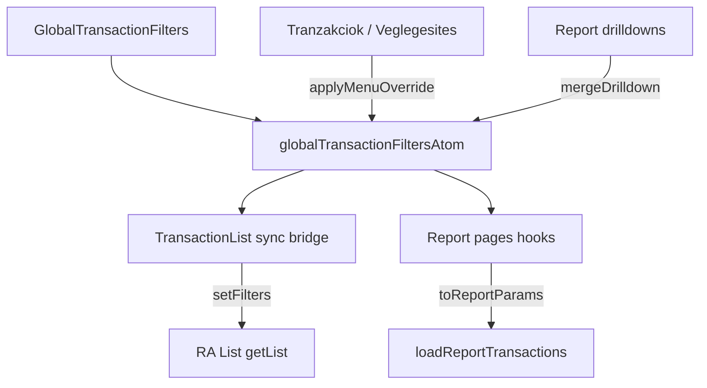

# Implementation plan: Globális sidebar szűrők

**Status:** planned  
**Date:** 2026-11-10  
**Kapcsolódó:** [ADR 0001 — React Admin content UI](../adr/0001-react-admin-content-ui.md), [PRD 0001 — Content backoffice v1](../prd/0001-content-backoffice-v1.md)  
**Érintett kód:** [`apps/content-backoffice/src/filters/`](../../apps/content-backoffice/src/filters/) (új), [`FrameSidebar.tsx`](../../apps/content-backoffice/src/layout/FrameSidebar.tsx), [`BackofficeMenu.tsx`](../../apps/content-backoffice/src/layout/BackofficeMenu.tsx), [`TransactionList.tsx`](../../apps/content-backoffice/src/pages/transactions/TransactionList.tsx), [`transactionListLocation.ts`](../../apps/content-backoffice/src/data/transactionListLocation.ts), report page-ek + hooks + drilldown

A tranzakciólista és a reportok ma külön szűrőállapotot tartanak (RA List URL vs. page-local `useState` + `ReportRangeFilterToolbar`). A cél egy **globális szűrőpanel** a bal oldali menü alatt (desktop) / a hamburger drawer menütételei alatt (mobil), Jotai atomban tárolt értékekkel, amit minden fogyasztó oldal átvesz.

**Döntések (1C + 2A):**

- Minden mai lista-szűrő + a report dátum-presetek a sidebarba kerülnek; helyi filter toolbar a listán és a reportokon nincs.
- Alap: `thisMonth` + `preview` (published) + `converted_to_workflow: none+expanded`.
- Véglegesítés / Tranzakciók menü továbbra is felülírja a **státuszt és a converted** értéket; a többi globális mező (dátum stb.) megmarad.

---

## 1. Cél

1. Egységes globális tranzakciószűrő UI a shell sidebarjában.
2. Állapot Jotai atomban (`jotai` dependency az `apps/content-backoffice`-ban).
3. Fogyasztók: `/transactions` lista, egg / hen / membership / project-balance reportok.
4. Megtartott menü-szenvedély: a két listamenü nem hagyja rajta egymás status+converted szűrőjét.
5. Drilldown a listára az atom frissítésén keresztül (nem csak URL-string építés).

## 2. Nem-cél

- Strapi séma / publish-guard / dataProvider merge logika átírása (`buildTransactionFilters`, `loadReportTransactions` megmarad).
- Workflow duplicate fetch, create/show, profile oldalak szűrése.
- Oldalspecifikus UI globálissá tétele: membership focus, project balance org Autocomplete + currency Select a riport oldalon marad.
- Persistálás localStorage-be / URL-be az atomon kívül (a lista URL továbbra is a RA `setFilters` következménye lehet).

## 3. Adatmodell

Új modul: `apps/content-backoffice/src/filters/`.

```ts
type GlobalTransactionFilters = {
  datePreset: DateRangePreset | 'custom'; // default: thisMonth
  date_gte?: string;
  date_lte?: string;
  status: 'preview' | 'draft' | 'all'; // default: preview
  converted_to_workflow: ConvertedFilterValue[];
  createdAt_gte?: string;
  createdAt_lte?: string;
  amount_gte?: number;
  amount_lte?: number;
  organization?: string;
  debit_account?: string;
  credit_account?: string;
  description?: string;
  vendor?: string;
};
```

Tiszte függvények (Vitest node):

| Helper                                       | Szerep                                                                            |
| -------------------------------------------- | --------------------------------------------------------------------------------- |
| `boundsFromGlobalFilters`                    | preset → bounds, vagy custom `date_*`                                             |
| `toListFilter`                               | atom → RA List `filter` (`preview` → `status: 'published'`, `all` → nincs status) |
| `toReportParams`                             | atom → `{ preset/bounds, transactionStatus }`                                     |
| `applyMenuOverride(state, 'all' \| 'draft')` | csak status + converted                                                           |
| `resetGlobalFilters`                         | 2A default snapshot                                                               |
| `mergeDrilldownIntoGlobal`                   | drilldown mezők az atomba                                                         |

**Dátum UX:** preset gombok állítják a `datePreset`-et és törlik a custom date-eket. A `date_gte` / `date_lte` (Szűrő hozzáadása) `datePreset: 'custom'`-ra vált.

**Menü override (2A):**

- Véglegesítés → `status: draft` + review converted (mind a négy érték).
- Tranzakciók → `status: all` + converted vissza `none+expanded`.
- Dátum, összeg, org, számlák, leírás, vendor **megmarad**.

## 4. UI

- `GlobalTransactionFilters.tsx`: MUI Stack.
  - Report-stílusú dátum `ToggleButtonGroup` (`ReportRangeFilterToolbar` mintája).
  - Státusz: meglévő `ReportTransactionStatusFilter` (preview / draft / all).
  - Ügylet-bontás multi-select (mai lista choices).
  - „Szűrő hozzáadása”: createdAt, amount, org, debit/credit, description, vendor, custom date + Clear.
  - Relációk: `useGetList` + MUI Autocomplete (nem RA `ReferenceInput` List context nélkül).
- Mount: `FrameSidebar` — a menu (`children`) után, divider + `overflowY: auto`.
- Jotai `Provider` az `App.tsx`-ben a `Admin` körül.

## 5. Adatfolyam



1. **TransactionList** — `filters` / `FilterButton` / Clear kikerül. Bridge a `List` gyerekeként: atom → `setFilters(toListFilter(state), …)`. A lista URL a `setFilters` miatt frissülhet.
2. **4 report page + hook** — atom fogyasztás; `ReportRangeFilterToolbar` törlése; focus / org / currency marad.
3. **Menü** — override az atomon, navigáció `/transactions`-re; aktív jelölés: pathname + atom `status === 'draft'`.
4. **Drilldown** — atom merge, majd `/transactions` (`membershipShare/drilldown.ts`, `projectBalance/drilldown.ts`).
5. **Clear** — sidebar → `resetGlobalFilters()`.

## 6. Fő fájlok

| Fájl / könyvtár                          | Változás                                  |
| ---------------------------------------- | ----------------------------------------- |
| `apps/content-backoffice/package.json`   | `jotai` dependency                        |
| `src/filters/*`                          | atom, helpers, `GlobalTransactionFilters` |
| `layout/FrameSidebar.tsx`                | panel mount                               |
| `layout/BackofficeMenu.tsx`              | menu override → atom                      |
| `data/transactionListLocation.ts`        | aktív mód + navigáció az atommal          |
| `pages/transactions/TransactionList.tsx` | helyi filter UI ki, sync bridge be        |
| `pages/reports/*ReportPage.tsx` + hooks  | atom fogyasztás, toolbar ki               |
| drilldown ts                             | atom merge navigáció előtt                |

## 7. Tesztek

- Node Vitest: mapping (preset→bounds, preview→published), menu override megőrzi a dátumot, reset defaultok, drilldown merge.
- Meglévő drilldown / report tesztek frissítése, ha a context már nem page-local state.
- Prettier az érintett fájlokra; `npm test --prefix apps/content-backoffice`.

## 8. Implementációs sorrend

1. jotai + atom + helperok + node tesztek
2. Sidebar UI + FrameSidebar mount + App Provider
3. TransactionList bridge, helyi toolbar eltávolítás
4. Report page/hook bekötés
5. Menü override + drilldown merge
6. Érintett tesztek + prettier + vitest
