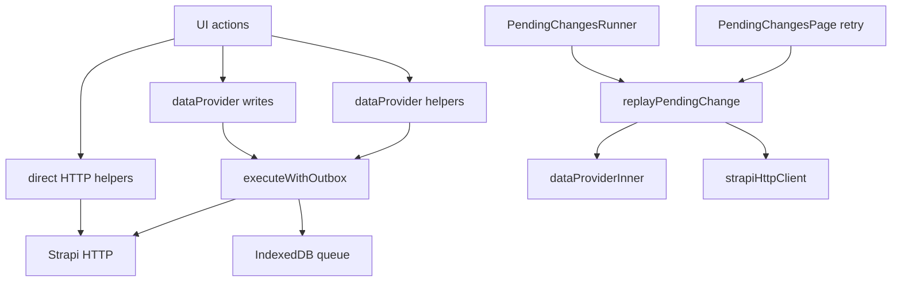
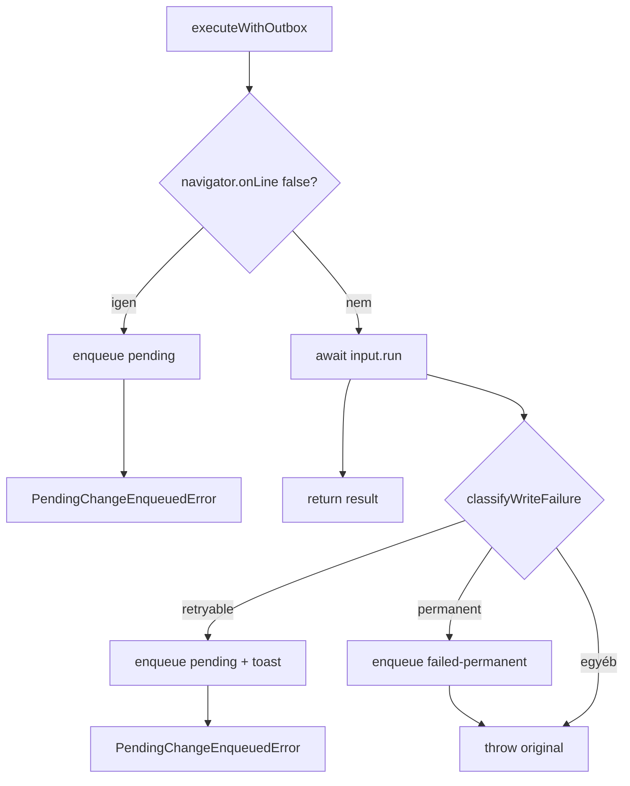
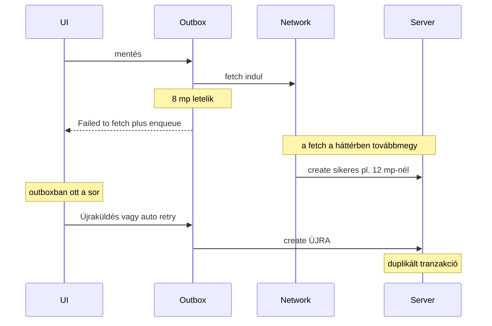

# Pending changes outbox (content-backoffice)

**Állapot (2026-11):** write-outbox v0 a SPA-ban (`pending-changes` feature flag). **S0 kész:** a veszélyes 8 mp-es `Promise.race` write-timeout **ki van véve**. S1–S3 (gateway, wake-before-write, staged replay, Playwright) **elhalasztva** — lásd „Hogyan lehet jobbá / univerzálissá”.

**Cél közönség:** későbbi agent / fejlesztő context — mi van ma, miért így, mi a következő lépés, milyen csapdák voltak.

Kapcsolódó: [wake page](../deploy/cpanel/wake-page.md), SPA: [`apps/content-backoffice/src/data/pendingChanges/`](../../apps/content-backoffice/src/data/pendingChanges/), feature seed: `pending-changes` a `backoffice-features.json`-ban.

---

## 1. Mi ez?

Kliens oldali **write outbox**: ha egy (kimondott) mentési / write hívás hálózati vagy retryable hibával elbukik, a payload IndexedDB-be (fallback: localStorage) kerül, a felhasználó a **Kiküldésre váró módosítások** oldalon látja, manuális vagy automatikus **Újraküldés** próbálja újra.

Ez **nem** teljes offline app (nincs read cache, PWA shell, offline listák).

---

## 2. Jelenlegi architektúra



### Fő modulok

| Modul                                                                                                                                                                   | Szerep                                                                             |
| ----------------------------------------------------------------------------------------------------------------------------------------------------------------------- | ---------------------------------------------------------------------------------- |
| [`executeWithOutbox.ts`](../../apps/content-backoffice/src/data/pendingChanges/executeWithOutbox.ts)                                                                    | Write körül: offline short-circuit, catch → enqueue, `PendingChangeEnqueuedError`  |
| [`withPendingChangesDataProvider.ts`](../../apps/content-backoffice/src/data/pendingChanges/withPendingChangesDataProvider.ts)                                          | RA `create` / `update` / `delete` / `*Many` wrapper                                |
| [`store.ts`](../../apps/content-backoffice/src/data/pendingChanges/store.ts) + [`persistence.ts`](../../apps/content-backoffice/src/data/pendingChanges/persistence.ts) | Queue CRUD, user-scope                                                             |
| [`retryRunner.ts`](../../apps/content-backoffice/src/data/pendingChanges/retryRunner.ts)                                                                                | Interval + online + auth event; FIFO / lock                                        |
| [`replay.ts`](../../apps/content-backoffice/src/data/pendingChanges/replay.ts)                                                                                          | dataProvider metódusok + custom (`convertTransaction`, `createAndConvert`)         |
| [`PendingChangesPage.tsx`](../../apps/content-backoffice/src/pages/pendingChanges/PendingChangesPage.tsx)                                                               | Lista, retry, discard — **retryhez kell `strapiHttpClient()`**                     |
| Feature gate                                                                                                                                                            | `GET /api/backoffice/config` → `enabled` tartalmazza-e a `pending-changes` kulcsot |

### Lefedett write pathok

- React Admin `dataProvider` create / update / delete / updateMany / deleteMany
- `saveTransactionDraft`, `createNewTransactionDraft`
- `convertTransactionToWorkflow`, `createAndConvertTransaction`
- Egg / bulk-quantity: `dataProvider.create` + `saveTransactionDraft` ([`saveRows.ts`](../../apps/content-backoffice/src/workflows/bulk-quantity/saveRows.ts))

### Bypass (nincs outbox)

- `publishTransaction`, `discardTransaction`
- `deleteTransaction`, `purgeExpansion`
- `attachTransactionReceipt` / upload
- Jelszócsere (`changePassword`)

### Futásidő viselkedés (S0 után)



- **Online siker:** nincs enqueue.
- **`navigator.onLine === false`:** azonnali enqueue, `run()` nem hívódik (DevTools Offline).
- **Retryable hiba** (TypeError / Failed to fetch, 0, 401, 5xx, …): enqueue + `PendingChangeEnqueuedError` (UI soft-success ahol kezelik).
- **Permanent** (400/403/404/409/422): enqueue `failed-permanent`, eredeti error rethrow.
- **Nincs** wall-clock `Promise.race` timeout (S0) — lásd §4.

---

## 3. Custom intent: createAndConvert

A „Mentés és ügylet kifejtése” offline/hálózati hibánál **egy** queue elem legyen, ne csak a create.

- Élő `run` és replay: `createTransactionDraft` → `convertTransaction`.
- Payload: `JSON.parse(JSON.stringify(data))` — **File / receipt_cards tartalom elveszik**.
- Részleges siker (create OK, convert fail) + újrapróbálás → **második create** kockázat (staged replay kellene — S2, elhalasztva).

Manuális Újraküldés: a page átadja a `strapiHttpClient`-et. httpClient nélkül a custom replay stub/hiba — korábban ez okozta a `Missing documentId` tünetet.

---

## 4. Eltávolított veszély: 8 mp Promise.race (tanulság)

Korábban minden write `Promise.race(run, 8s timeout)` volt. A timeout **nem abortálta** a fetch-et.



**Miért veszélyes:** hamis offline jelzés; online / lassú / cold-start pathon is; duplikátum.

**S0 döntés:** timeout race ki; marad offline short-circuit + confirmed failure utáni enqueue.

---

## 5. Cold start (szerver alszik)

Éles, gyakori eset (cPanel Passenger sleep). `navigator.onLine === true` — a böngésző online, a Node alszik.

| Megközelítés       | Viselkedés                                                                              |
| ------------------ | --------------------------------------------------------------------------------------- |
| 8 mp race (régi)   | ~8 mp → outbox; háttér-fetch siker + retry → duplikátum                                 |
| S0 (most)          | Kivárja a választ; siker → OK; fail → outbox. Nincs gyors soft-success várakozás közben |
| `onLine === false` | Cold startnál **nem** fut                                                               |

**Két réteg (nem egymás helyett):**

1. **Wake infrastruktúra** — [wake-page.md](../deploy/cpanel/wake-page.md), `/api/wake`, `/api/wake/ready`.
2. **Outbox** — csak megerősített sikertelen write után; retry amikor a szerver ready.

Későbbi (elhalasztott): mentés előtti wake/ready poll; AbortSignal-os hard deadline (race nélkül).

---

## 6. Gap-ek (ismert hiányosságok)

Ugyanazok a típusú lyukak, amiket a feature tesztelésekor megtaláltunk:

| Gap                         | Megjegyzés                                                                                              |
| --------------------------- | ------------------------------------------------------------------------------------------------------- |
| Bypass write-ok             | publish, discard, delete, purge, receipt, password                                                      |
| Preflight read              | pl. egg `duplicateFetch`: nem-hálózati hiba blokkolhat mentés előtt; hálózatnál soft-skip van           |
| File / receipt a payloadban | `JSON.stringify` elveszíti                                                                              |
| createAndConvert partial    | duplikált create retrykor                                                                               |
| FIFO / stuck `sending`      | blokkolhat későbbi same-key itemeket                                                                    |
| Soft-success UX             | Create / createAndConvert kezeli; finalize / bulk / egg sok helyen még „hiba”                           |
| Teszt                       | Unit a store/enqueue körül; **nincs** e2e pending-changes; replay httpClient regresszió unitban részben |

---

## 7. Tesztlefedettség (mai)

**Van:** enqueue policy, offline short-circuit, lassú siker nem enqueue-el (S0), classify errors, store/persistence, tab lock, retryRunner FIFO, wrapper success, PendingChangesPage empty/list/discard (retry mock).

**Nincs / gyenge:** Playwright outbox flow; valódi createAndConvert replay; receipt round-trip; finalize/bulk soft-success; stuck `sending`.

---

## 8. Távolság az „általános offline + retry”-től


| Képesség                        | Általános offline+retry | Ma + S0                          |
| ------------------------------- | ----------------------- | -------------------------------- |
| Write queue + auto/manual retry | kell                    | részben                          |
| Minden write Intent/gateway     | kell                    | nem                              |
| Soft-success UX mindenütt       | kell                    | részben                          |
| Idempotens / staged replay      | kell                    | nem                              |
| Abort-safe timeout              | kell                    | nincs (szándékos)                |
| Cold start wake                 | tipikus hosting         | külön wake page, nem a mentésből |
| Read / master-data cache        | kell                    | **nincs**                        |
| App shell / SW / PWA            | kell                    | **nincs**                        |
| Offline listák / kimutatások    | kell                    | **nincs**                        |
| Conflict UI                     | kell éretthez           | alig                             |

**Becslés:** mai kód ≈ **write-side** mechanizmus ~fele–kétharmada _minőségben lukasan_; általános offline app ≈ **~¼**. A nagy ugrás: **read cache + app shell** — külön program.

**Költségtanulság:** a feature már nagy diff (~pending-changes fa + seed + i18n). Továbbépítés (S1–S3) most több galiba-felületet nyitna, mint user-értéket — ezért **megállás S0 után**.

---

## 9. Hogyan lehet jobbá / univerzálissá (elhalasztott irány)

Cél réteg: **megbízható write-outbox v1** (nem teljes offline).

### Alapelvek

1. **Egy write gateway** — UI ne hívjon nyers `httpClient` write-ot; Intent API.
2. **Intent = user szándék** — pl. mentés+kifejtés egy intent.
3. **Soft-success szerződés** — enqueue után: i18n toast, űrlap lezárva, pending lista; soha raw `Failed to fetch` mint fordítási kulcs.
4. **Replay idempotens / staged** — create eredmény a queue itemen; convert külön stage.
5. **Timeout csak AbortSignal-lal** — ne `Promise.race` futó requesttel.
6. **Preflight read fail ≠ mentés tiltás hálózatnál**.
7. **Teszt:** unit gateway + staged replay; 1–2 Playwright smoke.

### Későbbi lépések (nem most)

1. Soft-success a hiányzó catch ágakon (finalize / bulk / egg).
2. Wake-before-write (`/api/wake` + ready) a mentés előtt.
3. Staged `createAndConvert` + stuck `sending` reset.
4. Playwright: offline createAndConvert → lista → online retry.
5. (Külön program) master-data cache + PWA shell + conflict UI.

### Feature flag

- Kulcs: `pending-changes` (Settings / backoffice-features).
- Menü / route gate: [`PendingChangesFeatureGate`](../../apps/content-backoffice/src/pages/pendingChanges/PendingChangesFeatureGate.tsx).
- Ha a feature túl kockázatos egy példányon: `enabled: false` a seed/Admin Settingsben — a wrapper a write pathon ettől még élhet; kikapcsoláskor érdemes tudatosan reviewolni.

---

## 10. Gyors ellenőrzőlista (smoke)

Online (szerver ébren):

- [ ] Új tranzakció mentés siker
- [ ] Mentés és ügylet kifejtése siker
- [ ] Lassú válasz (>8 mp) **nem** rak outboxba indokolatlanul

Offline (DevTools Offline) / confirmed fail:

- [ ] Mentés → toast `app.pending_changes.enqueued` (vagy kezelő soft-success)
- [ ] Pending lista sor; Újraküldés online után eltűnik (httpClient átadva)

Cold start:

- [ ] Wake page / `/api/wake` használata külön a mentéstől
- [ ] Mentés kivár vagy fail → outbox; nincs hamis 8 mp enqueue

---

## 11. Fájltérkép

```
apps/content-backoffice/src/data/pendingChanges/   # core
apps/content-backoffice/src/pages/pendingChanges/  # UI
apps/content-backoffice/src/layout/PendingChangesMenuItem.tsx
apps/content-backoffice/src/data/dataProvider.ts    # wrappers + createAndConvert
database/seeders/http/*/data/backoffice-features.json  # pending-changes flag
docs/deploy/cpanel/wake-page.md                   # cold start, nem outbox
```
