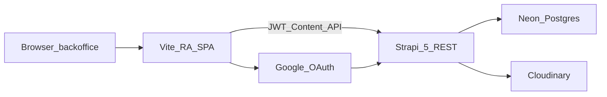

# PRD 0001: Content Backoffice v1

**Status:** draft  
**Date:** 2026-10-12, kiegészítve 2026-10-14  
**Product:** `content-backoffice`  
**Target URL:** `https://kor.fejlesztesek.hu/backoffice`  
**Related ADR:** [0001-react-admin-content-ui](../adr/0001-react-admin-content-ui.md)  
**Follow-up:** [0002-content-backoffice-v2](./0002-content-backoffice-v2.md)

## 1. Összefoglaló

A szervezet embereinek kell egy cockpit / dashboard jellegű SPA a Strapi Content Manager helyett. Az első szállítható verzió kiadások rögzítésére és minőségbiztosítására szolgál: projekt (`organization`) szerinti tranzakció, kifizető és költség számla, opcionális bizonylat (`receipt`).

A Strapi Admin megmarad fejlesztői felületnek. A szervezeti backoffice a Content API-t fogyasztja (Users & Permissions JWT), React Admin 5 + `ra-strapi` alapon, külön Vite alkalmazásként.

## 2. Probléma és cél

### Probléma

- A Strapi Content Manager nem szervezeti munkafolyamatra van szabva (draft → review → publish, szűk számla-allowlist, opcionális bizonylat).
- A szervezeti adatrögzítőknek nem kell (és nem szabad) Admin JWT / Content-Type Builder hozzáférés.
- A kiadások rögzítése kettős könyvelés logikájú (`debit_account` / `credit_account`), projektre kötve.

### Cél (v1)

1. Bejelentkezhető backoffice SPA ugyanazon a hoston (`/backoffice`).
2. Három tranzakció-oldal: új felvitel, draft review, readonly szűrhető lista.
3. Opcionális bizonylat a felvételi / review flow-ban.
4. Két Content szerep: `dataentry` (csak draft) és `editor` (publish).
5. Magyar alapértelmezésű i18n, profil (név, email, jelszócsere).
6. Audit a tranzakción és a bizonylaton: ki rögzítette, ki publikálta, és mikor. A mezőket a szerver írja.

### Nem-cél (v1)

Lásd [§8 Out of scope](#8-out-of-scope-v1) és a [v2 PRD](./0002-content-backoffice-v2.md).

## 3. Felhasználók és szerepek

Csak **Users & Permissions** (Content API). Strapi Admin JWT **nem** része az SPA autentikációnak. Dual Admin + Content login **out of scope**.

| Role id | Ki | Jogok az SPA-ban | Backend elvárás |
| --- | --- | --- | --- |
| `dataentry` | Adatrögzítő | Új tranzakció; readonly lista; profil | `transaction` / `receipt` create & update **csak draft**; nincs publish |
| `editor` | Szerkesztő | Draft review + publish; readonly lista; profil | Draft olvasás; `status=published` írás engedélyezett |
| Strapi Admin | Fejlesztő / üzemeltető | SPA-n kívül | Content user kézi létrehozás + invite; Google provider config |

### Felhasználókezelés

- Content usereket **admin hozza létre kézzel**, illetve **invite**-tal.
- Nincs nyilvános self-register v1-ben.
- Nincs kötelező user ↔ `member` kapcsolat v1-ben (a tagok nem feltétlenül rendelkeznek belépéssel).

### Org láthatóság

- v1: **minden szervezet** látható mindkét szerepnek (globális lista / választó).
- Egy user több szervezethez rögzíthet (nincs org–user ACL v1-ben).

## 4. Autentikáció

| Mód | Endpoint / mechanizmus | v1 |
| --- | --- | --- |
| Email + jelszó | `/api/auth/local` | kötelező |
| Google | Users & Permissions `google` provider | kötelező |
| Strapi Admin login | `/admin/login` | tilos az SPA-ban |

Az SPA: `ra-strapi` auth provider + Google OAuth redirect/callback a Content user modellre. JWT a Content API hívásokhoz.

## 5. Termékfelület — oldalak (IA)

A menü v1-ben **csak a tranzakció-domain**. Nincs külön Organizations / Members / Accounts / Currencies menüpont.

| Oldal | Javasolt route | Szerep | Viselkedés |
| --- | --- | --- | --- |
| **Új tranzakció felvitele** | `/transactions/create` | `dataentry` | Create űrlap; mentés mindig **draft**; Publish gomb nincs |
| **Draftok review-ja** | `/transactions/review` | `editor` | Csak `status=draft`; megnyitás, ellenőrzés, **Publish**; receipt megjelenik ha van |
| **Tranzakciók (readonly lista)** | `/transactions` | `dataentry` és `editor` | Draft **és** published; receipt oszlop/preview; szűrés statusra és mezőkre; **nincs szerkesztés** erről a nézetről |
| Bejelentkezés | `/login` | vendég | Email/jelszó + Google |
| Profil | `/profile` | mindkét szerep | Név, email, jelszócsere (local usereknél) |

### 5.1 Új tranzakció (`dataentry`)

Kötelező / választható mezők:

| Mező | Forrás | Megjegyzés |
| --- | --- | --- |
| `date` | transaction | kötelező |
| `amount` | transaction | kötelező |
| `description` | transaction | opcionális |
| `organization` | relation | kötelező — a szervezeti fa csomópontja (projekt) |
| `debit_account` | relation | kötelező — SPA szűrés: `code` ∈ `{5000, 5100, 5400}` |
| `credit_account` | relation | kötelező — SPA szűrés / javaslat: `1xxx` (pl. `1000` Készpénz, `1100` Bankszámlák) |
| `receipt` | relation | **opcionális** — 1:1 UI a v1 felvételi flow-ban |

Receipt (ha a felhasználó csatol):

- Fájl feltöltés (média) — custom upload path, mert az `ra-strapi` média támogatása hiányos (ADR).
- `vendor` opcionális (séma-követelmény: lásd [§9](#9-backend-követelmények)).
- Összeg / dátum / leírás a receipten: a UI a tranzakció értékeiből előtöltheti; finomhangolás implementációkor.

Mentés: mindig `status=draft`. `dataentry` nem publisholhat (UI + szerver).

### 5.2 Draft review (`editor`)

- Lista alapértelmezett szűrése: `status=draft`.
- Show / edit nézet: tranzakció mezők + kapcsolódó receipt (ha van), dokumentum megtekintése.
- **Publish** művelet elérhető.
- Látszik, ki rögzítette a draftot és mikor (`entered_by`, `createdAt`). Publish után az is, ki publikálta és mikor (`published_by`, `publishedAt`).
- v1: nincs külön „visszautasítás + kötelező megjegyzés” workflow; a QA javíthat draftot vagy visszavonhatja a publish szándékot (nem publishol). Részletes QA sor, értesítés és a visszautasítás megjegyzése → v2.

### 5.3 Readonly lista (mindkét szerep)

- Tartalmazza a draft **és** published rekordokat.
- Megjeleníti a receipt jelenlétét / előnézetét (ha van).
- Megjeleníti a rögzítő és a publikáló audit mezőit ([§9.5](#95-audit-mezők)). Ezek nem szerkeszthetők.
- Szűrők legalább:
  - `status` (draft / published)
  - `date` (tartomány)
  - `amount`
  - `organization`
  - `debit_account` / `credit_account`
  - `description` (szöveg)
- Erről a page-ről **nincs** create / edit / publish. A `dataentry` a create page-re megy; az `editor` a review page-re.

### 5.4 Profil

- Megjelenítés: név, email.
- Jelszócsere local (email/jelszó) fióknál.
- Avatar: **nem** v1 (→ v2).
- Google-only fióknál a jelszócsere UI elrejthető vagy disabled.

## 6. Számlakód-szabályok (SPA hardcode)

A seed közös számlatükröt hoz létre ([`database/seeders/org-initializer.js`](../../database/seeders/org-initializer.js)). v1-ben a szűrés **kliens oldali** `account.code` allowlist:

| Szerep a formon | Engedélyezett kódok | Példa seed név |
| --- | --- | --- |
| `debit_account` (költség) | `5000`, `5100`, `5400` | Anyagköltség, Bérköltség, Szolgáltatások |
| `credit_account` (kifizető) | `1xxx` javasolt allowlist (legalább `1000`, `1100`) | Készpénz, Bankszámlák |

Konfigurálható / szerveroldali allowlist → v2.

## 7. Technikai keret

| Elem | Döntés |
| --- | --- |
| App helye | `apps/content-backoffice` (Nx `appsDir`) |
| Stack | TypeScript + Vite + React Admin 5 + `ra-strapi` + Material UI |
| API | Strapi 5 REST, ugyanaz a host (`kor.fejlesztesek.hu`) |
| Azonosító | react-admin `id` = Strapi `documentId` (ADR wrapper ha kell) |
| i18n | default `hu`; `en` katalogus is (RA i18nProvider / react-i18next) |
| Deploy v1 | Manuális `vite build` + static feltöltés a cPanel `/backoffice` pathra |
| Env | `VITE_STRAPI_URL` (ugyanaz a origin / API gyökér) |

## 8. Out of scope (v1)

- Organizations, members, memberships, accounts, currencies menük / CRUD
- user ↔ member összerendelés
- Org–user ACL a szervezeti fán
- Profil avatar
- Automatikus CI/CD pipeline (→ v2 skeleton)
- `backoffice.kor.fejlesztesek.hu` subdomain
- Receipt N:M gazdag UI (v1: 1:1 a felvételi flow-ban)
- React Admin Enterprise RBAC / realtime. A saját audit mezők a [§9.5](#95-audit-mezők), nem az Enterprise audit log.
- Inline edit / publish a readonly listáról
- `dataentry` publish

## 9. Backend követelmények

Ezek a Strapi oldali változások a v1 SPA acceptance része (nem „nice to have”).

### 9.1 Receipt séma

Jelenlegi [`receipt` schema](../../src/api/receipt/content-types/receipt/schema.json): `vendor` és `document` **required**.

v1 követelmény:

- `vendor` legyen **optional** (lehet kiadás vendor nélkül; a receipt maga is opcionális a tranzakción).
- Ha a felhasználó létrehoz receipt sort, a `document` továbbra is kötelező lehet (van mit feltölteni).
- `transaction.receipt` reláció marad opcionális.

### 9.2 Draft / publish policy

A Users & Permissions alapból nem választja szét a „draft create” és a „publish” műveletet.

Követelmény:

- Szerveroldali policy / controller / lifecycle: `status=published` (vagy publish akció) **csak az `editor`** szerepnek.
- `dataentry` create/update esetén a rendszer draftot kényszerít / elutasítja a publish kísérletet.
- Az SPA elrejti a Publish UI-t `dataentry` elől; a szerver a forrásigazság.

### 9.3 Szerepek és jogosultságok

- Létrehozni a `dataentry` és `editor` Roles-t a Users & Permissionsben.
- Legalább: `transaction`, `receipt`, `organization`, `account` find; create/update a szerep szerint; media upload a receipthez.
- Google provider engedélyezése + callback URL-ek a `/backoffice` SPA-hoz.

### 9.4 Média feltöltés

Custom feltöltési útvonal a receipt `document` mezőhöz (Cloudinary provider már a projektben van). Az `ra-strapi` natív média gapjét a v1 implementáció megkerüli.

### 9.5 Audit mezők

A Strapi `createdBy` / `updatedBy` admin usert jelent, a Content API-n nem a belépett `dataentry` vagy `editor` user. A v1 ezért saját mezőt ír a `transaction` és a `receipt` sémába. Users & Permissions user `find` jog továbbra sincs, ezért a mező szöveg, nem reláció: a szerver a belépett user e-mailjét menti, a kliens nem tud userlistát olvasni.

| Mező | Típus | Ki írja |
| --- | --- | --- |
| `entered_by` | string | Szerver, create-kor, a Content user e-mailje. Ügyfélpayload nem írja felül. |
| `published_by` | string | Szerver, publish-kor, az `editor` user e-mailje. Unpublish-kor üres. |

A „mikor” a dokumentum saját `createdAt` és `publishedAt` mezője. Külön datetime mező nem kell.

A create és az update űrlapon ezek a mezők nincsenek. A review és a readonly lista mutatja őket. A Document Service middleware, ami a publish őrt adja, ezeket is állítja.

## 10. User story-k és acceptance criteria

1. **Belépés (dataentry)**  
   Local vagy Google belépés után a menüben látja: Új tranzakció + Tranzakciók lista. A Review page nem jelenik meg / nem elérhető.

2. **Új tranzakció**  
   Org, összeg, dátum, debit (`5000|5100|5400`), credit (`1xxx`), opcionális leírás és receipt. Mentés draft. Publish nincs.

3. **Opcionális receipt**  
   Receipt nélkül is menthető a tranzakció. Receipttel: fájl kötelező; vendor üres lehet (séma után).

4. **Nincs publish dataentrynek**  
   UI és API elutasítja a publish kísérletet.

5. **Editor review**  
   A Review page csak draftokat listáz; receipt látszik; Publish sikeres → published státusz.

6. **Readonly lista**  
   dataentry és editor látja draft + published tételeket receipttel; szűrhet statusra és mezőkre; nincs szerkesztés.

7. **Profil**  
   Név, email látszik; local usernél jelszócsere működik.

8. **i18n**  
   Alapértelmezett UI nyelv magyar; angol katalogus létezik.

9. **Deploy path**  
   Az app a `/backoffice` alatt töltődik; API ugyanazon a hoston elérhető.

10. **Audit**  
    Draft mentés után a tranzakción és a bizonylaton a rögzítő e-mailje és a `createdAt` látszik. Publish után a publikáló e-mailje és a `publishedAt` is. A kliens ezeket a mezőket nem tudja átírni.

## 11. Kockázatok

| Kockázat | Hatás | Mitigáció |
| --- | --- | --- |
| Google OAuth callback / redirect misconfig | Belépés sikertelen | Provider + SPA URL dokumentálása a deploy checklistben |
| `ra-strapi` média gap | Receipt feltöltés elakad | Custom upload a v1 scope része |
| Publish csak UI-n van tiltva | dataentry API-val publisholhat | Szerveroldali policy kötelező ([§9.2](#92-draft--publish-policy)) |
| `vendor` required marad | Opcionális receipt flow törik | Séma módosítás a v1 előtt ([§9.1](#91-receipt-séma)) |
| Seed kódok hiányoznak a környezetben | Üres debit/credit select | Seed / smoke check a deploy előtt |
| Draft+published Strapi 5 document párok | Lista / szűrés zavaros | Status filter és `documentId` konzisztens kezelés (ADR) |
| A kliens küldi az `entered_by` / `published_by` értéket | Hamis audit | A middleware felülírja create-kor és publish-kor, update payloadból eldobja ([§9.5](#95-audit-mezők)) |

## 12. Sikerkritérium (Definition of Done)

- [ ] `apps/content-backoffice` Vite+TS app Nx alatt buildel
- [ ] Login (local + Google) Content JWT-vel
- [ ] Három oldal a [§5](#5-termékfelület--oldalak-ia) szerint működik szerepkörönként
- [ ] Receipt opcionális; média feltöltés működik
- [ ] `receipt.vendor` optional a sémában
- [ ] Publish csak az `editor`-nak (UI + szerver)
- [ ] Audit: `entered_by` és `published_by` a tranzakción és a bizonylaton, szerver írja, a lista és a review mutatja
- [ ] Profil: név, email, jelszócsere
- [ ] i18n default `hu`
- [ ] Manuális deploy a `kor.fejlesztesek.hu/backoffice` pathra dokumentálva

## 13. Nyitott implementációs részletek (nem blokkolják a PRD-t)

- Pontos credit `1xxx` allowlist (minimum `1000`, `1100`; bővíthető a seed asset kódjaival).
- QA „visszadobás” csak nem-publish vs. későbbi reject mező (v2). A rögzítő és a publikáló audit mező v1 ([§9.5](#95-audit-mezők)).
- Invite email konkrét Strapi plugin / kézi flow üzemeltetési leírása.
