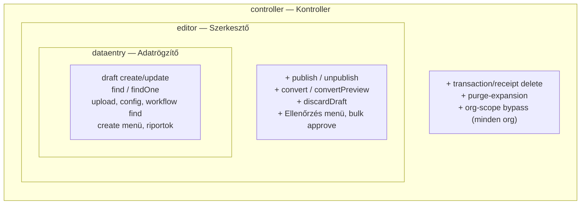
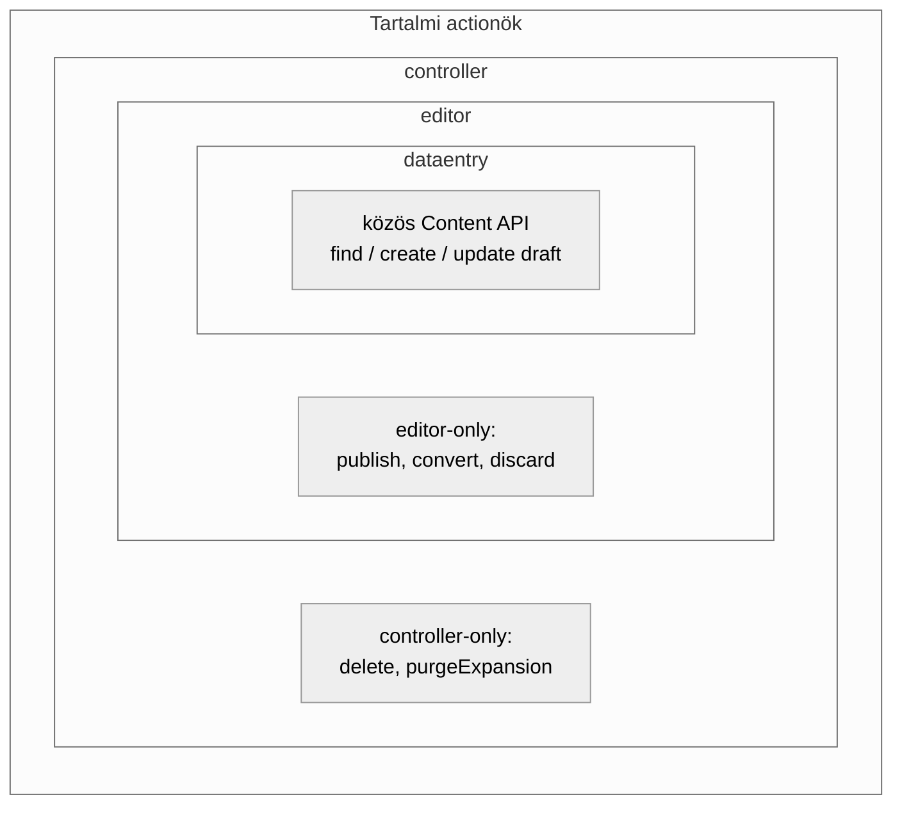
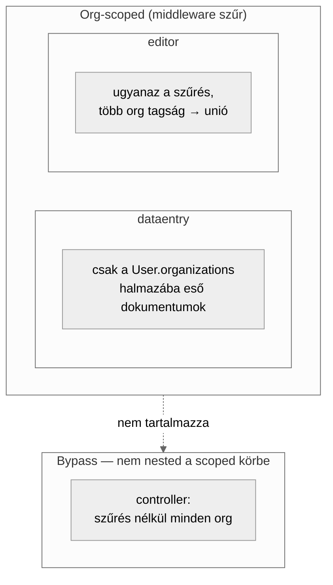

# Org-scoping Document Service middleware (cloud agent prompt)

Ez a fájl egy készen beilleszthető, angol nyelvű cloud agent promptot tartalmaz Cursorhoz; az alábbi bevezető **nem** része az agent promptnak.

## Szerepkörök viszonya (aktuális modell)

A content backoffice három Users & Permissions role-t használ. A jogosultságok **egymásba ágyazottak** (halmaz-tartalmazás): minden belső kör joga megvan a külsőnek is, plusz a külső saját többlete.

Példa a nested Venn-re (koncentrikus halmazok):



Ugyanez két külön Venn-ként: (1) tartalmi jogok, (2) szervezet-szűrés.

### 1) Tartalmi jogok — nested Venn



**Példa:** egy `dataentry` létrehozhat draft tranzakciót; az `editor` ugyanezt + véglegesíthet és kifejthet; a `controller` ugyanezt + törölhet kifejtett / storno sorokat.

### 2) Org-scoping — nested vs. külvilág

Itt a belső két role **szűrt**, a controller **kívül** esik a szűrésen (bypass), nem a szűrt halmaz része.



**Példa:** `editor` két szervezethez kötve csak azokat a tranzakciókat / bizonylatokat / szervezet-választókat látja; `controller` tagság nélkül is az összes orgot és rekordot.

### Összefoglaló tábla

| Role         | dataentry jogok | editor többlet    | controller többlet                    | Org filter     |
| ------------ | --------------- | ----------------- | ------------------------------------- | -------------- |
| `dataentry`  | igen            | —                 | —                                     | igen (M2M org) |
| `editor`     | igen            | publish/convert/… | —                                     | igen (M2M org) |
| `controller` | igen            | igen              | delete, purge-expansion, scope bypass | nem (bypass)   |

SPA: `isEditorLikeRole` = `editor` \| `controller`. Strapi: `EDITOR_LIKE_ROLE_TYPES` + `contentRoleActions('controller')`.

A mai scope **pontos M2M** tagságra megy (szülő kötés ≠ gyerekek). A szervezeti fa (subtree) kiterjesztés opciói, rangsor és UI/UX/DX/perf összehasonlítás: [plan 0009 — org-scope subtree expansion](../plans/0009-org-scope-subtree-expansion.md) (research only, egyelőre nem implementáljuk). Nem része az alábbi cloud agent promptnak.

---

## Cloud agent prompt

```text
## Goal
Implement organization-scoped Document Service filtering for selected Curr APIs, using a many-to-many link between the users-permissions User and Organization.

## Repo
pitiboy/curr (Strapi 5 + content-backoffice).

## 1. User ↔ Organization relation
- Extend users-permissions User via `src/extensions/users-permissions/content-types/user/schema.json`.
- Add a **many-to-many** relation to `api::organization.organization` (name it clearly, e.g. `organizations`).
- Let Strapi create the join table; do not hand-roll SQL.
- **Do not** modify the Role table.
- **Do not** create a new membership content type; leave the existing `membership` / `membership-type` models and their `rules` unchanged.
- Registration is disabled in this project — **do not** add `register.allowedFields` (or any registration field config).

## 2. Admin UI
- Rely on out-of-the-box Content Manager multi-select on both sides (User → organizations, Organization → users if the inverse is set appropriately).
- **No** custom admin injection zones, no Settings form patches, no DOM hacks.

## 3. Document Service middleware (selective, not global)
Register Document Service middleware that runs **only** for the content types / document UIDs that back these product surfaces (investigate the real UIDs and schemas in the repo; map Hungarian product names to code):
- termelés (production)
- átvezetés (pool / inter-org transfer)
- osztás (distribution)
- eladás (sales)
- report pages' transaction (and related) reads that currently load via Document Service / Content API

Do **not** register a global middleware for every content type. Prefer an explicit allowlist of UIDs (named constant).

Middleware behaviour (top of handler):
1. If the current user’s role needs **no** scoping (e.g. admin / a clearly named bypass role — discover what Curr already uses for unrestricted access; document the choice as a named constant), `return next()` immediately.
2. Otherwise load the user’s linked organizations.
3. Inject an organization constraint into `params.filters` (merge with `$and` so existing filters are preserved) **before** the DB query for find/findMany/findFirst/count (and equivalent Document Service actions you confirm are needed).
4. On create (if in scope), set/constrain organization from the user’s allowed set so they cannot write outside scope.

No external auth / Permit.io / third-party PDP. Keep everything in-repo.

## Role nesting (required constants)
Content roles nest as **dataentry ⊂ editor ⊂ controller** for Content API / SPA capabilities:
- Shared base: find/create/update draft, upload, config, workflow find.
- Editor-like (`editor` + `controller`): publish, convert, convertPreview, discardDraft; SPA review / bulk approve / convert UI.
- Controller-only: transaction/receipt delete, purgeExpansion; **org-scope bypass** (not org-filtered).
- Org-scoped roles: `dataentry` and `editor` only (`ORG_SCOPE_CONTENT_ROLE_TYPES`). Bypass: `controller` (`ORG_SCOPE_BYPASS_CONTENT_ROLE_TYPES`).
Wire SPA `RoleGuard` / menu / list / show with the same nesting (`isEditorLikeRole`), not `=== 'editor'` alone.

## 4. Extension hygiene and Strapi 5 caveats
- Changes only under `src/extensions/`, app APIs, and tests — **never** patch `node_modules`.
- Mind Strapi v5 quirks: users-permissions relation lifecycle / `documentId` bugs — prefer `afterCreate` or route middleware over `beforeCreate` if you must set relations in hooks.
- Be careful with inverse relations on User (known forgot-password email breakage); prefer a relation shape that keeps forgot-password working, and note the choice in the PR.
- After major Strapi upgrades, re-verify schema merge and middleware.

## 5. Process and done criteria
- New branch from default; open a **draft PR**.
- PR description in Hungarian: User–Organization M2M, which UIDs are scoped, bypass roles, how filters are injected.
- Tests: admin (or bypass) sees unscoped; non-admin only sees their orgs; a content type **not** on the allowlist stays unfiltered.
- `tsc` / lint / relevant vitest (or project test command) green for touched packages.

## Out of scope
- Reworking membership egg `rules`.
- External authorization products.

## Done when
User schema extension exists; selective Document Service middleware is wired; SPA treats controller as editor-like everywhere editor gates existed; tests cover bypass / isolation / unlisted UID / editor-like controller; draft PR opened; checks green.
```
