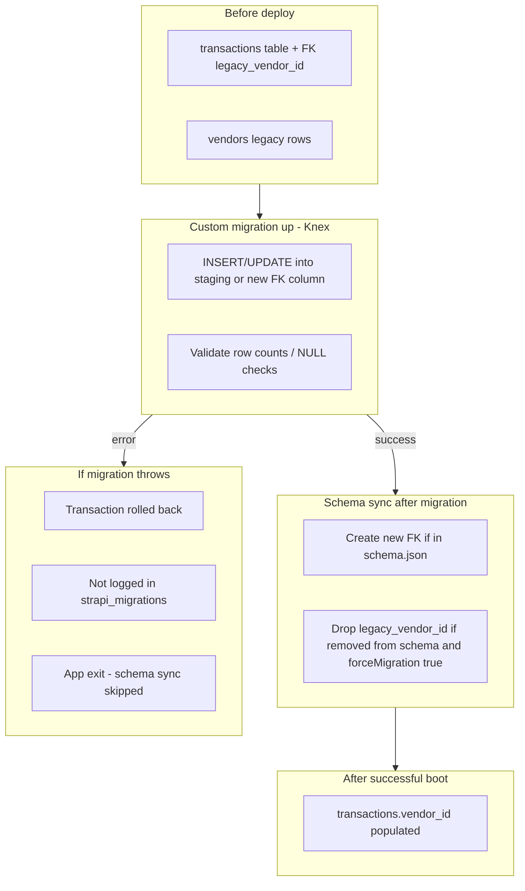

# Strapi 5 database migrations (KÖR reference)

**Executive summary.** In Strapi 5.58, custom migrations are **experimental**, run **automatically on application startup** (`strapi develop` / `strapi start`), **not** during `strapi build`. Pending user migrations in `database/migrations/` run **before** automatic schema sync. Each file runs **once**, in **alphabetical order**, inside a **transaction**; failures abort startup and are **not** recorded in `strapi_migrations`. Schema sync then aligns the database with current `schema.json` definitions and, unless disabled, **drops** Strapi-managed objects that no longer appear in code. The KÖR API pins `@strapi/strapi@5.58.0`, uses **PostgreSQL on Neon** via `DATABASE_URL`, sets **`forceMigration: false`** by default, and deploys through **cPanel + FTPS** (`npm run build`, upload, restart Node app).

Verified against [Strapi 5.58.0 docs](https://docs.strapi.io/cms/database-migrations) and `@strapi/database` / `@strapi/core` source at tag `v5.58.0`.

---

## Built-in mechanism

| Topic | Verified behavior |
| --- | --- |
| **Location** | `./database/migrations` (resolved from app root, or from **`dist/`** when `useTypescriptMigrations: true`). |
| **File types** | Non-recursive `*.js` and `*.sql` only ([discover.ts](https://github.com/strapi/strapi/blob/v5.58.0/packages/core/database/src/migrations/discover.ts)). `.ts` in source is **not** executed unless compiled and discovered as `.js`. |
| **Naming / order** | Docs recommend `YYYY.MM.DDTHH.mm.ss.name.js`; **order = lexical sort of the filename** ([docs](https://docs.strapi.io/cms/database-migrations)). |
| **API** | Export `up(knex, db)` (Knex **transaction** + `Database`). Optional `down` exists in code but [docs discourage down migrations](https://docs.strapi.io/cms/database-migrations); no CLI to run them. `.sql` files run via `knex.raw`; **no down** ([resolver.ts](https://github.com/strapi/strapi/blob/v5.58.0/packages/core/database/src/migrations/resolver.ts)). |
| **Enable / disable** | `settings.runMigrations` (default `true`) gates **user** files only ([database config](https://docs.strapi.io/cms/configurations/database), [users.ts](https://github.com/strapi/strapi/blob/v5.58.0/packages/core/database/src/migrations/users.ts)). Internal Strapi migrations always participate when pending. |
| **Tracking** | Table `strapi_migrations` (user), `strapi_migrations_internal` (Strapi) ([storage.ts](https://github.com/strapi/strapi/blob/v5.58.0/packages/core/database/src/migrations/storage.ts)). Name logged **after** successful `up` ([runner.ts](https://github.com/strapi/strapi/blob/v5.58.0/packages/core/database/src/migrations/runner.ts)). |
| **Transactions** | Each `up` wrapped in `db.transaction` ([common.ts](https://github.com/strapi/strapi/blob/v5.58.0/packages/core/database/src/migrations/common.ts)). Nested transactions possible per docs. |
| **On failure** | Migration not logged → remains pending; bootstrap throws → process exits; HTTP server does not listen ([Strapi.ts](https://github.com/strapi/strapi/blob/v5.58.0/packages/core/core/src/Strapi.ts)). |
| **Build** | `strapi build` compiles admin/TS only; **no DB access**. |

**Startup order (implementation).** After `register`, `bootstrap` loads content-type models into `@strapi/database`, then calls `db.schema.sync()` ([Strapi.ts](https://github.com/strapi/strapi/blob/v5.58.0/packages/core/core/src/Strapi.ts)). Inside `sync()` ([schema/index.ts](https://github.com/strapi/strapi/blob/v5.58.0/packages/core/database/src/schema/index.ts)):

1. If **any** pending user **or** internal migration → `migrations.up()` (user provider first, then internal ([migrations/index.ts](https://github.com/strapi/strapi/blob/v5.58.0/packages/core/database/src/migrations/index.ts))) → **`syncSchema()` always**.
2. Else if no persisted schema snapshot → `syncSchema()`.
3. Else if content-type schema **hash** changed → `syncSchema()`.
4. Else → skip DDL (`UNCHANGED`).

Docs describe the same high-level sequence: load schema → migrations → schema sync → persist schema ([database migrations](https://docs.strapi.io/cms/database-migrations)). Schema-change detection compares **stored content-type schemas**, not ad-hoc DBA edits.

**`forceMigration` (KÖR: default off).** When `true` (Strapi default), sync **drops** tables/columns/indexes/FKs Strapi previously managed but no longer in `schema.json`. When `false`, drops are skipped; the new schema is still stored, and skipped objects may **never** be dropped later if you turn `forceMigration` back on ([docs](https://docs.strapi.io/cms/database-migrations)). KÖR sets `forceMigration: env.bool('DATABASE_FORCE_MIGRATION', false)` in `config/database.ts`.

---

## Schema vs data lifecycle

1. **Deploy new code** (FTP upload of built tree + restart on cPanel).
2. **Startup runs custom migrations** against the **pre-sync database** — write SQL/Knex against **old** table/column/join names ([docs note](https://docs.strapi.io/cms/database-migrations)).
3. **Schema sync** applies DDL from new `schema.json` files (create → drop removed → alter).

Removing a relation or field from code does **not** immediately remove DB objects at deploy time; removal happens at **next successful startup’s schema sync** (unless `forceMigration: false`, which suppresses drops). Data in dropped structures is lost unless copied earlier.

**Can a migration read an old relation?** Yes, via **Knex/raw SQL** on existing tables/link tables. The running app’s Strapi models reflect **new** schemas, but physical columns Strapi has not yet dropped are still queryable in `up()`. You cannot rely on removed relations through `strapi.documents()` unless the content-type still defines them at boot.

**Good fit for built-in migrations:** renames (see `strapi generate migration` / `rename:field` in [CLI](https://docs.strapi.io/cms/cli)), copying data before a field/type is removed, one-off backfills on **existing** columns, internal upgrade scripts.

**Needs staging or extra care:**

- **New column + backfill in one release:** migration runs **before** sync creates the column ([GitHub #24609](https://github.com/strapi/strapi/issues/24609)). Use a guarded `ALTER TABLE`, a **two-deploy** sequence (schema first, data migration second), or `src/index.ts` `bootstrap()` after sync (loses automatic `strapi_migrations` tracking unless you add idempotency).
- **Destructive drops with `forceMigration: true`:** backup/Neon branch first; validate copied data before enabling drops.
- **Fresh empty DB + data migration expecting Strapi tables:** first boot may run user migrations before tables exist ([GitHub #24070](https://github.com/strapi/strapi/issues/24070)); guard with `hasTable` / split deploy.

---

## Diagram A — Startup sequence (Strapi 5.58, production)

```mermaid
sequenceDiagram
  participant Ops as Deploy (cPanel)
  participant Build as strapi build
  participant Node as server.js / strapi start
  participant Boot as bootstrap()
  participant DB as PostgreSQL (Neon)
  participant Mig as User + internal migrations
  participant Sync as syncSchema()

  Ops->>Build: Upload code; npm run build (local/CI)
  Note over Build: No DB migrations
  Ops->>Node: Restart Node app (single instance ideal)
  Node->>Boot: load() → register → bootstrap
  Boot->>DB: db.init(models from schema.json)
  Boot->>Mig: If pending migrations
  Mig->>DB: up() in transactions (strapi_migrations)
  Boot->>Sync: syncSchema() if migrations ran OR schema new/changed
  Sync->>DB: DDL + persist schema snapshot
  Boot->>Node: init routing, plugins bootstrap
  Node-->>Ops: HTTP available
```

---

## Diagram B — Example relation change

Hypothesis: `transaction` had `manyToOne` `legacy_vendor`; new model uses `manyToOne` `vendor` on another table.



Schema changes (new FK column) come from **schema sync**; **data** moves in the **migration**.

---

## Project layout (KÖR)

```
backend-strapi/
├── package.json              # strapi build / start; @strapi/strapi 5.58.0
├── server.js                 # cPanel entry: createStrapi({ distDir: './dist' }).start()
├── config/database.ts        # DATABASE_URL, pool, forceMigration, optional runMigrations / useTypescriptMigrations
├── database/migrations/      # Custom *.js or *.sql (committed; shipped via FTP)
├── src/api/*/content-types/*/schema.json   # Source of truth for schema sync
├── src/index.ts              # Optional bootstrap() after sync (untracked one-offs)
└── scripts/ftp-deploy.sh     # FTPS mirror after local npm run build
```

**Minimal migration (verified API, `.js` only at runtime):**

```javascript
'use strict';

module.exports = {
  async up(knex) {
    const hasLegacy = await knex.schema.hasColumn('transactions', 'legacy_vendor_id');
    if (!hasLegacy) return;

    await knex('transactions')
      .whereNotNull('legacy_vendor_id')
      .update({ vendor_id: knex.ref('legacy_vendor_id') });
  },
};
```

Filename example: `2026.04.20T12.00.00.backfill-transaction-vendor.js`. Generate via `npx strapi generate migration` ([CLI](https://docs.strapi.io/cms/cli)).

---

## Recommended KÖR deployment workflow

1. **Prepare DB:** Neon **branch** or backup before destructive or wide-reaching migrations.
2. **Build locally/CI:** `npm run build` (admin + TypeScript to `dist/`). Include new `database/migrations/*.js` in the FTP mirror (root `database/migrations`, not only `dist/`, unless `useTypescriptMigrations: true`).
3. **Avoid concurrent runners:** Stop or scale to **one** Node process on cPanel during restart so two instances do not race the same pending migration (no distributed lock in [runner.ts](https://github.com/strapi/strapi/blob/v5.58.0/packages/core/database/src/migrations/runner.ts)).
4. **Deploy:** `npm run deploy:kor.fejlesztesek.hu` (or target env) → on server: `npm install` if needed → **restart** app so `server.js` runs migrations then sync.
5. **Validate:** Smoke-test API; SQL checks for backfilled rows. With `DATABASE_FORCE_MIGRATION=false`, legacy tables/columns may remain until you intentionally enable drops after validation.
6. **Separate migration runner?** **Not required** for normal operation—Strapi runs migrations on startup. A second Strapi instance or custom runner is only useful if you deliberately isolate startup (same DB credentials, same migration files, still subject to concurrency risk).

---

## Checklist

- [ ] Migration filename sorts correctly vs existing files.
- [ ] Uses `.js` or `.sql` (or `useTypescriptMigrations` + compiled output in `dist/database/migrations`).
- [ ] `up()` targets **pre-sync** schema; guards for missing tables/columns on fresh DBs.
- [ ] Tested against a Neon **branch** copy of production.
- [ ] `runMigrations` / `DATABASE_FORCE_MIGRATION` understood for this release.
- [ ] Single app instance restarted for deploy.
- [ ] Post-deploy validation before relying on dropped legacy structures.

---

## References

| Claim | Source |
| --- | --- |
| Experimental feature, startup order, Knex `up`, no migration CLI | [Database migrations](https://docs.strapi.io/cms/database-migrations) |
| `runMigrations`, `forceMigration`, `useTypescriptMigrations` | [Database configuration](https://docs.strapi.io/cms/configurations/database) |
| `strapi generate migration`, rename flow | [CLI](https://docs.strapi.io/cms/cli) |
| `sync()` / `syncSchema()` orchestration | [schema/index.ts @ v5.58.0](https://github.com/strapi/strapi/blob/v5.58.0/packages/core/database/src/schema/index.ts) |
| Bootstrap calls `db.schema.sync()` | [Strapi.ts @ v5.58.0](https://github.com/strapi/strapi/blob/v5.58.0/packages/core/core/src/Strapi.ts) |
| User vs internal migration order | [migrations/index.ts @ v5.58.0](https://github.com/strapi/strapi/blob/v5.58.0/packages/core/database/src/migrations/index.ts) |
| File discovery, SQL, tracking, transactions | [discover.ts](https://github.com/strapi/strapi/blob/v5.58.0/packages/core/database/src/migrations/discover.ts), [resolver.ts](https://github.com/strapi/strapi/blob/v5.58.0/packages/core/database/src/migrations/resolver.ts), [runner.ts](https://github.com/strapi/strapi/blob/v5.58.0/packages/core/database/src/migrations/runner.ts), [storage.ts](https://github.com/strapi/strapi/blob/v5.58.0/packages/core/database/src/migrations/storage.ts) |
| Migrations-before-sync limitations | [GitHub #24070](https://github.com/strapi/strapi/issues/24070), [#24609](https://github.com/strapi/strapi/issues/24609) |
