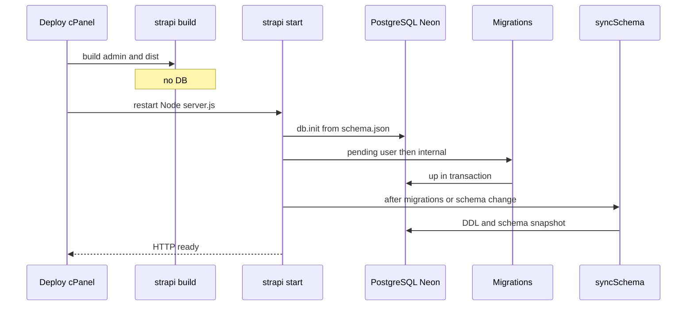
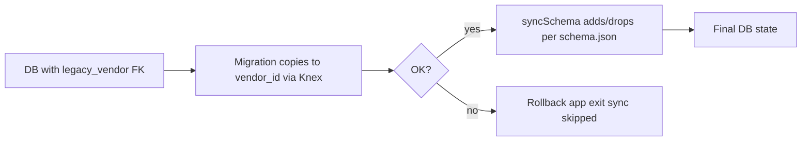

# Strapi 5 database migrations (KÖR reference)

**Executive summary.** Strapi 5.58 custom migrations are **experimental**, run on **`strapi develop` / `strapi start`** (not `strapi build`), **before** automatic schema sync. Files in `database/migrations/` run **once**, in **filename order**, each in a **transaction**; failures stop startup and are **not** logged to `strapi_migrations`. Sync then applies DDL from `schema.json` and may **drop** removed Strapi-managed objects unless `forceMigration` is false. KÖR uses **PostgreSQL on Neon**, **`DATABASE_FORCE_MIGRATION` default false**, and **cPanel FTPS** deploy.

Verified against [Strapi 5 docs](https://docs.strapi.io/cms/database-migrations) and `@strapi/strapi@5.58.0` source.

---

## Mechanism (verified)

| Topic        | Behavior                                                                                                                                                                                                                                                                                                                          |
| ------------ | --------------------------------------------------------------------------------------------------------------------------------------------------------------------------------------------------------------------------------------------------------------------------------------------------------------------------------- |
| **Path**     | `./database/migrations` (from app root, or **`dist/`** if `useTypescriptMigrations: true`)                                                                                                                                                                                                                                        |
| **Files**    | `*.js`, `*.sql` only, non-recursive ([discover.ts](https://github.com/strapi/strapi/blob/v5.58.0/packages/core/database/src/migrations/discover.ts))                                                                                                                                                                              |
| **Order**    | Lexical filename sort; docs pattern `YYYY.MM.DDTHH.mm.ss.name.js` ([migrations doc](https://docs.strapi.io/cms/database-migrations))                                                                                                                                                                                              |
| **API**      | `module.exports = { async up(knex, db) { … } }`; Knex is a transaction ([common.ts](https://github.com/strapi/strapi/blob/v5.58.0/packages/core/database/src/migrations/common.ts)). `.sql` → `knex.raw`. Official docs: no down migrations / no migration CLI ([migrations doc](https://docs.strapi.io/cms/database-migrations)) |
| **Settings** | `runMigrations` (default true) toggles **user** files; internal migrations still run when pending ([database config](https://docs.strapi.io/cms/configurations/database), [users.ts](https://github.com/strapi/strapi/blob/v5.58.0/packages/core/database/src/migrations/users.ts))                                               |
| **Tracking** | `strapi_migrations` / `strapi_migrations_internal`; name inserted only after successful `up` ([runner.ts](https://github.com/strapi/strapi/blob/v5.58.0/packages/core/database/src/migrations/runner.ts), [storage.ts](https://github.com/strapi/strapi/blob/v5.58.0/packages/core/database/src/migrations/storage.ts))           |
| **Failure**  | Rollback, bootstrap error, process exit; pending migration retries next boot                                                                                                                                                                                                                                                      |

**Startup order.** `bootstrap()` → `db.init(models)` → `db.schema.sync()` ([Strapi.ts](https://github.com/strapi/strapi/blob/v5.58.0/packages/core/core/src/Strapi.ts)). In `sync()` ([schema/index.ts](https://github.com/strapi/strapi/blob/v5.58.0/packages/core/database/src/schema/index.ts)): if pending user **or** internal migrations → `migrations.up()` (user, then internal) → **always** `syncSchema()`; else sync when no stored schema or content-type hash changed. Docs match: load schema → migrations → sync → persist ([migrations doc](https://docs.strapi.io/cms/database-migrations)).

**`forceMigration`.** Default `true` in Strapi; KÖR defaults **`false`** in `config/database.ts`. When true, sync drops tables/columns/indexes/FKs no longer in `schema.json`. When false, drops are skipped but the new schema is still stored ([migrations doc](https://docs.strapi.io/cms/database-migrations)).

---

## Deploy code, migrations, and sync

1. **Deploy** new application files (build + FTPS + cPanel restart).
2. **Migrations** transform data on the **pre-sync** database—target **old** table/column names ([migrations doc](https://docs.strapi.io/cms/database-migrations)).
3. **Schema sync** creates/alters/drops (if allowed) from `schema.json`.

Removing a field or relation takes effect on the **next successful startup sync**, not at upload time. Old data remains reachable in `up()` via Knex/SQL until sync drops it; removed relations are not available through `strapi.documents()` in new code.

**Use built-in migrations for:** renames (`strapi rename:field` / [CLI migration generator](https://docs.strapi.io/cms/cli)), copying data before removal, backfills on **existing** columns.

**Stage or workaround when:** new column + backfill in one release (migration runs **before** column exists—[#24609](https://github.com/strapi/strapi/issues/24609)); empty DB + migration expecting Strapi tables ([#24070](https://github.com/strapi/strapi/issues/24070)); destructive drops—Neon branch/backup and validate before enabling drops.

---

## Diagram A — Startup (Strapi 5.58)



---

## Diagram B — Relation change (example)



DDL from **sync**; data move in **migration**.

---

## KÖR layout

```
├── package.json                 # build, start; @strapi/strapi 5.58.0
├── server.js                    # cPanel: createStrapi distDir start
├── config/database.ts           # DATABASE_URL, forceMigration, runMigrations
├── database/migrations/         # *.js or *.sql shipped on deploy
├── src/api/.../schema.json      # Drives schema sync
└── scripts/ftp-deploy.sh        # FTPS after npm run build
```

```javascript
'use strict';
module.exports = {
  async up(knex) {
    if (!(await knex.schema.hasColumn('transactions', 'legacy_vendor_id')))
      return;
    await knex('transactions')
      .whereNotNull('legacy_vendor_id')
      .update({ vendor_id: knex.ref('legacy_vendor_id') });
  },
};
```

---

## KÖR deployment workflow

1. Neon **branch/backup** before risky changes.
2. `npm run build`; deploy including `database/migrations/`.
3. Restart **one** Node instance (no migration locking in core—avoid parallel boots).
4. Validate data; with `forceMigration: false`, drop legacy objects manually or enable drops only after verification.
5. **Separate migration runner not required**—startup runs migrations; extra Strapi/process only if you isolate boot (same concurrency caveats).

---

## Checklist

- [ ] Filename sort order correct; `.js` or `.sql` (or TS via `useTypescriptMigrations` + `dist/`)
- [ ] `up()` guards missing tables/columns; targets pre-sync schema
- [ ] Tested on Neon branch
- [ ] Single-instance restart on deploy
- [ ] `runMigrations` / `DATABASE_FORCE_MIGRATION` set intentionally

---

## References

- [Database migrations](https://docs.strapi.io/cms/database-migrations) · [Database configuration](https://docs.strapi.io/cms/configurations/database) · [CLI](https://docs.strapi.io/cms/cli)
- [schema/index.ts](https://github.com/strapi/strapi/blob/v5.58.0/packages/core/database/src/schema/index.ts) · [Strapi.ts](https://github.com/strapi/strapi/blob/v5.58.0/packages/core/core/src/Strapi.ts) · [migrations/](https://github.com/strapi/strapi/tree/v5.58.0/packages/core/database/src/migrations)
- [#24070](https://github.com/strapi/strapi/issues/24070) · [#24609](https://github.com/strapi/strapi/issues/24609)
