# Ügyletek

**Dátum:** 2026-10-28  
**Számlatükör:** [database/seeders/http/kor/data/accounts.json](../database/seeders/http/kor/data/accounts.json)  
**Sor séma:** [src/api/transaction/content-types/transaction/schema.json](../src/api/transaction/content-types/transaction/schema.json)  
**Tagi számlák:** [src/member-accounts.ts](../src/member-accounts.ts)  
**Kapcsolódó:** [docs/readme.md](./readme.md), [v1 PRD](./prd/0001-content-backoffice-v1.md), [implementation plan 0002](./plans/0002-transaction-workflow-content-type.md) (katalógus + Convert API), [implementation plan 0003](./plans/0003-transaction-workflow-backoffice.md) (backoffice Convert UI)

Ez a fájl a kétlábas könyvelés ügyleteit írja le a meglévő számlatükörre. A v1 űrlap továbbra is egy kézi tartozik/követel sor. A több soros bontást a [`transaction-workflow`](../src/api/transaction-workflow/content-types/transaction-workflow/schema.json) sablon és a konverziós API végzi (lásd [Ügylet konfigurálása Strapi-ban](#ügylet-konfigurálása-strapi-ban); backoffice gombok: [0003](./plans/0003-transaction-workflow-backoffice.md)).

## Szókincs

Az **ügylet** a teljes gazdasági esemény. A fejezetek neve ügylet. Adminban a sablon collection neve `transaction-workflow`; a felhasználói felirat később lehet Ügylet / Deal.

A **tranzakció** egy sor: egy tartozik, egy követel, egy összeg, egy pénznem. A mostani felület ezt mutatja: `Tranzakció` / `Tranzakciók` a [hu.ts](../apps/content-backoffice/src/i18n/hu.ts)-ben, `Transaction` / `Transactions` az [en.ts](../apps/content-backoffice/src/i18n/en.ts)-ben. Ezek a képernyők egy sort szerkesztenek, a feliratuk tranzakció marad.

A **konverzió** egy már létező, még nem átalakított (`converted_to_workflow = false`) egysoros tranzakciót a sablon `step` listája szerint több sorra bont. A sorok `related_transaction` kapcsolattal maradnak egy ügyletben. A belső collection neve `transaction-workflow`; a felhasználó az Ügylet szót látja.

## Mit rögzít egy sor

Egy `transaction` sor mezői: `debit_account`, `credit_account`, `amount`, `currency_type`, `organization`, opcionálisan `transaction_type` és `related_transaction`.

A tartozik a „mire ment”. A követel a „honnan”. A táblák fejlécében a nyíl ezt a pénzmozgást jelöli: **Tartozik ← Követel**, az összeg a követel oldalról a tartozik oldalra érkezik. A sor `organization` mezője a projekt vagy a hely, ahová az esemény tartozik. Ez független attól, hogy a számla a seedben melyik szervezeten ül.

Több lépés azért lánc, mert egy sornak egy tartozikja, egy követelje, egy összege és egy pénzneme van. Két szervezet közötti mozgás két sor: mindkettő a `1900` átvezetőn keresztül, külön `organization` értékkel.

A korona pénznem (`currency-type`, kód `KOR`), önálló főkönyvi számla nélkül. A `1000` Készpénz forintban és koronában is vihet egyenleget (pl. Homály stróman), de **tartós koronaegyenleg csak lekötött állóeszközön** (`15xx` / `1500`) maradhat (lásd [Korona és lekötés](#korona-és-lekötés)). Az ól a szervezeti fa egy csomópontja, ugyanúgy, ahogy a seedben a `I/4.12.1.2.1 Roger Milla Kameruni juh nyáj`. Külön hely entitás a [readme](./readme.md) szerint későbbi tétel.

A szövetkezeti főkönyvben a **forint** mozog a kincstár pénzeszközein (`1100`, `1000`), a költség- és bevételszámlákon, valamint az eszközökön. A mennyiség (tojás, kiló) koronára váltás nélkül könyvelődik. A pénzmozgás nélküli sor (megítélt követelés, előírás, foglaló beszámítása) közvetlenül könyvelődik. A két pénzeszköz közötti átvezetés (készpénzfelvétel, bányászás) szintén közvetlen forint sor. **Korona lekötés csak állóeszközhöz** történik: a [lekötés blokk](#lekötés-blokk) HUF fedezettel és egy KOR tükörsorral az eszközre (`15xx` / `1500`) — külső fizetés (eladó, szállító) és közös költség **nem** vált koronát.

A **szabadon felhasználható** forint a kincstárban és a tagi egyenlegekben van; ebből mehet közös és projektköltség forintban. Ez csökkenti a még le nem kötött poolt. Amikor a tag később leköt, az arányos része ennél a kisebb poolból számolódik. A lekötés összege a bizonylat napján érvényes `currency-rate` szerint koronában is könyvelhető az eszközre (a forint fedezet a `1900`-on keresztül).

A minták árfolyama stabil: 1 korona = 100 Ft. Eltérő visszaváltási árfolyamnál a különbözet a `5700` Pénzügyi költségek vagy a `4300` Pénzügyi bevételek.

## Tagi számlák

Minden tagnak két saját számlája van. Mindkettő automatikusan jön létre, amikor a tagot felveszik, a régi tagoknál pedig induláskor pótlódik. Kódjuk minden tagnál ugyanaz, a nevük a tag azonosítójából áll, például `kovács.erika`.

| Kód    | Név                          | Mit mutat                                                                                                                                |
| ------ | ---------------------------- | ---------------------------------------------------------------------------------------------------------------------------------------- |
| `1101` | `<azonosító> - tagi számla`  | Mivel tartozik a tag a szövetkezetnek, vagy a szövetkezet a tagnak. Ezen megy át a tagi befizetés és a tag által megelőlegezett költség. |
| `1001` | `<azonosító> - saját számla` | A Homály készpénz, ami fizikailag a tagnál van.                                                                                          |

A tagot a sor számlája azonosítja. Tagi befizetésnél, megelőlegezett költségnél és elszámolásnál a tag `1101`-es számlája áll a soron, ezért külön tag mező nem kell. A korábbi megoldás, hogy a tag neve csak a leírásban áll, és a befizetés közvetlenül a közös `3000`-re megy, ezzel megszűnik.

A tag által saját zsebből kifizetett szövetkezeti költség: tartozik a költség számla, követel a tag `1101`-e. A szövetkezet ezzel tartozik a tagnak. A visszafizetés: tartozik a `1101`, követel a `1100`.

## Két főkönyv: Szövetkezet és Homály

A könyvekben két főkönyv fut. A **Szövetkezet** a hivatalos rendszer: bank, pénztár, minden, ami a szövetkezet nevén van. A **Homály** a tagoknál lévő készpénz rendszere.

Egy sor akkor Homály, ha valamelyik oldala egy tag `1001` saját számlája. Minden más sor Szövetkezet. A Homályba a [Bányászás](#ügylet-9--bányászás) **forintban** visz át pénzt; Homályban a működési kiadás szintén **HUF**, korona nélkül. **KOR** a Homályban csak az [1. ügyletnél](#ügylet-1--tagi-befizetés-ingatlan-vásárlásra) jelenik meg: stróman a `1100`-ról a tag `1001`-jére **az ingatlan vételáráig (KOR)**, majd `1001` → `15xx` ugyanennyi KOR; a tényleges **korona lekötés** utána, az eszköz HUF értékéből a `1900`-on keresztül. Ha a `1001`-en a vételár felett KOR vagy HUF maradna (hibás stróman), a felesleg [bányászás](#ügylet-9--bányászás) (HUF), nem ingatlan-KOR.

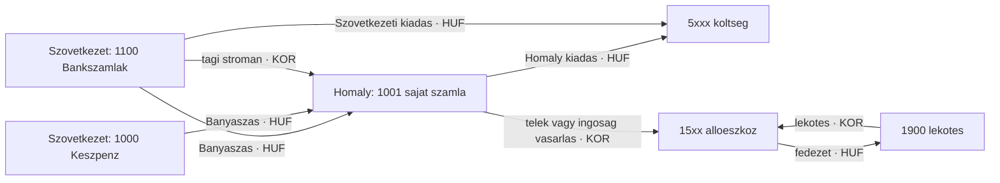

## Honnan jön a pénz

Kívülről érkező pénz mindig egy 1-es osztályú eszközszámlára érkezik, tartozik oldalra. Ez többnyire a `1100` Bankszámlák vagy a `1000` Készpénz. A követel oldal mondja meg, miért jött:

| Követel             | Mit jelent                                                    |
| ------------------- | ------------------------------------------------------------- |
| `4000`–`4300`       | bevétel: értékesítés, szolgáltatás, támogatás, kamat          |
| `3000` Részjegytőke | részjegy, tőke                                                |
| `1101` tagi számla  | a tag rendezi, amivel tartozott, például az előírt részjegyet |
| `1200` Követelések  | korábban megítélt követelés kiegyenlítése                     |

A külső bank, a tag saját bankja a könyvekben nem szerepel.

## Költségek és eszközök számlái

Melyik tétel melyik számlára kerül tartozik oldalra. A követel oldal a fizetés módja: `1100`, `1000`, tagi megelőlegezésnél a tag `1101`-e, Homályban a tag `1001`-je.

| Tétel                                       | Tartozik                                               | Megjegyzés                                                                    |
| ------------------------------------------- | ------------------------------------------------------ | ----------------------------------------------------------------------------- |
| Üzemanyag, utazás                           | `5410` Utazás és üzemanyag                             |                                                                               |
| Lakóépület                                  | `1530` Lakóépületek                                    | eszköz                                                                        |
| Belterületi földterület, lakótelek          | `1520` Belterületi földterületek                       | eszköz                                                                        |
| Mezőgazdasági földterület                   | `1510` Mezőgazdasági földterületek                     | eszköz                                                                        |
| Képzési díj                                 | `5420` Oktatás és képzés                               |                                                                               |
| Mezőgazdasági emberi szolgáltatás, kaszálás | `5430` Mezőgazdasági szolgáltatások                    |                                                                               |
| Könyvelési díj                              | `5440` Könyvelési és szakértői díjak                   |                                                                               |
| Banki díjak                                 | `5700` Pénzügyi költségek                              | `5700` ← `1100`                                                               |
| Gépbérlés                                   | `5450` Bérleti díjak                                   |                                                                               |
| Javítási díj                                | `5460` Javítás és karbantartás                         | ha az ingatlanba beépül és értéket növel: az eszközszámla, `1530` vagy `1500` |
| Munkaebéd                                   | `5510` Reprezentáció                                   |                                                                               |
| Hatósági díj                                | `5800` Egyéb költségek                                 |                                                                               |

## Számlatükör-rések

A táblázatok a hiányzó tételeket a javasolt kóddal írják. Ezek a seedben még nincsenek, vagy javítani kell őket.

- `1900` Átvezetés devizanemek között. Ezen a technikai számlán egyensúlyoz külön a forint sor és a korona sor. Még nincs a seedben.
- `EGG` csak az edizone seedben van. A tojásos ügylet ezt a pénznemet használja, mértékegység: egg, kategória: RESOURCES.
- `FRUIT` nincs a kor seedben. Javasolt mértékegység: kg, kategória: RESOURCES.
- `4500` Saját termelésű készletek állományváltozása. A tojás és a gyümölcs keletkezése ide kerül követelként. Korábban ez `4400` volt, de a `4400` a seedben most Előfizetések és tagsági díjak, ezért új, szabad kódot kapott. Az értékesítés bevétele a `4000` marad, és csak az eladáskor.
- A `4400` Előfizetések és tagsági díjak a seedben `equity` típusú. Bevételi számla, javasolt típus: `revenue`.
- A `1530` Lakóépületek leírása a seedben „1520 Lakóépületek számla”. A kód `1530`, a leírásból a `1520` elírás.
- Az `1400` Előlegek a seedben a Terjesztési Igazgatóságon ül. Ingatlan-előlegnél a sor szervezete az ingatlan projektje, `I/4.11.1.1 Lakóterületek` vagy `I/4.11.1.2 Termőterületek`.
- A `1101` és `1001` nincs az `accounts.json`-ban: tagonként automatikusan jön létre.
- Az árfolyamot a `currency-rate` adja, a sor nem őrzi meg.

A korábbi rések közül a `KOR` pénznem már a [kor currency-types](../database/seeders/http/kor/data/currency-types.json) fájlban van, a kétszeres `4300` kód pedig megszűnt.

A kincstár a mintákban az `I/3. Pénzügyi Igazgatóság`: a `1000` és a `1100` a seedben ehhez a szervezethez tartozik.

## Korona és lekötés

A korona **nem** köztes lépés minden kiadásnál és bevételnél. Csak **lekötéskor** jelenik meg: amikor forintot a tag vagy a szövetkezet egy adott **projekthez kötött állóeszközhöz** (ingatlan, ingóság / tárgyi eszköz) köt, a KOR az eszközszámlán (`15xx` / `1500`) marad. A lekötés forint összege és korona összege a bizonylat napján érvényes `currency-rate` alapján együtt értelmezhető; a korona a lekötött eszköz „könyvelt értékének” belső mértékegysége.

### Hol lehet koronaegyenleg

Korona **csak** állóeszköz-számlán maradhat — ingatlan vagy ingóság, nem forgóeszköz (készlet, pénzeszköz, követelés). A sor `organization` mezője az eszköz projektje.

| Mit köt le                                                        | Eszközszámla (HUF + KOR)           | Szervezet (példa a seedben)                                                                                           |
| ----------------------------------------------------------------- | ---------------------------------- | --------------------------------------------------------------------------------------------------------------------- |
| mezőgazdasági föld, termőterület                                  | `1510` Mezőgazdasági földterületek | `I/4.11.1.2 Termőterületek`, vagy a konkrét termő projekt csomópontja                                                 |
| lakótelek, belterületi föld                                       | `1520` Belterületi földterületek   | `I/4.11.1.1 Lakóterületek`                                                                                            |
| lakóépület                                                        | `1530` Lakóépületek                | lakó projekt / lakóterület csomópont                                                                                  |
| projekt ingóság, beruházás (ól, gép, juhnyáj infrastruktúra stb.) | `1500` Tárgyi eszközök             | a projekt csomópontja, pl. `I/4.12.1.1.1 Szávai Márton gyümölcsfaliget`, `I/4.12.1.2.1 Roger Milla Kameruni juh nyáj` |
| tagi részjegyhez tartozó lakó rész                                | `1520` vagy `1530`                 | ugyanannak a lakóingatlannak a projekt szervezete                                                                     |

A készlet (`1300`), a költség- és bevételszámlák, valamint a kincstár pénzeszközei **nem** tartanak tartós KOR egyenleget.

### Lekötés blokk

A lekötés **nem** fizeti ki vele az eladót vagy a szállítót. A külső fizetés külön, tiszta forint sor. A blokk két sor: HUF fedezet az átvezetőre, majd ugyanannyi érték KOR-ban vissza az eszközre. A forint fedezet forrása az eszköz HUF értéke (`1510`, `1520`, `1530`, `1500`).

| Lépés                  | Tartozik ← | Követel              | Pénznem | Szervezet            |
| ---------------------- | ---------- | -------------------- | ------- | -------------------- |
| 1. Forint fedezet      | `1900`     | `15xx` / `1500` HUF  | HUF     | eszköz szervezete    |
| 2. Korona az eszközre  | `15xx` / `1500` | `1900`          | KOR     | eszköz szervezete    |

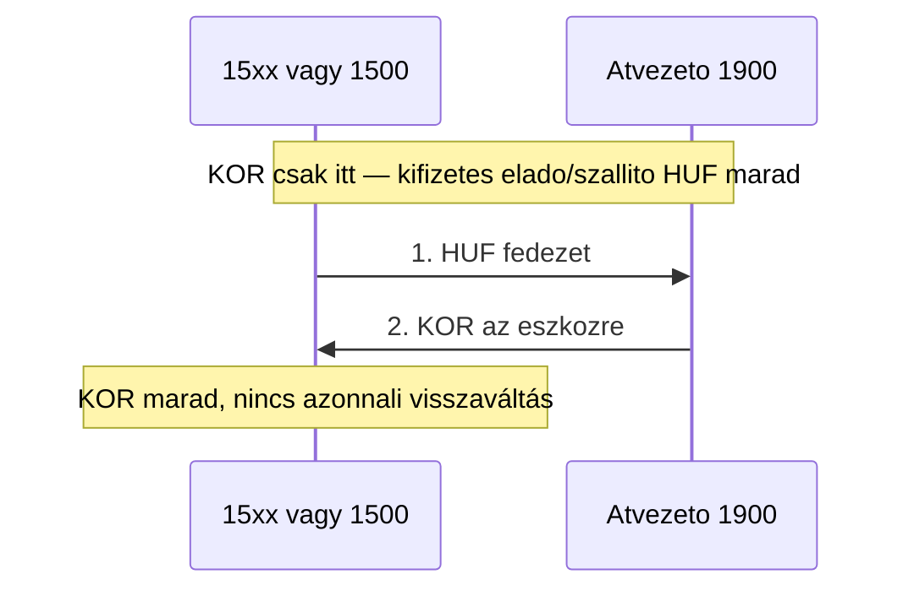

Az [1.](#ügylet-1--tagi-befizetés-ingatlan-vásárlásra), [2.](#ügylet-2--készpénzes-belterületi-ingatlan-vásárlás), [5.](#ügylet-5--ingatlan-szerzése) (szövetkezeti bankos vétel), [6.](#ügylet-6--felújítás) (értéknövelő eszköz) ügylet ezt a két lépést használja. **Tagi** úton ([1.](#ügylet-1--tagi-befizetés-ingatlan-vásárlásra)) a fedezet forrása az eszköz HUF értéke (pl. `1520` → `1900`), a vétel Homályban KOR (`1001` → `15xx`). **Szövetkezeti** úton a külső kifizetés HUF (`1520` ← `1100` vagy `1000`), a lekötés fedezete az eszköz HUF egyenlege.

### Szabad forint és közös költség

A befizetett, még **nem** lekötött forint a kincstárban és a tagi `1101` / `3000` Részjegytőke kapcsolaton keresztül követhető. Ebből a poolból mehet:

- közös költség (pl. [8. ügylet](#ügylet-8--adminisztráció)),
- projektköltség forintban (Homály kiadás a [9. ügylet](#ügylet-9--bányászás) után),
- külső számla kifizetése forintban.

Ezek **nem** hívnak le korona blokkot. A pool csökken; amikor később valaki leköt, az arányosan kevesebb szabad forintból számolódik a része.

### Forint bevétel (korona nélkül)

Bevétel és támogatás a pénzeszközre érkezik, a végleges sor közvetlen forint. A mennyiség (tojás, gyümölcs) változatlan.

| Lépés           | Tartozik ← | Követel                | Pénznem | Szervezet             |
| --------------- | ---------- | ---------------------- | ------- | --------------------- |
| 1. Beérkezés    | pénzeszköz | `1900`                 | HUF     | kincstár vagy projekt |
| 2. Végleges sor | `1900`     | bevétel vagy követelés | HUF     | projekt               |

A [3.](#ügylet-3--tojás-keletkezése-és-eladása), [4.](#ügylet-4--gyümölcs-szürete-és-piaci-eladása) és [7.](#ügylet-7--területalapú-agrár-támogatás) ügylet ezt a két lépést használja (a megítélés sor külön, pénzmozgás nélkül). Opcionálisan a bevétel egy része később külön ügylettel leköthető a projekt állóeszközére; addig forint marad.

## Minta ügyletek

| #   | Ügylet                                                                                          | Rövid leírás                                  |
| --- | ----------------------------------------------------------------------------------------------- | --------------------------------------------- |
| 1   | [Tagi befizetés ingatlan vásárlásra](#ügylet-1--tagi-befizetés-ingatlan-vásárlásra)             | részjegy `1100`-on, vétel Homály KOR, lekötés |
| 2   | [Készpénzes belterületi ingatlan vásárlás](#ügylet-2--készpénzes-belterületi-ingatlan-vásárlás) | `1000` → `1520`, szövetkezeti kp              |
| 3   | [Tojás](#ügylet-3--tojás-keletkezése-és-eladása)                                                | készlet + eladás HUF                          |
| 4   | [Gyümölcs](#ügylet-4--gyümölcs-szürete-és-piaci-eladása)                                        | szüret, piac HUF                              |
| 5   | [Ingatlan szerzése](#ügylet-5--ingatlan-szerzése)                                               | foglaló + bankos vétel, szövetkezet           |
| 6   | [Felújítás](#ügylet-6--felújítás)                                                               | értéknövelés + lekötés                        |
| 7   | [Agrár támogatás](#ügylet-7--területalapú-agrár-támogatás)                                      | megítélés + jóváírás HUF                      |
| 8   | [Adminisztráció](#ügylet-8--adminisztráció)                                                     | közös költség HUF                             |
| 9   | [Bányászás](#ügylet-9--bányászás)                                                               | `1100`/`1000` → tag `1001` HUF                |

A kincstár pénzeszközei: **`1000` Készpénz**, **`1100` Bankszámlák** (seed szerint).

## Ügylet 1 — tagi befizetés ingatlan vásárlásra

**Egysoros (v1 űrlap / match forrás):** a backoffice ma egy kézi sort ment. A `transaction-workflow` fejléc ezen a T←K páron matchel; a bontás a sablon `step` listája + konverziós API (lásd [alább](#ügylet-konfigurálása-strapi-ban) és a [0002 plan](./plans/0002-transaction-workflow-content-type.md)).

| Tartozik ←                       | Követel                           | Összeg (minta) | Pénznem | Szervezet                |
| -------------------------------- | --------------------------------- | -------------- | ------- | ------------------------ |
| `1520` Belterületi földterületek | `1101` kovács.erika - tagi számla | 2 000 000      | HUF     | I/4.11.1.1 Lakóterületek |

Mezőgazdasági földnél a tartozik `1510` Mezőgazdasági földterületek, szervezet `I/4.11.1.2 Termőterületek`. Az összeg a befizetett részjegy (vételár); a bontás (előírás, bank, Homály KOR, lekötés) a sablon lépései.

Egy tag részjegyet fizet be a saját bankjából. A részjegy a `1101` tagi számlán megy át: előírás, majd befizetés a **`1100` Bankszámlák**-ra. A területvásárlás jellemzően **bankon keresztül** történik: stróman **KOR** a `1100`-ról a tag `1001` Homály számlájára **a vételár összegében**, onnan KOR vétel az ingatlan `15xx` számlára. A **korona lekötés** utána, az eszköz HUF értékéből ([lekötés blokk](#lekötés-blokk)). Ha a `1001`-en a vételár felett KOR vagy HUF maradna (hibás stróman), a felesleg **bányászás** (`1100` → `1001` HUF), nem további ingatlan-KOR.

Minta: `kovács.erika` 2 000 000 Ft részjegy / telek vételár (20 000 korona lekötés). Számla: `1520` Belterületi földterületek. Szervezet: `I/4.11.1.1 Lakóterületek`. (Mezőgazdasági földnél `1510`, szervezet `I/4.11.1.2 Termőterületek`.)

| #   | Lépés              | Tartozik ←                         | Követel                            | Összeg             | Pénznem | Szervezet                 | Típus     |
| --- | ------------------ | ---------------------------------- | ---------------------------------- | ------------------ | ------- | ------------------------- | --------- |
| 1   | Részjegy előírása  | `1101` kovács.erika - tagi számla  | `3000` Részjegytőke                | 2 000 000          | HUF     | I/3. Pénzügyi Igazgatóság | Átvezetés |
| 2   | Bejövő tagi utalás | `1100` Bankszámlák                 | `1101` kovács.erika - tagi számla  | 2 000 000          | HUF     | I/3. Pénzügyi Igazgatóság | Utalás    |
| 3   | Stróman (vételár)  | `1001` kovács.erika - saját számla | `1100` Bankszámlák                 | 2 000 000          | KOR     | I/3. Pénzügyi Igazgatóság | Átvezetés |
| 4   | Telek vételár      | `1520` Belterületi földterületek   | `1001` kovács.erika - saját számla | 2 000 000          | KOR     | I/4.11.1.1 Lakóterületek  | Átvezetés |
| 5   | Lekötés, vételár   | [lekötés blokk](#lekötés-blokk)    | fedezet `1520` HUF érték           | 2 000 000 / 20 000 | HUF+KOR | I/4.11.1.1 Lakóterületek  | Átvezetés |

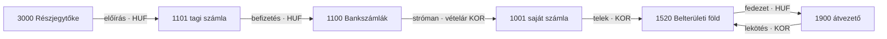

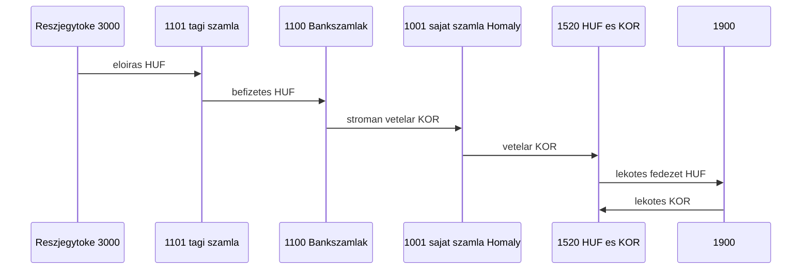

Zárás: `3000` követel 2 000 000 Ft, `1101` és `1100` nulla, `1520` tartozik 2 000 000 Ft HUF + 20 000 KOR lekötve.

Seedből hiányzik: `1900`.

## Ügylet 2 — készpénzes belterületi ingatlan vásárlás

A szövetkezet **készpénzből** (`1000` Készpénz) vásárol belterületi ingatlant — tagi részjegy és Homály **nélkül**. A vételár HUF készpénz; utána [lekötés blokk](#lekötés-blokk) a `1520`-ra.

**Egysoros match forrás (v1):** `1520` ← `1000`, összeg a vételár (minta 800 000 HUF). A teljes bontás (lekötés) a sablon `step` listája.

Minta: belterületi telek 800 000 Ft. Számla: `1520`. Szervezet: `I/4.11.1.1 Lakóterületek`. Lekötés: 8 000 KOR (1 korona = 100 Ft).

| #   | Lépés              | Tartozik ←                       | Követel         | Összeg          | Pénznem | Szervezet                | Típus     |
| --- | ------------------ | -------------------------------- | --------------- | --------------- | ------- | ------------------------ | --------- |
| 1   | Telek vételár      | `1520` Belterületi földterületek | `1000` Készpénz | 800 000         | HUF     | I/4.11.1.1 Lakóterületek | Készpénz  |
| 2   | Lekötés, vételár   | [lekötés blokk](#lekötés-blokk)  | fedezet `1520`  | 800 000 / 8 000 | HUF+KOR | I/4.11.1.1 Lakóterületek | Átvezetés |

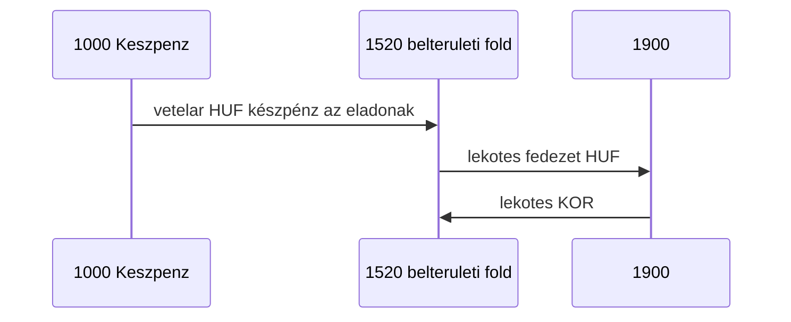

Zárás: `1520` tartozik 800 000 Ft HUF + 8 000 KOR, `1000` csökken 800 000 Ft-tal.

Seedből hiányzik: `1900`.

## Ügylet 3 — tojás keletkezése és eladása

Tojás jelenik meg egy ólban, készletre kerül, majd eladáskor a darab kimegy a készletből, a forint pedig közvetlenül értékesítési bevétel lesz (korona nélkül).

**Egysoros match forrás (v1):** a keletkezés sora `1300` ← `4500` (EGG). A teljes eladási folyamat (forint bevétel + készletcsökkenés) a sablon `step` listája; a Napi tojás űrlap csak a keletkezést írja (lásd alább).

A szervezet az `I/4.12.1.2 Állattenyésztés` gyereke. A seedben ilyen ól még nincs; a juhnyáj mutatja a fa mintáját. A minta szervezete: Tojóól.

Minta: 30 tojás keletkezik, mind a 30 elkelt 6 000 Ft-ért.

| Lépés            | Tartozik ←                    | Követel          | Összeg | Pénznem | Szervezet | Típus     |
| ---------------- | ----------------------------- | ---------------- | ------ | ------- | --------- | --------- |
| Keletkezés       | `1300` Készletek              | `4500`           | 30     | EGG     | Tojóól    | Átvezetés |
| Beérkezés        | `1000` Készpénz               | `1900`           | 6 000  | HUF     | Tojóól    | Készpénz  |
| Értékesítés      | `1900`                        | `4000`           | 6 000  | HUF     | Tojóól    | Átvezetés |
| Készletcsökkenés | `5600` Értékesítési költségek | `1300` Készletek | 30     | EGG     | Tojóól    | Átvezetés |

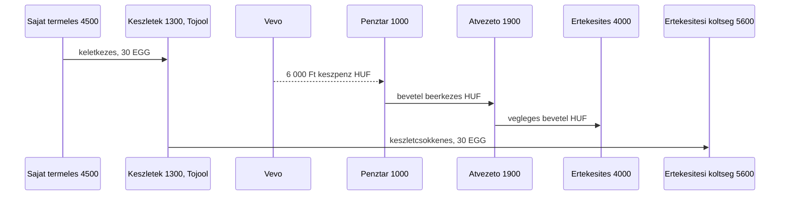

A bevétel a [forint bevétel](#forint-bevétel-korona-nélkül) két lépése. A `4000` követel, szervezet a Tojóól.

A darabszámla és a forint bevétel külön pénznem. A tojásnak ebben a modellben nincs forint önköltsége. Eladás után az ól `1300` tojás-egyenlege nulla.

Seedből hiányzik: `EGG`, `4500`, `1900`, és a Tojóól szervezeti csomópont.

### Napi tojás rögzítés (edizone backoffice)

Az edizone példányon a content-backoffice **Napi tojás rögzítés** űrlapja (`egg-daily-entry` workflow) egyszerre több tyúkólt tölthet ki. A tyúkólok az `Tyúktartás` gyermek szervezetei (alom szerint). Mezők: egy közös dátum (alapértelmezés: ma) és ólanként egy egész darabszám (0 vagy üres sor nem kerül mentésre).

Mentésenként egy tranzakció jön létre nem nulla soronként, piszkozatként, ugyanazzal a szerepkör- és véglegesítési logikával, mint az **Új tranzakció** űrlap. Könyvelés soronként:

| Tartozik ←       | Követel                                            | Összeg | Pénznem | Szervezet       | Típus       |
| ---------------- | -------------------------------------------------- | ------ | ------- | --------------- | ----------- |
| `1300` Készletek | `4500` Saját termelésű készletek állományváltozása | darab  | EGG     | az adott tyúkól | `Átvezetés` |

Bizonylat nincs. Ha ugyanarra a napra, ólra, EGG pénznemre és `1300`/`4500` párosra már van sor, a mentés előtt párbeszéd kínál **új sor** vagy **meglévő összeg frissítése** választást. A workflow kapcsoló a **Settings** collection `egg-daily-entry` sorában van (edizone seed: enabled; kor: disabled). Részletek: [apps/content-backoffice/src/workflows/bulk-quantity/README.md](../apps/content-backoffice/src/workflows/bulk-quantity/README.md).

### Napi tojás továbbosztás (edizone backoffice, 2. lépés)

A **Napi tojás rögzítés** űrlap két lépésből áll: (1) termelés az ólankénti mezőkkel (fent), (2) **továbbosztás** a `Tyúktartás` szervezet tagjai között. A tagokat a **`membership`** kapcsolja a szervezethez: `membership.member` → tag, `membership.organization` → szervezet, `membership.membership_type` → tagságtípus. A tojás szabály a tagságon (`membership.rules`, opcionális felülírás) vagy a tagságtípus alapértelmezésén (`membership_type.rules`) van: `{ "egg": { "mode": "internal" | "sale", "ratio": number } }`.

A 2. lépés mutatja a napi termelt darabszámot, az élő **még kiosztatlan** számlálót, és tagonként egy egész mezőt. Ha a kiosztott összeg meghaladja a mai termelést, figyelmeztetés jelenik meg (pl. előző napi raktár miatt); a mentés ettől még engedélyezett. **Csak termelés mentése** kihagyja a továbbosztást; a 2. lépés végén a termelés és a továbbosztás együtt mentődik. A nem nulla sorok tranzakciói piszkozatként jönnek létre, ugyanazzal a szerepkör-logikával, mint az **Új tranzakció** űrlap.

| Szabály               | Tartozik ←                  | Követel                 | Összeg                | Pénznem                             | Szervezet    | Típus       |
| --------------------- | --------------------------- | ----------------------- | --------------------- | ----------------------------------- | ------------ | ----------- |
| `internal`            | tag `1001` saját számla     | `1300` Készletek        | db                    | EGG                                 | `Tyúktartás` | `Átvezetés` |
| `sale` — tojás        | tag `1001` saját számla     | `1300` Készletek        | db                    | EGG                                 | ugyanaz      | `Átvezetés` |
| `sale` — kp befizetés | `1000` Készpénz             | tag `1001` saját számla | db × ratio × árfolyam | `VITE_EGG_SALE_CURRENCY` (alap HUF) | ugyanaz      | `Készpénz`  |
| `sale` — bevétel      | `4000` Értékesítés bevétele | `1000` Készpénz         | ugyanaz               | HUF                                 | ugyanaz      | `Átvezetés` |

Az árfolyam a **`currency-rate`** legfrissebb `EGG` → eladási pénznem sora a űrlap dátumáig (beleértve). Ha értékesítési tag van, de nincs ilyen árfolyam, az értékesítési sorok és a mentés tiltva van; a használt árfolyam megjelenik az űrlapon. A kiosztatlan tojás a `1300`-on marad (nincs tranzakció).

Duplikátum kulcs: dátum + szervezet + pénznem + tartozik/követel számlapár (termelés és továbbosztás ugyanígy). Ha bármelyik lépéshez talál meglévő sort, egy párbeszéd kínál **új sor** vagy **meglévő frissítése** választást; a választás **minden** érintett sorra vonatkozik (termelés + továbbosztás).

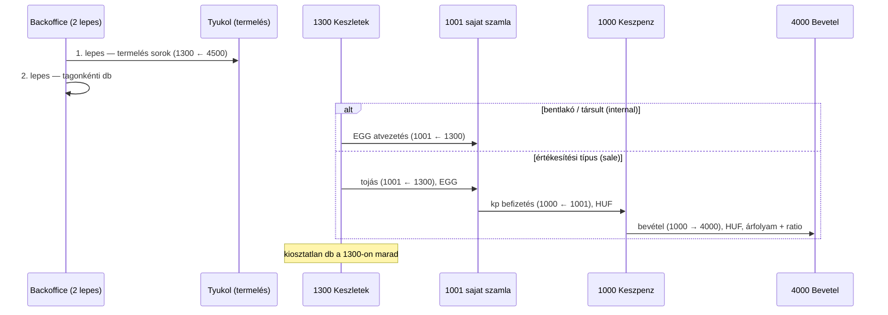

**Későbbi riport:** tervezett készletkimutatás (termelt vs. kiosztott vs. `1300` maradvány); a tranzakciós adatok erre lekérdezhetők (dátum, `1300`/`4500`/`1000`/`4000`, szervezet, EGG/HUF).

## Ügylet 4 — gyümölcs szürete és piaci eladása

A gyümölcsfaligetben leszüretelt mennyiség készletre kerül. A piacra vitt rész kimegy a készletből, a befolyt forint közvetlenül a `4000`-re kerül. A raktáron hagyott kiló a `1300`-on marad.

**Egysoros match forrás (v1):** a szüret sora `1300` ← `4500` (FRUIT). A piaci eladás és készletcsökkenés a sablon `step` listája.

Szervezet: `I/4.12.1.1.1 Szávai Márton gyümölcsfaliget`. Mértékegység: kg (`FRUIT`).

Minta: 80 kg szüret, ebből 50 kg eladás 25 000 Ft-ért. Raktáron marad 30 kg.

| Lépés            | Tartozik ←                    | Követel          | Összeg | Pénznem | Szervezet                     | Típus     |
| ---------------- | ----------------------------- | ---------------- | ------ | ------- | ----------------------------- | --------- |
| Szüret           | `1300` Készletek              | `4500`           | 80     | FRUIT   | Szávai Márton gyümölcsfaliget | Átvezetés |
| Beérkezés        | `1000` Készpénz               | `1900`           | 25 000 | HUF     | Szávai Márton gyümölcsfaliget | Készpénz  |
| Értékesítés      | `1900`                        | `4000`           | 25 000 | HUF     | Szávai Márton gyümölcsfaliget | Átvezetés |
| Készletcsökkenés | `5600` Értékesítési költségek | `1300` Készletek | 50     | FRUIT   | Szávai Márton gyümölcsfaliget | Átvezetés |

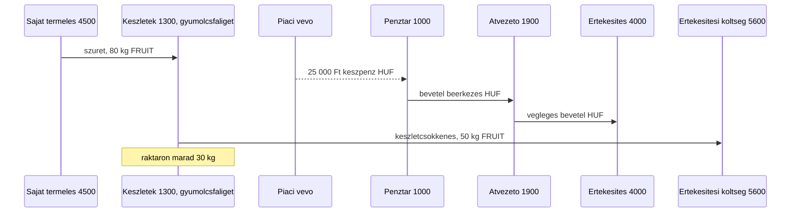

A `4000` követel, szervezet a gyümölcsfaliget. A `1300` egyenlege ennél a szervezetnél 30 kg. Forint önköltség nincs. A bevétel koronára történő lekötése külön, önkéntes lépés lenne a projekt állóeszközén.

Seedből hiányzik: `FRUIT`, `4500`, `1900`.

## Ügylet 5 — ingatlan szerzése

Telek vagy épület vásárlása foglalóval, majd a fennmaradó vételár bankból. A kifizetések **forintban** mennek (`1400`, `1530` ← `1100`). A vételár forint értékére **lekötés blokk** kerül az eszközre (KOR a `1530`-on marad). A foglaló beszámítása a vételárba pénzmozgás nélküli sor.

**Egysoros match forrás (v1):** tipikusan a foglaló `1400` ← `1100`, vagy a seed a teljes vételárhoz igazított fejlécet használ (`1530` ← `1100`, minta 10 000 000 HUF), ha a `percent` 0–100 korlát miatt a foglalóösszeg nem arányosítja a többi lépést — lásd [0002 seed 8.5](./plans/0002-transaction-workflow-content-type.md#85-ügylet-5--ingatlan-szerzése).

Az ingatlan számla a fajta szerint: `1510` Mezőgazdasági földterületek, `1520` Belterületi földterületek, `1530` Lakóépületek. A minta egy lakóház, `1530`. Szervezet: `I/4.11.1.1 Lakóterületek`. Pénzeszköz: `1100` Bankszámlák.

Minta: 2 000 000 Ft foglaló, 8 000 000 Ft fennmaradó rész. Összesen 10 000 000 Ft eszköz; lekötés 100 000 korona (1 korona = 100 Ft).

| Lépés              | Tartozik ←                                  | Követel                  | Összeg               | Pénznem   | Szervezet                | Típus     |
| ------------------ | ------------------------------------------- | ------------------------ | -------------------- | --------- | ------------------------ | --------- |
| Foglaló kifizetés  | `1400` Előlegek                             | `1100`                   | 2 000 000            | HUF       | I/4.11.1.1 Lakóterületek | Utalás    |
| Fennmaradó vételár | `1530` Lakóépületek                         | `1100`                   | 8 000 000            | HUF       | I/4.11.1.1 Lakóterületek | Utalás    |
| Beszámítás         | `1530` Lakóépületek                         | `1400` Előlegek          | 2 000 000            | HUF       | I/4.11.1.1 Lakóterületek | Átvezetés |
| Lekötés blokk      | a [lekötés blokk](#lekötés-blokk) két sora | fedezet `1530` HUF érték | 10 000 000 / 100 000 | HUF + KOR | I/4.11.1.1 Lakóterületek | Átvezetés |

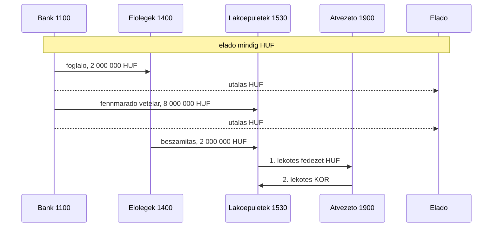

A `1530` egyenlege 10 000 000 Ft HUF + 100 000 KOR. Az `1400` nullázódik. Hitelből vett ingatlannál a fennmaradó rész követelje a `2200` Hosszú lejáratú kötelezettségek lenne. Ez az ügylet bankos vétel.

Seedből hiányzik: `1900`.

## Ügylet 6 — felújítás

Értéknövelő felújítás: a kivitelezés az épület értékébe kerül. A szállító **forintban** kap utalást. Az értéknövelés összege **lekötés blokk** az eszközre (KOR a `1500`-on / `1530`-on marad). Karbantartásnál csak forint költség sor, lekötés nélkül.

**Egysoros match forrás (v1):** az aktiválás sora `1500` ← `2000` (minta 1 500 000 HUF). Az utalás és a lekötés a sablon `step` listája.

Minta: 1 500 000 Ft (15 000 korona lekötés, 1 korona = 100 Ft). Szervezet: `I/4.12.1.2 Állattenyésztés`, egy ól felújítása. Pénzeszköz: `1100`. Lakóháznál a tartozik a `1530` Lakóépületek.

| Lépés         | Tartozik ←                           | Követel                     | Összeg             | Pénznem | Szervezet                  | Típus     |
| ------------- | ------------------------------------ | --------------------------- | ------------------ | ------- | -------------------------- | --------- |
| Aktiválás     | `1500` Tárgyi eszközök               | `2000` Szállítói tartozások | 1 500 000          | HUF     | I/4.12.1.2 Állattenyésztés | Átvezetés |
| Utalás        | `2000` Szállítói tartozások          | `1100` Bankszámlák          | 1 500 000          | HUF     | I/4.12.1.2 Állattenyésztés | Utalás    |
| Lekötés blokk | lásd [lekötés blokk](#lekötés-blokk) | fedezet `1500` HUF érték    | 1 500 000 / 15 000 | HUF+KOR | I/4.12.1.2 Állattenyésztés | Átvezetés |

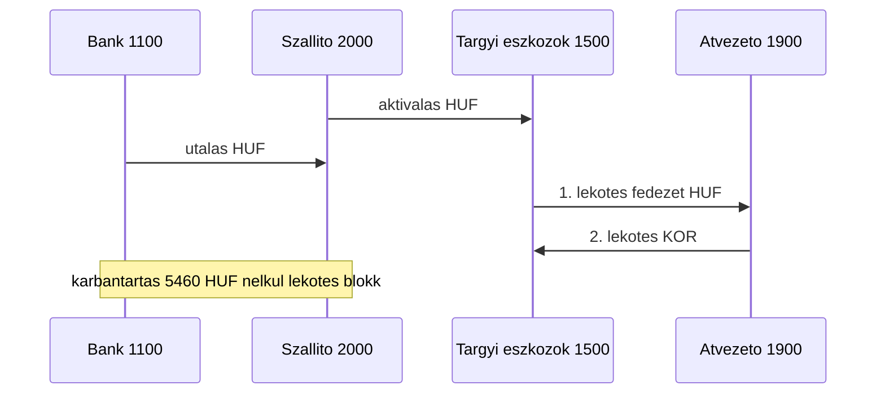

Zárás után a `1500` 1 500 000 Ft HUF + 15 000 KOR-ral nő, a `2000` nulla, a bank csökken. A `5300` Értékcsökkenés későbbi, időszakos sor.

Karbantartásnál: `5460` ← `1100` vagy tagi `1101`, lekötés nélkül. Ha a javítás beépül az ingatlanba és értéket növel, aktiválás HUF-ban és lekötés blokk az eszközre.

Seedből hiányzik: `1900`.

## Ügylet 7 — területalapú agrár támogatás

Működési, területalapú támogatás egy támogatott földterületre. A megítéléskor keletkezik az egyéb bevétel és a követelés. A kincstári jóváírás a bankra érkezik **forintban**, a [forint bevétel](#forint-bevétel-korona-nélkül) lépésein, és a követelést zárja. A `4200` a jóváíráskor nem ismétlődik. Értékesítés nincs, a `4000` kimarad. A támogatás összegének termőföld eszközre történő lekötése külön, önkéntes ügylet.

**Egysoros match forrás (v1):** a megítélés sora `1200` ← `4200` (minta 400 000 HUF). A kincstári jóváírás / követelés zárása a sablon `step` listája.

A seedben nincs külön támogatási bevétel számla, ezért a bevétel a `4200` Egyéb bevételek. Szervezet: `I/4.11.1.2 Termőterületek`, a támogatott földterület projektje. Pénzeszköz: `1100`.

Minta: 400 000 Ft.

| Lépés              | Tartozik ←         | Követel                | Összeg  | Pénznem | Szervezet                 | Típus     |
| ------------------ | ------------------ | ---------------------- | ------- | ------- | ------------------------- | --------- |
| Megítélés          | `1200` Követelések | `4200` Egyéb bevételek | 400 000 | HUF     | I/4.11.1.2 Termőterületek | Átvezetés |
| Kincstári jóváírás | `1100` Bankszámlák | `1900`                 | 400 000 | HUF     | I/3. Pénzügyi Igazgatóság | Utalás    |
| Követelés zárása   | `1900`             | `1200` Követelések     | 400 000 | HUF     | I/4.11.1.2 Termőterületek | Átvezetés |

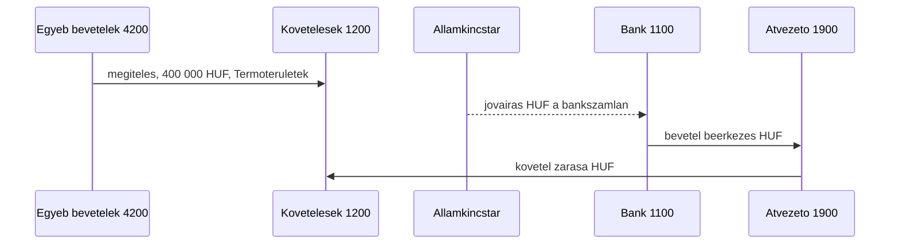

Zárás:

| Számla                 | Egyenleg            |
| ---------------------- | ------------------- |
| `1100` Bankszámlák     | 400 000 Ft tartozik |
| `1200` Követelések     | 0                   |
| `4200` Egyéb bevételek | 400 000 Ft követel  |

A bank 400 000 Ft-tal nő, a `4200` követel egyenlege 400 000 Ft, a `1200` nulla. Korona csak külön lekötés ügylettel kerülhet a `1510`-re.

Ha a támogatás előzetes megítélés nélkül érkezik, a megítélés sora elmarad, és a záró sor követelje közvetlenül a `4200`: `1900` ← `4200`. A bank és a `4200` egyenlege ugyanaz.

A beruházási támogatás nem bevétel, hanem az eszközhöz kötött halasztott tétel, és nem ennek az ügyletnek a része.

Seedből hiányzik: `1900`.

## Ügylet 8 — adminisztráció

Külső könyvelői vagy ügyintézői számla. **Közös költség forintban**, korona és lekötés nélkül: szállítói számla, majd utalás a szabad poolból.

**Egysoros match forrás (v1):** a számla sora `5440` ← `2000` (minta 80 000 HUF). Az utalás a sablon `step` listája.

Szervezet: `I/3. Pénzügyi Igazgatóság`. Pénzeszköz: `1100`. A `5440` Könyvelési és szakértői díjak a seedben is ezen a szervezeten ül.

Minta: 80 000 Ft.

| Lépés  | Tartozik ←                           | Követel                     | Összeg | Pénznem | Szervezet                 | Típus     |
| ------ | ------------------------------------ | --------------------------- | ------ | ------- | ------------------------- | --------- |
| Számla | `5440` Könyvelési és szakértői díjak | `2000` Szállítói tartozások | 80 000 | HUF     | I/3. Pénzügyi Igazgatóság | Átvezetés |
| Utalás | `2000` Szállítói tartozások          | `1100` Bankszámlák          | 80 000 | HUF     | I/3. Pénzügyi Igazgatóság | Utalás    |

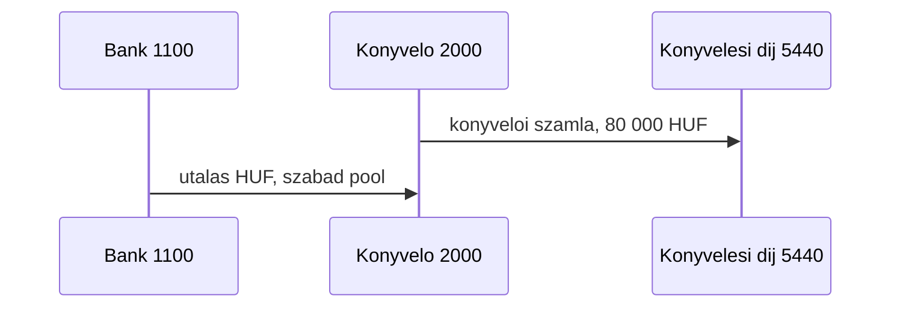

Hatósági díj ugyanígy könyvelődik, a számla tartozikja a `5800` Egyéb költségek. A banki díj nem kap szállítói számlát: a bank levonja, a sor `5700` ← `1100`. A kidolgozott ügylet a könyvelői számla.

Seedből hiányzik: `1900`.

## Ügylet 9 — bányászás

A bányászás a hivatalos Szövetkezet rendszerből, a `1100` bankról vagy a `1000` pénztárból készpénzt visz át a Homály rendszerbe, egy tag `1001` saját számlájára. Kiadásnak látszik, mert a pénz kimegy a szövetkezet számláiról, de nem költség: két főkönyv közötti átvezetés. A bányászás sorában nincs `5xxx` számla. A költség később, Homályban keletkezik, amikor a tag a `1001`-ről fizet.

**Egysoros match forrás (v1):** `1001` ← `1100` (vagy `1000`), típus `Bányászás`. A lenti Homály kiadások **külön** egysoros tranzakciók, nem ennek a sablonnak a része.

A tranzakciótípus `Bányászás`. A sor Homály, mert az egyik oldala `1001`. Mivel két pénzeszköz között mozog, nem érinti a lekötést, ugyanúgy, mint a készpénzfelvétel.

Minta: 50 000 Ft a bankról `kovács.erika` saját számlájára. Utána Homályban 12 000 Ft munkaebéd és 8 000 Ft üzemanyag a gyümölcsfaligetnél.

| Lépés                    | Tartozik ←                         | Követel                            | Összeg | Pénznem | Szervezet                     | Típus     |
| ------------------------ | ---------------------------------- | ---------------------------------- | ------ | ------- | ----------------------------- | --------- |
| Bányászás                | `1001` kovács.erika - saját számla | `1100` Bankszámlák                 | 50 000 | HUF     | I/3. Pénzügyi Igazgatóság     | Bányászás |
| Homály kiadás: munkaebéd | `5510` Reprezentáció               | `1001` kovács.erika - saját számla | 12 000 | HUF     | Szávai Márton gyümölcsfaliget | Készpénz  |
| Homály kiadás: üzemanyag | `5410` Utazás és üzemanyag         | `1001` kovács.erika - saját számla | 8 000  | HUF     | Szávai Márton gyümölcsfaliget | Készpénz  |

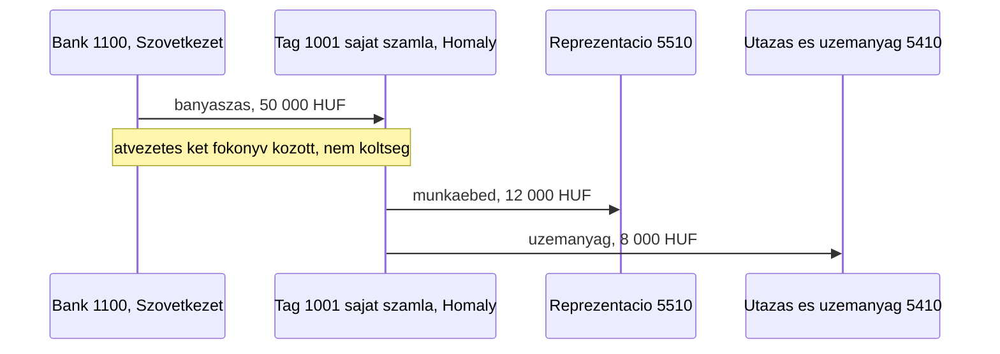

Zárás után a bank 50 000 Ft-tal kevesebb, a tag `1001`-jén 30 000 Ft marad, ez a nála lévő Homály készpénz. A költség 20 000 Ft, a bányászott 50 000 Ft-ból csak ennyi. Ha a tag a maradékot visszaadja a pénztárba, a sor `1000` ← `1001`, típus Átvezetés.

A Homály kiadás és a bányászás koronát és lekötést nem érint.

Seedből hiányzik: semmi. A `1001` tagonként automatikusan jön létre, a `Bányászás` típus a [transaction-types](../database/seeders/http/kor/data/transaction-types.json) fájlban van.

## Ügylet konfigurálása Strapi-ban

A sablon collection: [`transaction-workflow`](../src/api/transaction-workflow/content-types/transaction-workflow/schema.json). A lépések dynamic zone: [`workflow.step`](../src/components/workflow/step.json) (Related accounts), [`workflow.step-member-debit`](../src/components/workflow/step-member-debit.json), [`workflow.step-member-credit`](../src/components/workflow/step-member-credit.json). A v1 kézi tranzakció űrlap ettől nem változik. Seed és Convert API: [0002 plan](./plans/0002-transaction-workflow-content-type.md). Backoffice Convert gombok (editor, match után): [0003 plan](./plans/0003-transaction-workflow-backoffice.md).

A `transaction-type` címke marad (Készpénz, Utalás, Átvezetés, Barter, Jutalék, Elrendelt, Bányászás). A Strapi Adminban és a backoffice-ban a megjelenő név Ügylet.

### Ki mit csinál

A könyvelő a Strapi Adminban összeállítja a sablont (fejléc match + `step` lista). A rögzítő továbbra is egysoros v1 tranzakciót ment. Egy Convert API hívás a még nem átalakított sorokat a sablon szerint kibontja. A generált sorok státuszát a sablon `steps_published` mezője adja (default published); a Convert híváskor felülírható.

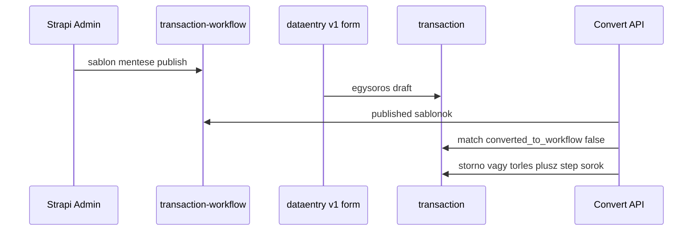

### Mit tárol egy sablon

| Mező                                         | Szerep                                                                                                                                                                                        |
| -------------------------------------------- | --------------------------------------------------------------------------------------------------------------------------------------------------------------------------------------------- |
| `name`                                       | Admin címke (pl. ügylet neve)                                                                                                                                                                 |
| `debit_account_code` / `credit_account_code` | Kötelező match: a forrás `transaction` számláinak `code` értéke (integer 1000–9999 ↔ string kód). Általános: minden tag `1101`/`1001` példánya matchelhető, nincs fix tag-reláció a matchben. |
| `currency_type` / `transaction_type`         | Opcionális; ha ki van töltve, a match ezekre is szűr                                                                                                                                          |
| `keep_original`                              | Default `true` — storno + megtartás; `false` — eredeti törlése                                                                                                                                |
| `steps_published`                            | Default `true` — generált step (és storno) sorok published; `false` → draft. Convert API/UI felülírhatja.                                                                                     |
| `configuration`                              | JSON, **fenntartott**, nincs implementáció                                                                                                                                                    |
| `step`                                       | Dynamic zone: Related / Member as Debit / Member as Credit; sorrend = kifejtés; séma `min: 1`                                                                 |

Nincs `workflow_key`, `inputs`, `active`, `sort_order`. A `draftAndPublish` a sablonon **be** van kapcsolva: a Convert csak **published** sablonokat használ.

Step komponensek:

| Komponens | Számlák |
| --------- | ------- |
| `workflow.step` (Related accounts) | `debit_account` + `credit_account` reláció |
| `workflow.step-member-debit` | `member_account_code` (`1101`/`1001`) + `credit_account` |
| `workflow.step-member-credit` | `member_account_code` (`1101`/`1001`) + `debit_account` |

Közös: `description` (default `{1}`), `percent` (0–100), `currency_type`, `organization`, opcionális `transaction_type`, `copy_receipt`. Tagi oldalon a Convert a **forrás trx** / member testvér példányát használja.

A [lekötés blokk](#lekötés-blokk) és a [forint bevétel](#forint-bevétel-korona-nélkül) üzleti norma marad: mindkét könyvelési sor külön step a dynamic zone-ban (nincs implicit `1900` kibontás).

### Konverzió

Csak `converted_to_workflow = false` tranzakciók. Match: `debit_account.code` és `credit_account.code` egyezik a fejléc kódokkal; ha a sablonon van `currency_type` és/vagy `transaction_type`, azokra is. A match **kód alapú**, ezért ugyanaz a sablon minden tag `1101`/`1001` sorára alkalmazható.

**`keep_original: true`:** az eredeti megmarad; beszúrás egy storno sor (`amount * -1`, ugyanazok a mezők) + a `step` szerinti új sorok. A storno és az új sorok `related_transaction` → eredeti. `converted_to_workflow: true` az **eredetin és a storno soron**.

**`keep_original: false`:** az eredeti törlődik; csak az új step-sorok; egymás között `related_transaction` lánc.

A generált sorok `entered_key` mezője idempotenciához (pl. `{originalDocumentId}:storno` / `{originalDocumentId}:step:{i}`). A Convert Strapi route/controller a `transaction-workflow` API alatt.

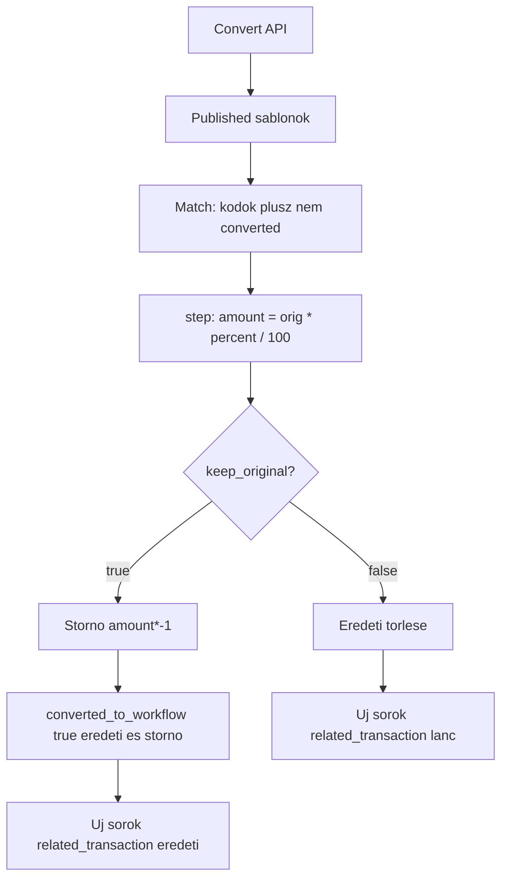
