# Ügyletek

**Dátum:** 2026-10-24  
**Számlatükör:** [database/seeders/http/kor/data/accounts.json](../database/seeders/http/kor/data/accounts.json)  
**Sor séma:** [src/api/transaction/content-types/transaction/schema.json](../src/api/transaction/content-types/transaction/schema.json)  
**Tagi számlák:** [src/member-accounts.ts](../src/member-accounts.ts)  
**Kapcsolódó:** [docs/readme.md](./readme.md), [v1 PRD](./prd/0001-content-backoffice-v1.md)

Ez a fájl a kétlábas könyvelés ügyleteit írja le a meglévő számlatükörre. Kód, séma, seed és a mostani backoffice-feliratok nem változnak tőle. A v1 űrlap továbbra is egy kézi tartozik/követel sor.

## Szókincs

Az **ügylet** a teljes gazdasági esemény. Egy kitöltésből több sor születik, `related_transaction` láncon. A fejezetek neve ügylet. A későbbi egyszerűsített űrlap felirata magyarul Ügylet / Ügyletek, angolul Deal / Deals. A katalógusban és a felületen ez a két szó jelenik meg.

A **tranzakció** egy sor: egy tartozik, egy követel, egy összeg, egy pénznem. A mostani felület ezt mutatja: `Tranzakció` / `Tranzakciók` a [hu.ts](../apps/content-backoffice/src/i18n/hu.ts)-ben, `Transaction` / `Transactions` az [en.ts](../apps/content-backoffice/src/i18n/en.ts)-ben. Ezek a képernyők egy sort szerkesztenek, a feliratuk tranzakció marad.

A belső collection neve lehet `posting-workflow`. A felhasználó az Ügylet szót látja.

## Mit rögzít egy sor

Egy `transaction` sor mezői: `debit_account`, `credit_account`, `amount`, `currency_type`, `organization`, opcionálisan `transaction_type` és `related_transaction`.

A tartozik a „mire ment”. A követel a „honnan”. A táblák fejlécében a nyíl ezt a pénzmozgást jelöli: **Tartozik ← Követel**, az összeg a követel oldalról a tartozik oldalra érkezik. A sor `organization` mezője a projekt vagy a hely, ahová az esemény tartozik. Ez független attól, hogy a számla a seedben melyik szervezeten ül.

Több lépés azért lánc, mert egy sornak egy tartozikja, egy követelje, egy összege és egy pénzneme van. Két szervezet közötti mozgás két sor: mindkettő a `1900` átvezetőn keresztül, külön `organization` értékkel.

A korona pénznem (`currency-type`, kód `KOR`), önálló főkönyvi számla nélkül. A `1000` Készpénz forintban és koronában is vihet egyenleget, de **koronaegyenleg csak lekötött nyilvántartásokon** maradhat (lásd [Korona és lekötés](#korona-és-lekötés)). Az ól a szervezeti fa egy csomópontja, ugyanúgy, ahogy a seedben a `I/4.12.1.2.1 Roger Milla Kameruni juh nyáj`. Külön hely entitás a [readme](./readme.md) szerint későbbi tétel.

A szövetkezeti főkönyvben a **forint** mozog a kincstár pénzeszközein (`1100`, `1000`), a költség- és bevételszámlákon, valamint az eszközökön. A mennyiség (tojás, kiló) koronára váltás nélkül könyvelődik. A pénzmozgás nélküli sor (megítélt követelés, előírás, foglaló beszámítása) közvetlenül könyvelődik. A két pénzeszköz közötti átvezetés (készpénzfelvétel, bányászás) szintén közvetlen forint sor. **Korona kibocsátás és áthelyezés csak lekötéskor** történik: amikor befizetett vagy szabad forintot egy projekthez, birtokhoz vagy lakóingatlan-részhez kötünk, a kincstár a lekötött forintnak megfelelő koronát a cél nyilvántartásra helyezi — külső fizetés (eladó, NAV, szállító) és közös költség **nem** vált koronát.

A **szabadon felhasználható** forint a kincstárban és a tagi egyenlegekben van; ebből mehet közös és projektköltség forintban. Ez csökkenti a még le nem kötött poolt. Amikor a tag később leköt, az arányos része ennél a kisebb poolból számolódik. A lekötés összege a bizonylat napján érvényes `currency-rate` szerint koronában is könyvelhető a cél nyilvántartásra (a forint eszköz- vagy tőke tétele külön sorban marad).

A minták árfolyama stabil: 1 korona = 100 Ft. Eltérő visszaváltási árfolyamnál a különbözet a `5700` Pénzügyi költségek vagy a `4300` Pénzügyi bevételek.

## Tagi számlák

Minden tagnak két saját számlája van. Mindkettő automatikusan jön létre, amikor a tagot felveszik, a régi tagoknál pedig induláskor pótlódik. Kódjuk minden tagnál ugyanaz, a nevük a tag azonosítójából áll, például `kovács.erika`.

| Kód    | Név                          | Mit mutat                                                                                                                                |
| ------ | ---------------------------- | ---------------------------------------------------------------------------------------------------------------------------------------- |
| `1101` | `<azonosító> - tagi számla`  | Mivel tartozik a tag a szövetkezetnek, vagy a szövetkezet a tagnak. Ezen megy át a tagi befizetés és a tag által megelőlegezett költség. |
| `1001` | `<azonosító> - saját számla` | A Homály készpénz, ami fizikailag a tagnál van.                                                                                          |

A tagot a sor számlája azonosítja. Tagi befizetésnél, megelőlegezett költségnél és elszámolásnál a tag `1101`-es számlája áll a soron, ezért külön tag mező nem kell. A korábbi megoldás, hogy a tag neve csak a leírásban áll, és a befizetés közvetlenül a közös `3000`-re megy, ezzel megszűnik.

A tag által saját zsebből kifizetett szövetkezeti költség: tartozik a költség számla, követel a tag `1101`-e. A szövetkezet ezzel tartozik a tagnak. A visszafizetés: tartozik a `1101`, követel a `1100`.

## Két főkönyv: Szövetkezet és Homály

A könyvekben két főkönyv fut. A **Szövetkezet** a hivatalos rendszer: bank, pénztár, minden, ami a szövetkezet nevén van. A **Homály** a tagoknál lévő készpénz rendszere.

Egy sor akkor Homály, ha valamelyik oldala egy tag `1001` saját számlája. Minden más sor Szövetkezet. A Homályba a [Bányászás](#ügylet-8--bányászás) visz át pénzt, Homályban a tag a `1001`-ről fizet.

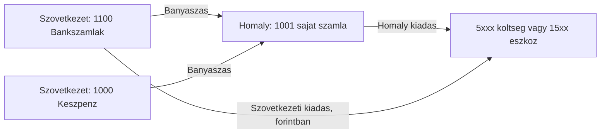

## Honnan jön a pénz

Kívülről érkező pénz mindig egy 1-es osztályú eszközszámlára érkezik, tartozik oldalra. Ez többnyire a `1100` Bankszámlák vagy a `1000` Készpénz. A követel oldal mondja meg, miért jött:

| Követel            | Mit jelent                                                    |
| ------------------ | ------------------------------------------------------------- |
| `4000`–`4300`      | bevétel: értékesítés, szolgáltatás, támogatás, kamat          |
| `3000` Alaptőke    | részjegy, tőke                                                |
| `1101` tagi számla | a tag rendezi, amivel tartozott, például az előírt részjegyet |
| `1200` Követelések | korábban megítélt követelés kiegyenlítése                     |

A külső bank, a tag saját bankja a könyvekben nem szerepel.

## Költségek és eszközök számlái

Melyik tétel melyik számlára kerül tartozik oldalra. A követel oldal a fizetés módja: `1100`, `1000`, tagi megelőlegezésnél a tag `1101`-e, Homályban a tag `1001`-je.

| Tétel                                       | Tartozik                                               | Megjegyzés                                                                    |
| ------------------------------------------- | ------------------------------------------------------ | ----------------------------------------------------------------------------- |
| Üzemanyag, utazás                           | `5410` Utazás és üzemanyag                             |                                                                               |
| Lakóépület                                  | `1530` Lakóépületek                                    | eszköz                                                                        |
| Belterületi földterület, lakótelek          | `1520` Belterületi földterületek                       | eszköz                                                                        |
| Mezőgazdasági földterület                   | `1510` Mezőgazdasági földterületek                     | eszköz                                                                        |
| Képzési díj                                 | `5420` Oktatás és képzés                               |                                                                               |
| Vagyonszerzési illeték                      | az ingatlan eszközszámlája: `1510`, `1520` vagy `1530` | aktiválva, az ingatlan értékébe                                               |
| Mezőgazdasági emberi szolgáltatás, kaszálás | `5430` Mezőgazdasági szolgáltatások                    |                                                                               |
| Könyvelési díj                              | `5440` Könyvelési és szakértői díjak                   |                                                                               |
| Banki díjak                                 | `5700` Pénzügyi költségek                              | `5700` ← `1100`                                                               |
| Gépbérlés                                   | `5450` Bérleti díjak                                   |                                                                               |
| Javítási díj                                | `5460` Javítás és karbantartás                         | ha az ingatlanba beépül és értéket növel: az eszközszámla, `1530` vagy `1500` |
| Munkaebéd                                   | `5510` Reprezentáció                                   |                                                                               |
| Hatósági díj                                | `5800` Egyéb költségek                                 |                                                                               |

## Számlatükör-rések

A táblázatok a hiányzó tételeket a javasolt kóddal írják. Ezek a seedben még nincsenek, vagy javítani kell őket.

- `1900` Átvezetés devizanemek között. Ezen a technikai számlán egyensúlyoz külön a forint sor és a korona sor. Még nincs a seedben.
- `EGG` csak az edizone seedben van. A tojásos ügylet ezt a pénznemet használja, mértékegység: egg, kategória: RESOURCES.
- `FRUIT` nincs a kor seedben. Javasolt mértékegység: kg, kategória: RESOURCES.
- `4500` Saját termelésű készletek állományváltozása. A tojás és a gyümölcs keletkezése ide kerül követelként. Korábban ez `4400` volt, de a `4400` a seedben most Előfizetések és tagsági díjak, ezért új, szabad kódot kapott. Az értékesítés bevétele a `4000` marad, és csak az eladáskor.
- A `4400` Előfizetések és tagsági díjak a seedben `equity` típusú. Bevételi számla, javasolt típus: `revenue`.
- A `1530` Lakóépületek leírása a seedben „1520 Lakóépületek számla”. A kód `1530`, a leírásból a `1520` elírás.
- Az `1400` Előlegek a seedben a Terjesztési Igazgatóságon ül. Ingatlan-előlegnél a sor szervezete az ingatlan projektje, `I/4.11.1.1 Lakóterületek` vagy `I/4.11.1.2 Termőterületek`.
- Külön illeték számla nincs és nem is kell: a vagyonszerzési illeték az ingatlan eszközszámlájára aktiválódik.
- A `1101` és `1001` nincs az `accounts.json`-ban: tagonként automatikusan jön létre.
- Az árfolyamot a `currency-rate` adja, a sor nem őrzi meg.

A korábbi rések közül a `KOR` pénznem már a [kor currency-types](../database/seeders/http/kor/data/currency-types.json) fájlban van, a kétszeres `4300` kód pedig megszűnt.

A kincstár a mintákban az `I/3. Pénzügyi Igazgatóság`: a `1000` és a `1100` a seedben ehhez a szervezethez tartozik.

## Korona és lekötés

A korona **nem** köztes lépés minden kiadásnál és bevételnél. Csak **lekötéskor** jelenik meg: amikor forintot a tag vagy a szövetkezet egy adott **birtokhoz**, **projekthez** vagy **lakóingatlan-részhez** köt, a kincstár (`I/3. Pénzügyi Igazgatóság`) kibocsátja a koronát, és az a cél nyilvántartáson marad. A lekötés forint összege és korona összege a bizonylat napján érvényes `currency-rate` alapján együtt értelmezhető; a korona a nyilvántartás „könyvelt értékének” belső mértékegysége.

### Hol lehet koronaegyenleg

Korona (`1000` KOR egyenleg) **csak** ezeken a szervezeti nyilvántartásokon maradhat:

| Nyilvántartás | Példa a seedben | Mit köt le |
| ------------- | --------------- | ---------- |
| Birtok nyilvántartás | `I/4.11.1.1 Lakóterületek`, `I/4.11.1.2 Termőterületek` | földterület, birtok érték |
| Projekt nyilvántartás | minden egyes projekt csomópont, pl. `I/4.12.1.1.1 Szávai Márton gyümölcsfaliget` | projektbe kötött tőke |
| Lakó ingatlan része | lakótelek / lakóépület projektje, eszköz `1520` vagy `1530` | tagi részjegyhez tartozó lakó rész |

Más szervezeten (kincstár, adminisztráció, ól mint termelő egység stb.) **nem** marad tartós koronaegyenleg: a kincstár csak kibocsát, a cél nyilvántartás tartja.

### Lekötés blokk

A lekötés **nem** fizeti ki vele az eladót vagy a szállítót. A külső fizetés külön, tiszta forint sor. A blokk csak azt rögzíti, hogy mennyi érték került koronában a cél nyilvántartásra. A forint fedezet forrása lehet a kincstár pénzeszköze (`1100`, `1000`), vagy — tagi befizetésnél — a már beérkezett forint, amit eszközre (`1510`, `1520`, `1530`) is könyvelünk HUF-ban.

Pénzeszköz a forint lábon: `1000` Készpénz vagy `1100` Bankszámlák. A korona a `1000`-en jelenik meg, szervezetenként külön sor, mert egy tranzakciónak egy `organization` értéke van.

| Lépés | Tartozik ← | Követel | Pénznem | Szervezet |
| ----- | ---------- | ------- | ------- | --------- |
| 1. Forint fedezet a lekötéshez | `1900` | pénzeszköz | HUF | kincstár |
| 2. Korona kibocsátás (kincstár) | `1000` | `1900` | KOR | kincstár |
| 3. Korona le a kincstárról | `1900` | `1000` | KOR | kincstár |
| 4. Korona a cél nyilvántartásra | `1000` | `1900` | KOR | birtok / projekt / lakó rész |

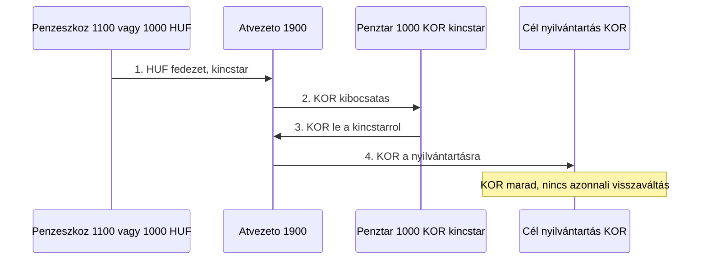

Az [4.](#ügylet-4--ingatlan-szerzése), [5.](#ügylet-5--felújítás) (értéknövelő eszköz esetén), [9.](#ügylet-9--tagi-befizetésből-lakótelek) ügylet és a tagi területi befizetés lekötése ezt a négy lépést használja. A blokk **mellé** jön a forint eszköz- vagy tőketétel (pl. `1520` ← `1100` vételár, `1530` aktiválás), illetve a tényleges utalás.

### Szabad forint és közös költség

A befizetett, még **nem** lekötött forint a kincstárban és a tagi `1101` / alaptőke kapcsolaton keresztül követhető. Ebből a poolból mehet:

- közös költség (pl. [7. ügylet](#ügylet-7--adminisztráció)),
- projektköltség forintban ([1. ügylet](#ügylet-1--hirtelen-készpénzes-projektköltség), Homály kiadás),
- külső számla kifizetése forintban.

Ezek **nem** hívnak le korona blokkot. A pool csökken; amikor később valaki leköt, az arányosan kevesebb szabad forintból számolódik a része.

### Forint bevétel (korona nélkül)

Bevétel és támogatás a pénzeszközre érkezik, a végleges sor közvetlen forint. A mennyiség (tojás, gyümölcs) változatlan.

| Lépés | Tartozik ← | Követel | Pénznem | Szervezet |
| ----- | ---------- | ------- | ------- | --------- |
| 1. Beérkezés | pénzeszköz | `1900` | HUF | kincstár vagy projekt |
| 2. Végleges sor | `1900` | bevétel vagy követelés | HUF | projekt |

A [2.](#ügylet-2--tojás-keletkezése-és-eladása), [3.](#ügylet-3--gyümölcs-szürete-és-piaci-eladása) és [6.](#ügylet-6--területalapú-agrár-támogatás) ügylet ezt a két lépést használja (a megítélés sor külön, pénzmozgás nélkül). Opcionálisan a bevétel egy része később külön ügylettel leköthető a projekt nyilvántartására; addig forint marad.

#### Tagi befizetés és terület lekötése

★ Egyszerűsített összefoglaló: befizetés forintban, vétel forintban, lekötés koronában a birtok nyilvántartásán.

| credit / követel → | debit / tartozik | valuta | magyarázat |
| ------------------ | ---------------- | ------ | ---------- |
| `3000` Alaptőke | `1101` tagi számla | HUF | előírás |
| `1101` tagi számla | `1100` Bankszámlák | HUF | befizetés |
| `1520` / `1510` | `1100` | HUF | telek vételár kifizetése |
| lekötés blokk 1–4 | (lásd fent) | HUF + KOR | korona a birtok nyilvántartásán |
| `2300` Adótartozások | `1520` / `1510` | HUF | illeték az eszköz értékébe |
| `1100` | `2300` | HUF | illeték utalása |

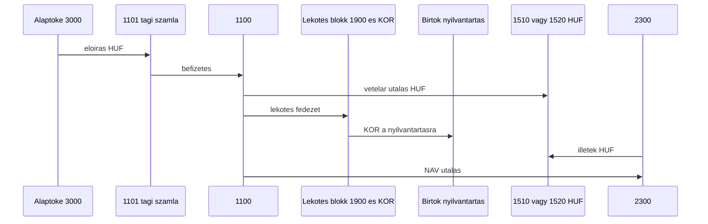

#### Bányászás

★ Egyszerű, egysoros:

| credit → | debit |
| -------- | ----- |
| `1100` Bankszámlák | `1001` XY - saját számla |

Korona és lekötés nem érinti.

## Ügylet 1 — hirtelen készpénzes projektköltség

Egy tag kívülről, a saját bankjából utalja be az egyszeri hozzájárulást. A hozzájárulás a tag `1101`-es tagi számláján megy át. A szövetkezet a banki összeget készpénzbe veszi, majd a **szabad forint poolból** anyagköltségként kifizeti a projekten — **korona és lekötés nélkül**, mert ez működési kiadás, nem tőkelekötés a projekt nyilvántartására.

Egyszerűsített mezők: dátum, tag, összeg forintban, projekt, költség számla (például `5000`, `5410`, `5430` vagy `5800`), leírás, opcionális nyugta. A tagot a tagi számlája azonosítja.

Minta: 10 000 Ft. Tag: `kovács.erika`. Projekt: `I/4.12.1.1.1 Szávai Márton gyümölcsfaliget`. Költség: `5000` Anyagköltség.

A 10 000 Ft kívülről, egyszeri tagi hozzájárulásként érkezik. Előbb az előírás: a tag tartozik a hozzájárulással, ez a `1101` tartozik és a `3000` Alaptőke követel. Utána a befizetés: a tag a saját bankjából utal, a pénz a `1100`-ra érkezik, a követel oldal a `1101`, ez rendezi az előírást. A külső bank a könyvekben nem szerepel. Az alaptőke egyenlege ezután végig 10 000 Ft marad.

A következő sor már nem befizetés. A bankról levett készpénz a `1000` pénztárba kerül, hogy a költség készpénzben kifizethető legyen. A követel oldal itt a `1100`, az alaptőke nem ismétlődik.

| Lépés                 | Tartozik ←                        | Követel                           | Összeg | Pénznem | Szervezet                     | Típus     |
| --------------------- | --------------------------------- | --------------------------------- | ------ | ------- | ----------------------------- | --------- |
| Hozzájárulás előírása | `1101` kovács.erika - tagi számla | `3000` Alaptőke                   | 10 000 | HUF     | I/3. Pénzügyi Igazgatóság     | Átvezetés |
| Bejövő tagi utalás    | `1100` Bankszámlák                | `1101` kovács.erika - tagi számla | 10 000 | HUF     | I/3. Pénzügyi Igazgatóság     | Utalás    |
| Készpénzfelvétel      | `1000` Készpénz                   | `1100` Bankszámlák                | 10 000 | HUF     | I/3. Pénzügyi Igazgatóság     | Készpénz  |
| Anyagköltség          | `5000` Anyagköltség               | `1000`                            | 10 000 | HUF     | Szávai Márton gyümölcsfaliget | Készpénz  |

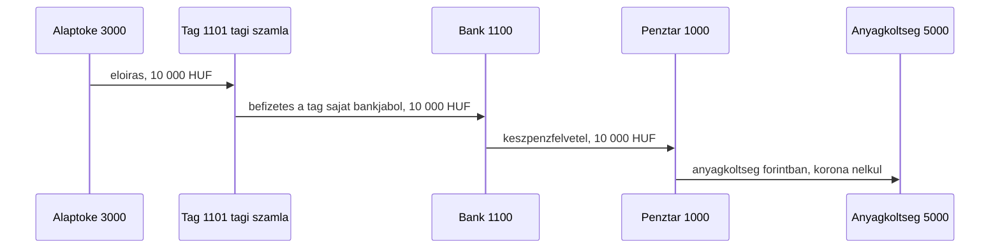

Zárás után a `1101` nulla, a kincstári készpénz forintban nulla, a `5000` tartozik egyenlege 10 000 Ft, a `3000` követel egyenlege 10 000 Ft. A projekt nyilvántartásán **nincs** koronaegyenleg, mert nem történt lekötés.

Ha ugyanezt az összeget a tag a projektbe **lekötné** (tőkeként, nem anyagköltségként), külön ügyletben jönne a [lekötés blokk](#lekötés-blokk) a gyümölcsfaliget projekt nyilvántartására, az aktuális árfolyamon.

## Ügylet 2 — tojás keletkezése és eladása

Tojás jelenik meg egy ólban, készletre kerül, majd eladáskor a darab kimegy a készletből, a forint pedig közvetlenül értékesítési bevétel lesz (korona nélkül).

Egyszerűsített mezők: dátum, ól (szervezet), darabszám, eladási forint, leírás.

A szervezet az `I/4.12.1.2 Állattenyésztés` gyereke. A seedben ilyen ól még nincs; a juhnyáj mutatja a fa mintáját. A minta szervezete: Tojóól.

Minta: 30 tojás keletkezik, mind a 30 elkelt 6 000 Ft-ért.

| Lépés            | Tartozik ←                    | Követel          | Összeg | Pénznem | Szervezet | Típus     |
| ---------------- | ----------------------------- | ---------------- | ------ | ------- | --------- | --------- |
| Keletkezés       | `1300` Készletek              | `4500`           | 30     | EGG     | Tojóól    | Átvezetés |
| Beérkezés        | `1000` Készpénz               | `1900`           | 6 000  | HUF     | Tojóól    | Készpénz  |
| Értékesítés      | `1900`                        | `4000`           | 6 000  | HUF     | Tojóól    | Átvezetés |
| Készletcsökkenés | `5600` Értékesítési költségek | `1300` Készletek | 30     | EGG     | Tojóól    | Átvezetés |

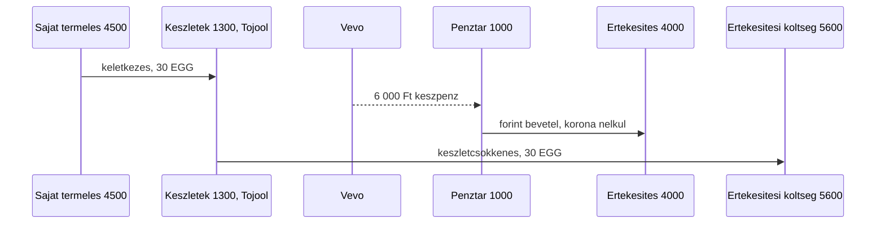

A bevétel a [forint bevétel](#forint-bevétel-korona-nélkül) két lépése. A `4000` követel, szervezet a Tojóól.

A darabszámla és a forint bevétel külön pénznem. A tojásnak ebben a modellben nincs forint önköltsége. Eladás után az ól `1300` tojás-egyenlege nulla.

Seedből hiányzik: `EGG`, `4500`, `1900`, és a Tojóól szervezeti csomópont.

### Napi tojás rögzítés (edizone backoffice)

Az edizone példányon a content-backoffice **Napi tojás rögzítés** űrlapja (`egg-daily-entry` workflow) egyszerre több tyúkólt tölthet ki. A tyúkólok az `I/4.12.1.2.1 Tyúktartás` gyermek szervezetei (alom szerint). Mezők: egy közös dátum (alapértelmezés: ma) és ólanként egy egész darabszám (0 vagy üres sor nem kerül mentésre).

Mentésenként egy tranzakció jön létre nem nulla soronként, piszkozatként, ugyanazzal a szerepkör- és véglegesítési logikával, mint az **Új tranzakció** űrlap. Könyvelés soronként:

| Tartozik ← | Követel | Összeg | Pénznem | Szervezet | Típus |
| --- | --- | --- | --- | --- | --- |
| `1300` Készletek | `4500` Saját termelésű készletek állományváltozása | darab | EGG | az adott tyúkól | `Átvezetés` |

Bizonylat nincs. Ha ugyanarra a napra, ólra, EGG pénznemre és `1300`/`4500` párosra már van sor, a mentés előtt párbeszéd kínál **új sor** vagy **meglévő összeg frissítése** választást. A feature flag az edizone szerver `BACKOFFICE_WORKFLOWS` env-jében alapból engedélyezett; más példányon rejtett. Részletek: [apps/content-backoffice/src/workflows/bulk-quantity/README.md](../apps/content-backoffice/src/workflows/bulk-quantity/README.md).

## Ügylet 3 — gyümölcs szürete és piaci eladása

A gyümölcsfaligetben leszüretelt mennyiség készletre kerül. A piacra vitt rész kimegy a készletből, a befolyt forint közvetlenül a `4000`-re kerül. A raktáron hagyott kiló a `1300`-on marad.

Egyszerűsített mezők: dátum, leszüretelt kg, eladott kg, forint bevétel, leírás.

Szervezet: `I/4.12.1.1.1 Szávai Márton gyümölcsfaliget`. Mértékegység: kg (`FRUIT`).

Minta: 80 kg szüret, ebből 50 kg eladás 25 000 Ft-ért. Raktáron marad 30 kg.

| Lépés            | Tartozik ←                    | Követel          | Összeg | Pénznem | Szervezet                     | Típus     |
| ---------------- | ----------------------------- | ---------------- | ------ | ------- | ----------------------------- | --------- |
| Szüret           | `1300` Készletek              | `4500`           | 80     | FRUIT   | Szávai Márton gyümölcsfaliget | Átvezetés |
| Beérkezés        | `1000` Készpénz               | `1900`           | 25 000 | HUF     | Szávai Márton gyümölcsfaliget | Készpénz  |
| Értékesítés      | `1900`                        | `4000`           | 25 000 | HUF     | Szávai Márton gyümölcsfaliget | Átvezetés |
| Készletcsökkenés | `5600` Értékesítési költségek | `1300` Készletek | 50     | FRUIT   | Szávai Márton gyümölcsfaliget | Átvezetés |

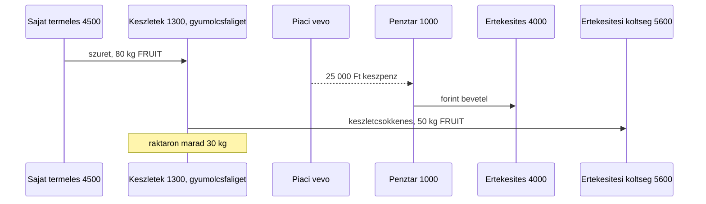

A `4000` követel, szervezet a gyümölcsfaliget. A `1300` egyenlege ennél a szervezetnél 30 kg. Forint önköltség nincs. A bevétel koronára történő lekötése külön, önkéntes lépés lenne a projekt nyilvántartásán.

Seedből hiányzik: `FRUIT`, `4500`, `1900`.

## Ügylet 4 — ingatlan szerzése

Telek vagy épület vásárlása foglalóval, majd a fennmaradó vételár bankból. A kifizetések **forintban** mennek (`1400`, `1530` ← `1100`). A vételár forint értékére **lekötés blokk** kerül a lakóingatlan / birtok nyilvántartására (korona a nyilvántartáson marad). A foglaló beszámítása a vételárba pénzmozgás nélküli sor.

Egyszerűsített mezők: dátum, foglaló, fennmaradó vételár, ingatlan számla, leírás.

Az ingatlan számla a fajta szerint: `1510` Mezőgazdasági földterületek, `1520` Belterületi földterületek, `1530` Lakóépületek. A minta egy lakóház, `1530`. Szervezet: `I/4.11.1.1 Lakóterületek`. Pénzeszköz: `1100` Bankszámlák. A vagyonszerzési illeték az ingatlan értékébe kerül, a [9. ügylet](#ügylet-9--tagi-befizetésből-lakótelek) szerint.

Minta: 2 000 000 Ft foglaló, 8 000 000 Ft fennmaradó rész. Összesen 10 000 000 Ft eszköz; lekötés 100 000 korona (1 korona = 100 Ft).

| Lépés              | Tartozik ←                    | Követel         | Összeg    | Pénznem | Szervezet                | Típus     |
| ------------------ | ----------------------------- | --------------- | --------- | ------- | ------------------------ | --------- |
| Foglaló kifizetés  | `1400` Előlegek               | `1100`          | 2 000 000 | HUF     | I/4.11.1.1 Lakóterületek | Utalás    |
| Fennmaradó vételár | `1530` Lakóépületek           | `1100`          | 8 000 000 | HUF     | I/4.11.1.1 Lakóterületek | Utalás    |
| Beszámítás         | `1530` Lakóépületek           | `1400` Előlegek | 2 000 000 | HUF     | I/4.11.1.1 Lakóterületek | Átvezetés |
| Lekötés blokk      | a [lekötés blokk](#lekötés-blokk) négy sora | (fedezet `1100`) | 10 000 000 / 100 000 | HUF + KOR | kincstár → Lakóterületek | Átvezetés |

```mermaid
sequenceDiagram
  participant Bank as Bank 1100
  participant Eloleg as Elolegek 1400
  participant Haz as Lakoepuletek 1530
  participant Lekotes as Lekotes blokk KOR
  participant Nyilv as Lakoteruletek nyilvantartas
  participant Elado as Elado

  Bank->>Eloleg: foglalo, 2 000 000 HUF
  Bank-->>Elado: utalas
  Bank->>Haz: fennmarado vetelar, 8 000 000 HUF
  Bank-->>Elado: utalas
  Eloleg->>Haz: beszamitas, 2 000 000 HUF
  Bank->>Lekotes: fedezet 10 000 000 HUF
  Lekotes->>Nyilv: 100 000 KOR marad a nyilvantartason
```

A `1530` egyenlege 10 000 000 Ft HUF-ban. A Lakóterületek nyilvántartásán 100 000 KOR marad. Az `1400` nullázódik. Hitelből vett ingatlannál a fennmaradó rész követelje a `2200` Hosszú lejáratú kötelezettségek lenne. Ez az ügylet bankos vétel.

Seedből hiányzik: `1900`.

## Ügylet 5 — felújítás

Értéknövelő felújítás: a kivitelezés az épület értékébe kerül. A szállító **forintban** kap utalást. Az értéknövelés összege **lekötés blokk** a projekt vagy lakóingatlan nyilvántartására (korona marad). Karbantartásnál csak forint költség sor, lekötés nélkül.

Egyszerűsített mezők: dátum, hely (szervezet), kivitelezői összeg, leírás.

Minta: 1 500 000 Ft (15 000 korona lekötés, 1 korona = 100 Ft). Szervezet: `I/4.12.1.2 Állattenyésztés`, egy ól felújítása. Pénzeszköz: `1100`. Lakóháznál a tartozik a `1530` Lakóépületek, a lekötés célja a lakó projekt nyilvántartása.

| Lépés          | Tartozik ←                  | Követel                     | Összeg              | Pénznem | Szervezet                  | Típus     |
| -------------- | --------------------------- | --------------------------- | ------------------- | ------- | -------------------------- | --------- |
| Aktiválás      | `1500` Tárgyi eszközök      | `2000` Szállítói tartozások | 1 500 000           | HUF     | I/4.12.1.2 Állattenyésztés | Átvezetés |
| Utalás         | `2000` Szállítói tartozások | `1100` Bankszámlák          | 1 500 000           | HUF     | I/4.12.1.2 Állattenyésztés | Utalás    |
| Lekötés blokk  | lásd [lekötés blokk](#lekötés-blokk) | fedezet `1100`     | 1 500 000 / 15 000  | HUF+KOR | kincstár → projekt         | Átvezetés |

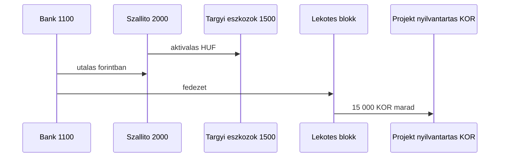

Zárás után a `1500` 1 500 000 Ft-tal nő, a `2000` nulla, a bank csökken, a projekt nyilvántartásán 15 000 KOR. A `5300` Értékcsökkenés későbbi, időszakos sor.

Karbantartásnál: `5460` ← `1100` vagy tagi `1101`, lekötés nélkül. Ha a javítás beépül az ingatlanba és értéket növel, aktiválás HUF-ban és lekötés blokk a lakóingatlan nyilvántartására.

Seedből hiányzik: `1900`.

## Ügylet 6 — területalapú agrár támogatás

Működési, területalapú támogatás egy támogatott földterületre. A megítéléskor keletkezik az egyéb bevétel és a követelés. A kincstári jóváírás a bankra érkezik **forintban**, a [forint bevétel](#forint-bevétel-korona-nélkül) lépésein, és a követelést zárja. A `4200` a jóváíráskor nem ismétlődik. Értékesítés nincs, a `4000` kimarad. A támogatás összegének birtok nyilvántartásra történő lekötése külön, önkéntes ügylet.

Egyszerűsített mezők: dátum, támogatott terület (szervezet), megítélt összeg, leírás.

A seedben nincs külön támogatási bevétel számla, ezért a bevétel a `4200` Egyéb bevételek. Szervezet: `I/4.11.1.2 Termőterületek`, a támogatott földterület projektje. Pénzeszköz: `1100`.

Minta: 400 000 Ft.

| Lépés              | Tartozik ←         | Követel                | Összeg  | Pénznem | Szervezet                 | Típus     |
| ------------------ | ------------------ | ---------------------- | ------- | ------- | ------------------------- | --------- |
| Megítélés          | `1200` Követelések | `4200` Egyéb bevételek | 400 000 | HUF     | I/4.11.1.2 Termőterületek | Átvezetés |
| Kincstári jóváírás | `1100` Bankszámlák | `1900`                 | 400 000 | HUF     | I/3. Pénzügyi Igazgatóság | Utalás    |
| Követelés zárása   | `1900`             | `1200` Követelések     | 400 000 | HUF     | I/4.11.1.2 Termőterületek | Átvezetés |

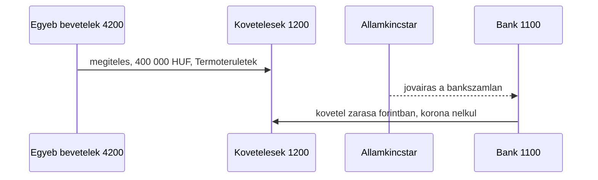

Zárás:

| Számla                 | Egyenleg          |
| ---------------------- | ----------------- |
| `1100` Bankszámlák     | 400 000 Ft tartozik |
| `1200` Követelések     | 0                 |
| `4200` Egyéb bevételek | 400 000 Ft követel  |

A bank 400 000 Ft-tal nő, a `4200` követel egyenlege 400 000 Ft, a `1200` nulla. Korona csak külön lekötés ügylettel kerülhet a Termőterületek birtok nyilvántartására.

Ha a támogatás előzetes megítélés nélkül érkezik, a megítélés sora elmarad, és a záró sor követelje közvetlenül a `4200`: `1900` ← `4200`. A bank és a `4200` egyenlege ugyanaz.

A beruházási támogatás nem bevétel, hanem az eszközhöz kötött halasztott tétel, és nem ennek az ügyletnek a része.

Seedből hiányzik: `1900`.

## Ügylet 7 — adminisztráció

Külső könyvelői vagy ügyintézői számla. **Közös költség forintban**, korona és lekötés nélkül: szállítói számla, majd utalás a szabad poolból.

Egyszerűsített mezők: dátum, összeg, leírás.

Szervezet: `I/3. Pénzügyi Igazgatóság`. Pénzeszköz: `1100`. A `5440` Könyvelési és szakértői díjak a seedben is ezen a szervezeten ül.

Minta: 80 000 Ft.

| Lépés  | Tartozik ←                            | Követel                     | Összeg | Pénznem | Szervezet                 | Típus     |
| ------ | ------------------------------------- | --------------------------- | ------ | ------- | ------------------------- | --------- |
| Számla | `5440` Könyvelési és szakértői díjak  | `2000` Szállítói tartozások | 80 000 | HUF     | I/3. Pénzügyi Igazgatóság | Átvezetés |
| Utalás | `2000` Szállítói tartozások           | `1100` Bankszámlák          | 80 000 | HUF     | I/3. Pénzügyi Igazgatóság | Utalás    |

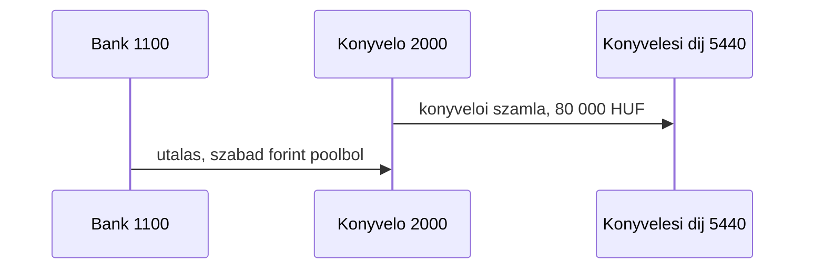

Hatósági díj ugyanígy könyvelődik, a számla tartozikja a `5800` Egyéb költségek. A banki díj nem kap szállítói számlát: a bank levonja, a sor `5700` ← `1100`. A kidolgozott ügylet a könyvelői számla.

Seedből hiányzik: `1900`.

## Ügylet 8 — bányászás

A bányászás a hivatalos Szövetkezet rendszerből, a `1100` bankról vagy a `1000` pénztárból készpénzt visz át a Homály rendszerbe, egy tag `1001` saját számlájára. Kiadásnak látszik, mert a pénz kimegy a szövetkezet számláiról, de nem költség: két főkönyv közötti átvezetés. A bányászás sorában nincs `5xxx` számla. A költség később, Homályban keletkezik, amikor a tag a `1001`-ről fizet.

Egyszerűsített mezők: dátum, tag, összeg, honnan (`1100` vagy `1000`), leírás.

A tranzakciótípus `Bányászás`. A sor Homály, mert az egyik oldala `1001`. Mivel két pénzeszköz között mozog, nem érinti a lekötést, ugyanúgy, mint a készpénzfelvétel.

Minta: 50 000 Ft a bankról `kovács.erika` saját számlájára. Utána Homályban 12 000 Ft munkaebéd és 8 000 Ft üzemanyag a gyümölcsfaligetnél.

| Lépés                    | Tartozik ←                         | Követel                            | Összeg | Pénznem | Szervezet                     | Típus     |
| ------------------------ | ---------------------------------- | ---------------------------------- | ------ | ------- | ----------------------------- | --------- |
| Bányászás                | `1001` kovács.erika - saját számla | `1100` Bankszámlák                 | 50 000 | HUF     | I/3. Pénzügyi Igazgatóság     | Bányászás |
| Homály kiadás: munkaebéd | `5510` Reprezentáció               | `1001` kovács.erika - saját számla | 12 000 | HUF     | Szávai Márton gyümölcsfaliget | Készpénz  |
| Homály kiadás: üzemanyag | `5410` Utazás és üzemanyag         | `1001` kovács.erika - saját számla | 8 000  | HUF     | Szávai Márton gyümölcsfaliget | Készpénz  |

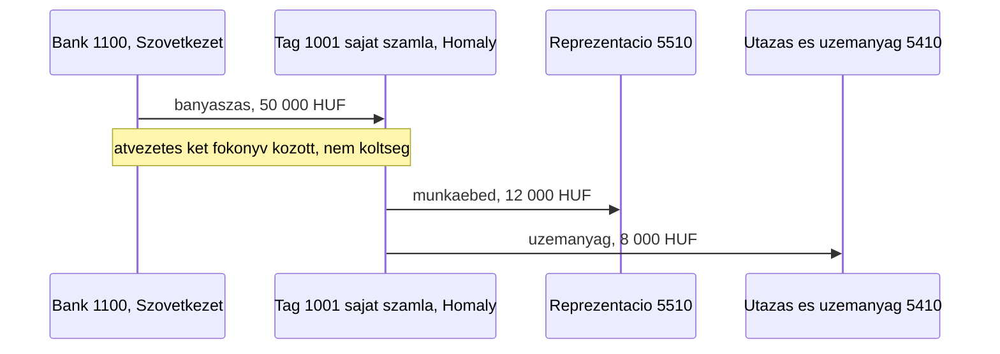

Zárás után a bank 50 000 Ft-tal kevesebb, a tag `1001`-jén 30 000 Ft marad, ez a nála lévő Homály készpénz. A költség 20 000 Ft, a bányászott 50 000 Ft-ból csak ennyi. Ha a tag a maradékot visszaadja a pénztárba, a sor `1000` ← `1001`, típus Átvezetés.

A Homály kiadás és a bányászás koronát és lekötést nem érint.

Seedből hiányzik: semmi. A `1001` tagonként automatikusan jön létre, a `Bányászás` típus a [transaction-types](../database/seeders/http/kor/data/transaction-types.json) fájlban van.

## Ügylet 9 — tagi befizetésből lakótelek

Egy tag részjegyet fizet be a saját bankjából. A részjegy a `1101` tagi számláján megy át: előbb az előírás, aztán a befizetés. A pénzből a szövetkezet lakótelket vesz, a vagyonszerzési illetéket pedig a telek értékébe aktiválja.

Egyszerűsített mezők: dátum, tag, befizetett összeg, vételár, illeték, leírás.

Minta: `kovács.erika` 2 080 000 Ft részjegyet fizet. A telek vételára 2 000 000 Ft (20 000 korona), a vagyonszerzési illeték 80 000 Ft (800 korona). Számla: `1520` Belterületi földterületek, mert a lakótelek belterületi föld. Szervezet: `I/4.11.1.1 Lakóterületek`. Pénzeszköz: `1100`.

A vételár és az illeték **forintban** fizetendő (`1520` ← `1100`, majd `2300` ← `1100`). A tag teljes befizetése lekötésre kerül: [lekötés blokk](#lekötés-blokk) a vételárra és az illeték aktivált értékére (összesen 20 800 KOR a Lakóterületek nyilvántartásán, 1 korona = 100 Ft). Az illeték aktiválása: `1520` ← `2300`.

| #   | Lépés              | Tartozik ←                        | Követel                           | Összeg             | Pénznem | Szervezet                 | Típus     |
| --- | ------------------ | --------------------------------- | --------------------------------- | ------------------ | ------- | ------------------------- | --------- |
| 1   | Részjegy előírása  | `1101` kovács.erika - tagi számla | `3000` Alaptőke                   | 2 080 000          | HUF     | I/3. Pénzügyi Igazgatóság | Átvezetés |
| 2   | Bejövő tagi utalás | `1100` Bankszámlák                | `1101` kovács.erika - tagi számla | 2 080 000          | HUF     | I/3. Pénzügyi Igazgatóság | Utalás    |
| 3   | Telek vételár      | `1520` Belterületi földterületek  | `1100` Bankszámlák                | 2 000 000          | HUF     | I/4.11.1.1 Lakóterületek  | Utalás    |
| 4   | Lekötés, vételár   | [lekötés blokk](#lekötés-blokk)   | fedezet `1100`                    | 2 000 000 / 20 000 | HUF+KOR | kincstár → Lakóterületek  | Átvezetés |
| 5   | Illeték aktiválása | `1520` Belterületi földterületek  | `2300` Adótartozások              | 80 000             | HUF     | I/4.11.1.1 Lakóterületek  | Átvezetés |
| 6   | Lekötés, illeték   | [lekötés blokk](#lekötés-blokk)   | fedezet `1100`                    | 80 000 / 800       | HUF+KOR | kincstár → Lakóterületek  | Átvezetés |
| 7   | Illeték utalása    | `2300` Adótartozások              | `1100` Bankszámlák                | 80 000             | HUF     | I/4.11.1.1 Lakóterületek  | Utalás    |

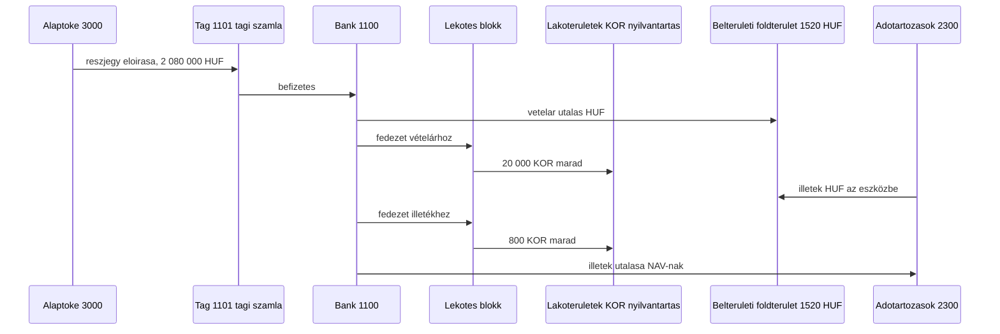

Zárás:

| Számla                            | Egyenleg |
| --------------------------------- | -------- |
| `3000` Alaptőke                   | 2 080 000 Ft követel |
| `1101` kovács.erika - tagi számla | 0 |
| `1100` Bankszámlák                | 0 |
| `2300` Adótartozások              | 0 |
| `1520` Belterületi földterületek  | 2 080 000 Ft tartozik |
| Lakóterületek nyilvántartás KOR   | 20 800 KOR (lekötve) |

A telek 2 080 000 Ft értéken áll a könyvekben, ebből 80 000 Ft az aktivált illeték. A tag részjegye le van kötve: 20 800 korona a birtok / lakóingatlan-rész nyilvántartásán. A bank nullára zár.

Mezőgazdasági földnél ugyanez a lánc, a számla `1510` Mezőgazdasági földterületek, a szervezet `I/4.11.1.2 Termőterületek`.

Seedből hiányzik: `1900`.

## Ügylet konfigurálása Strapi-ban

Ez javaslat a későbbi egyszerűsített űrlaphoz. A collection és a resolver még nincs a kódban. A v1 képernyő ettől nem változik, és a `dataentry` továbbra sem publikál.

A `transaction-type` címke marad (Készpénz, Utalás, Átvezetés, Barter, Jutalék, Elrendelt, Bányászás). A lépéssort egy külön collection írja le, kódban szállítva, draft nélkül. A belső neve `posting-workflow`. A Strapi Adminban és a backoffice-ban a megjelenő név Ügylet.

### Ki mit csinál

A könyvelő az ügyletet egyszer állítja össze a Strapi Adminban. A rögzítő utána már csak a rövid űrlapot látja. A resolver a mentett lépésekből draft tranzakciókat ír. Az `editor` a láncot ellenőrzi és publikálja.

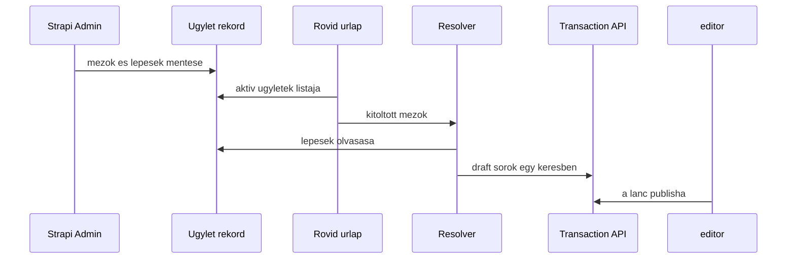

### Mit tárol egy ügylet

Egy rekord azonosítóból, névből, aktív jelzőből, beviteli mezőkből és lépésekből áll. A számla, a pénznem, a tranzakciótípus és a szervezet mind meglévő rekord, legördülőből. Az összegnek két módja van: a beviteli mező másolata, vagy átváltás a `currency-rate` szerint a bizonylat napján. Szabad képlet nincs.

A beviteli mezők ismétlődő komponens, `posting.input`: kulcs, címke, fajta. Minden mező ugyanazt az alakot követi, ezért ide nem dynamic zone kell.

A lépések dynamic zone, a Strapi 5.58 blokklistája. A szerkesztő az „Add a component” listából tesz fel blokkot, és húzással rendezi. Három komponens van, bármilyen sorrendben, többször is:

- `posting.line`: egy tartozik/követel sor. A számla lehet rögzített rekord, a beviteli mező kulcsa, vagy egy tag mező `1101`-es tagi, illetve `1001`-es saját számlája. Mellette az összeg módja, a pénznem, a szervezet és a tranzakciótípus.
- `posting.korona-lekotes`: a [lekötés blokk](#lekötés-blokk). Az admin a forint fedezet pénzeszközét és a cél nyilvántartás mezőjét választja (birtok, projekt vagy lakóingatlan-rész). A korona összeget az árfolyam adja; a blokk után a KOR a cél szervezeten marad.
- `posting.bevetel-forint`: a [forint bevétel](#forint-bevétel-korona-nélkül) két technikai sora. Az admin a pénzeszközt és a végleges követel számlát választja.

A `1900`-as sorok nem külön admin-blokk. A resolver a blokk `__component` értékét olvassa, és a lekötés / bevétel lépéseit a fenti táblákból bontja ki.

Új ügylet a meglévő három blokkból admin adat. Negyedik blokkfajta új komponens, tehát kódváltozás, ugyanazon a határon, mint amikor az összeg sem másolat, sem árfolyam.

Az 1. ügylet adminrekordja így nézne ki.

Beviteli mezők, ezekből áll a rövid űrlap:

| Kulcs         | Címke az űrlapon | Fajta                                 |
| ------------- | ---------------- | ------------------------------------- |
| `date`        | Dátum            | dátum                                 |
| `member`      | Tag              | tag                                   |
| `amount`      | Összeg forintban | szám                                  |
| `project`     | Projekt          | szervezet                             |
| `expense`     | Költség számla   | számla                                |
| `description` | Leírás           | szöveg                                |
| `receipt`     | Nyugta           | opcionális fájl, a meglévő receipt út |

Lépések, ezekből lesznek a tranzakciók:

| Sorrend | Komponens                                    | Tartozik ←                           | Követel                        | Összeg                                    | Szervezet           |
| ------- | -------------------------------------------- | ------------------------------------ | ------------------------------ | ----------------------------------------- | ------------------- |
| 1       | `posting.line`, típus Átvezetés, pénznem HUF | `member` tagi számlája, `1101`       | `3000` rögzített               | `amount`                                  | kincstár, rögzített |
| 2       | `posting.line`, típus Utalás, pénznem HUF    | `1100` rögzített                     | `member` tagi számlája, `1101` | `amount`                                  | kincstár, rögzített |
| 3       | `posting.line`, típus Készpénz, pénznem HUF  | `1000` rögzített                     | `1100` rögzített               | `amount`                                  | kincstár, rögzített |
| 4       | `posting.line`, típus Készpénz, pénznem HUF  | `expense`                            | `1000` rögzített               | `amount`                                  | `project`           |

Az első három blokk `posting.line`. A negyedik a költség kifizetése forintban a projekten; **korona-lekötés nincs** benne. Lekötés csak külön ügyletben, `posting.korona-lekotes` blokkal.

### Mit lát a rögzítő

Az űrlap a beviteli mezőkből készül. Az 1. ügyletnél a rögzítő ennyit tölt ki, számlakódot és korona-sort nem választ:

```text
Ügylet: Hirtelen készpénzes projektköltség

Dátum            2026-10-14
Tag              kovács.erika
Összeg forintban 10 000
Projekt          Szávai Márton gyümölcsfaliget
Költség számla   5000 Anyagköltség
Leírás           egyszeri tagi hozzájárulás, majd anyag
Nyugta           opcionális
```

A feliratok a két katalógusba kerülnek: hu `Ügylet |||| Ügyletek`, en `Deal |||| Deals`. Az új ügylet gomb magyarul Új ügylet, angolul New deal. A mostani tranzakció-képernyők szövege változatlan, azok továbbra is egy sort szerkesztenek.

### Hogyan lesznek belőle sorok

A resolver minden ügyletre ugyanaz a kód. A kitöltött mezőket és a mentett lépéseket olvassa, az árfolyamot a bizonylat napjára kéri, majd egy kérésben draft tranzakciókat ír. Minden sor `related_transaction` mezője az előző sorra mutat, így a lánc egy ügylet marad.

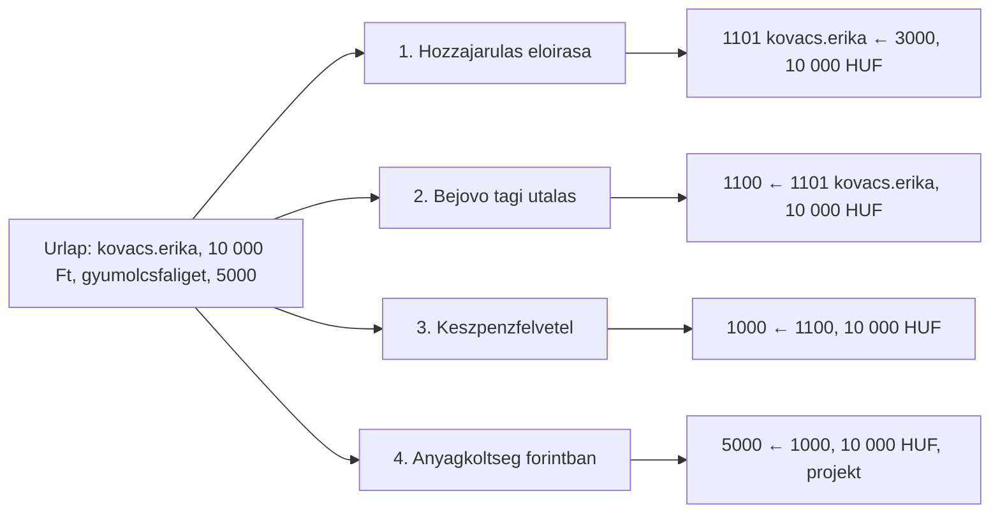

A 10 000 Ft-os mintánál a resolver az [1. ügylet tábláját](#ügylet-1--hirtelen-készpénzes-projektköltség) írja ki: az előírást, a bejövő tagi utalást, a készpénzfelvételt, majd a költség sort forintban. A nyugta, ha van, a költség sorhoz kapcsolódik.

A `korona-lekotes` egy admin-lépés, a könyvekben négy tranzakció. A bontás a [lekötés blokk](#lekötés-blokk) táblája szerint megy; a fedezet pénzeszköze és a cél nyilvántartás a lépés paramétere:

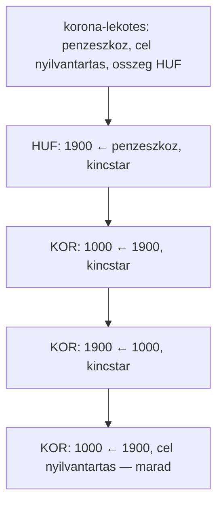

A `bevetel-forint` két sor: beérkezés, majd végleges bevétel/követelés. Az 1. ügyletben ilyen blokk nincs.

Új ügyletfajta, például a könyvelői számla, admin adat: új `posting.input` mezők és a három meglévő blokk új sorrendje. Negyedik blokk, vagy olyan összeg, amit sem másolni, sem árfolyammal váltani nem lehet, már kódváltozás.
