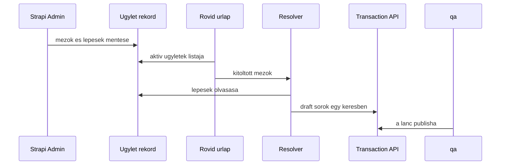
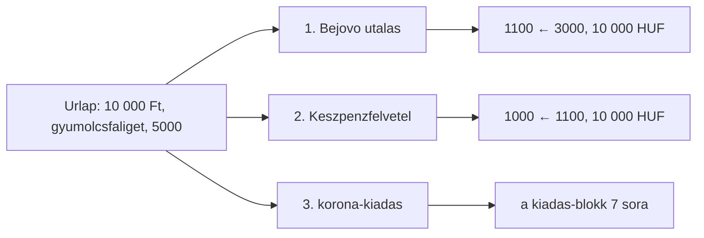
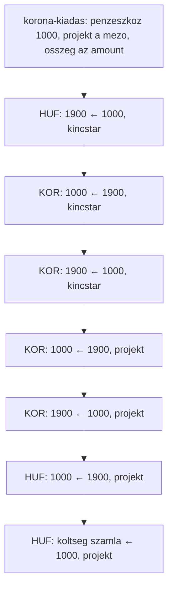

# Ügyletek

**Dátum:** 2026-10-14  
**Számlatükör:** [database/seeders/http/kor/data/accounts.json](../database/seeders/http/kor/data/accounts.json)  
**Sor séma:** [src/api/transaction/content-types/transaction/schema.json](../src/api/transaction/content-types/transaction/schema.json)  
**Kapcsolódó:** [docs/readme.md](./readme.md), [v1 PRD](./prd/0001-content-backoffice-v1.md)

Ez a fájl a kétlábas könyvelés ügyleteit írja le a meglévő számlatükörre. Kód, séma, seed és a mostani backoffice-feliratok nem változnak tőle. A v1 űrlap továbbra is egy kézi tartozik/követel sor.

## Szókincs

Az **ügylet** a teljes gazdasági esemény. Egy kitöltésből több sor születik, `related_transaction` láncon. A fejezetek neve ügylet. A későbbi egyszerűsített űrlap felirata magyarul Ügylet / Ügyletek, angolul Deal / Deals. A katalógusban és a felületen ez a két szó jelenik meg.

A **tranzakció** egy sor: egy tartozik, egy követel, egy összeg, egy pénznem. A mostani felület ezt mutatja: `Tranzakció` / `Tranzakciók` a [hu.ts](../apps/content-backoffice/src/i18n/hu.ts)-ben, `Transaction` / `Transactions` az [en.ts](../apps/content-backoffice/src/i18n/en.ts)-ben. Ezek a képernyők egy sort szerkesztenek, a feliratuk tranzakció marad.

A belső collection neve lehet `posting-workflow`. A felhasználó az Ügylet szót látja.

## Mit rögzít egy sor

Egy `transaction` sor mezői: `debit_account`, `credit_account`, `amount`, `currency_type`, `organization`, opcionálisan `transaction_type` és `related_transaction`.

A tartozik a „mire ment”. A követel a „honnan”. A táblák fejlécében a nyíl ezt a pénzmozgást jelöli: **Tartozik ← Követel**, az összeg a követel oldalról a tartozik oldalra érkezik. A sor `organization` mezője a projekt vagy a hely, ahová az esemény tartozik. Ez független attól, hogy a számla a seedben melyik szervezeten ül.

Több lépés azért lánc, mert egy sornak egy tartozikja, egy követelje, egy összege és egy pénzneme van. Két szervezet közötti mozgás két sor: mindkettő a `1900` átvezetőn keresztül, külön `organization` értékkel.

A korona pénznem (`currency-type`, kód `KOR`), önálló főkönyvi számla nélkül. A `1000` Készpénz forintban és koronában is vihet egyenleget. Az ól a szervezeti fa egy csomópontja, ugyanúgy, ahogy a seedben a `I/4.12.1.2.1 Roger Milla Kameruni juh nyáj`. Külön hely entitás a [readme](./readme.md) szerint későbbi tétel.

Minden pénzmozgás a közös koronablokkon megy át, és csak utána éri a végleges főkönyvi számlát. A mennyiség (tojás, kiló) koronára váltás nélkül könyvelődik. A pénzmozgás nélküli sor (megítélt követelés, foglaló beszámítása) közvetlenül könyvelődik.

A minták árfolyama stabil: 1 korona = 100 Ft. Eltérő visszaváltási árfolyamnál a különbözet a `5700` Pénzügyi költségek vagy a bevételi `4300` Pénzügyi bevételek. A tagdíjként seedelt, szintén `4300` kódú tőkeszámla árfolyamnyereségre nem használható.

## Számlatükör-rések

A táblázatok a hiányzó tételeket a javasolt kóddal írják. Ezek a seedben még nincsenek.

- `KOR` pénznem a [kor currency-types](../database/seeders/http/kor/data/currency-types.json) fájlban nincs (ott `HUF`, `EUR`, `HOUR` van). Javasolt kategória: CASH, mértékegység: KOR.
- `EGG` csak az edizone seedben van. A tojásos ügylet ezt a pénznemet használja, mértékegység: egg, kategória: RESOURCES.
- `FRUIT` nincs a kor seedben. Javasolt mértékegység: kg, kategória: RESOURCES.
- `1900` Átvezetés devizanemek között. Ezen a technikai számlán egyensúlyoz külön a forint sor és a korona sor.
- `4400` Saját termelésű készlet növekedése. A tojás és a gyümölcs keletkezése ide kerül követelként. Az értékesítés bevétele a `4000` marad, és csak az eladáskor.
- A `4300` kód kétszer szerepel: Pénzügyi bevételek (bevétel) és Előfizetések és tagsági díjak (tőke). A tagi befizetés a `3000` Alaptőkére megy, amíg a kódok szét nem válnak.
- Az `1400` Előlegek a seedben a Terjesztési Igazgatóságon ül. Ingatlan-előlegnél a sor szervezete a vagyont tartó csomópont, `I/3.9 Nyilvántartások, vagyontárgyak`.
- A tranzakción nincs tag mező. A tag neve a leírásban fér el. Az árfolyamot a `currency-rate` adja, a sor nem őrzi meg.

A kincstár a mintákban az `I/3. Pénzügyi Igazgatóság`: a `1000` és a `1100` a seedben ehhez a szervezethez tartozik.

## Közös koronablokk

Pénzeszköz a forint lábon: `1000` Készpénz vagy `1100` Bankszámlák. A korona mindig a `1000`-en jelenik meg. A projektre helyezés két sor, mert egy tranzakciónak egy szervezete van.

### Kiadás

A forint már a pénzeszközön van. A blokk végén a célszámla tartozik, a pénzeszköz követel. Nettó: a pénzeszköz egyszer csökken, a célszámla egyszer nő. A korona a közbenső projekt-egyenleg.

| Lépés | Tartozik ← | Követel | Pénznem | Szervezet |
| --- | --- | --- | --- | --- |
| 1. Forint a tartalékba | `1900` | pénzeszköz | HUF | kincstár |
| 2. Korona kibocsátás | `1000` | `1900` | KOR | kincstár |
| 3. Korona le a kincstárról | `1900` | `1000` | KOR | kincstár |
| 4. Korona a projektre | `1000` | `1900` | KOR | projekt |
| 5. Korona visszaváltása | `1900` | `1000` | KOR | projekt |
| 6. Forint vissza a pénzeszközre | pénzeszköz | `1900` | HUF | projekt |
| 7. Végleges sor | célszámla | pénzeszköz | HUF | projekt |

Az 1. és a 4. ügylet ezt a teljes blokkot használja. Az 5. és a 7. ügylet a 6. lépésnél megáll: a forint újra a `1100`-on van, a célszámla pedig a szállítói számlával és az utalással következik. Abban a két ügyletben a 7. lépés nincs benne a blokkban, különben az eszköz vagy a költség kétszer nőne.

### Bevétel

A végleges számla a blokk után kerül követelre. Az első forint pár (beérkezés, majd átváltás) a visszaváltás előtt összeadva nulláz. A korona közben a projekten van. Nettó: a pénzeszköz nő, a végleges számla követel oldala nő.

| Lépés | Tartozik ← | Követel | Pénznem | Szervezet |
| --- | --- | --- | --- | --- |
| 1. Beérkezés | pénzeszköz | `1900` | HUF | kincstár |
| 2. Forint a tartalékba | `1900` | pénzeszköz | HUF | kincstár |
| 3. Korona kibocsátás | `1000` | `1900` | KOR | kincstár |
| 4. Korona le a kincstárról | `1900` | `1000` | KOR | kincstár |
| 5. Korona a projektre | `1000` | `1900` | KOR | projekt |
| 6. Korona visszaváltása | `1900` | `1000` | KOR | projekt |
| 7. Forint a projekt pénzeszközére | pénzeszköz | `1900` | HUF | projekt |
| 8. Végleges sor | `1900` | bevétel vagy követelés | HUF | projekt |

A 2., 3. és 6. ügylet ezt a blokkot használja. A beérkezés típusa készpénznél Készpénz, banknál Utalás. A 8. lépés típusa Átvezetés.

## Ügylet 1 — hirtelen készpénzes projektköltség

Egy tag kívülről, a saját bankjából utalja be az egyszeri hozzájárulást. A szövetkezet a banki összeget készpénzbe veszi, az koronára vált, a projektre kerül, majd visszaváltás után anyagköltségként kifizetésre megy.

Egyszerűsített mezők: dátum, összeg forintban, projekt, költség számla (`5000`, `5400` vagy `5800`), leírás, opcionális nyugta. A tag neve a leírásba kerül. Az árfolyam a `currency-rate` törzsből jön.

Minta: 10 000 Ft, 1 korona = 100 Ft, tehát 100 korona. Projekt: `I/4.12.1.1.1 Szávai Márton gyümölcsfaliget`. Költség: `5000` Anyagköltség.

A 10 000 Ft kívülről, egyszeri tagi hozzájárulásként érkezik. A tag a saját bankjából utal a szövetkezet számlájára. A külső bank a könyvekben nem szerepel: a tartozik oldal a `1100` Bankszámlák, ide ér a pénz, a követel oldal a `3000` Alaptőke, ez rögzíti a hozzájárulást. A seedben nincs külön tagi tőkeszámla, ezért a közös `3000` nő, a tag neve a leírásban áll. Az alaptőke egyenlege ezután végig 10 000 Ft marad.

A következő sor már nem befizetés. A bankról levett készpénz a `1000` pénztárba kerül, hogy a költség készpénzben kifizethető legyen. A követel oldal itt a `1100`, az alaptőke nem ismétlődik.

| Lépés | Tartozik ← | Követel | Összeg | Pénznem | Szervezet | Típus |
| --- | --- | --- | --- | --- | --- | --- |
| Bejövő tagi utalás | `1100` Bankszámlák | `3000` Alaptőke | 10 000 | HUF | I/3. Pénzügyi Igazgatóság | Utalás |
| Készpénzfelvétel | `1000` Készpénz | `1100` Bankszámlák | 10 000 | HUF | I/3. Pénzügyi Igazgatóság | Készpénz |
| Forint a tartalékba | `1900` | `1000` | 10 000 | HUF | I/3. Pénzügyi Igazgatóság | Átvezetés |
| Korona kibocsátás | `1000` | `1900` | 100 | KOR | I/3. Pénzügyi Igazgatóság | Átvezetés |
| Korona le a kincstárról | `1900` | `1000` | 100 | KOR | I/3. Pénzügyi Igazgatóság | Átvezetés |
| Korona a projektre | `1000` | `1900` | 100 | KOR | Szávai Márton gyümölcsfaliget | Átvezetés |
| Korona visszaváltása | `1900` | `1000` | 100 | KOR | Szávai Márton gyümölcsfaliget | Átvezetés |
| Forint vissza a pénztárba | `1000` | `1900` | 10 000 | HUF | Szávai Márton gyümölcsfaliget | Átvezetés |
| Anyagköltség | `5000` Anyagköltség | `1000` | 10 000 | HUF | Szávai Márton gyümölcsfaliget | Készpénz |

A készpénzfelvétel utáni hét sor a kiadás-blokk. Zárás után a bank és a kincstári készpénz forintban nulla, a projekt készpénze forintban nulla, a `5000` tartozik egyenlege 10 000 Ft, a `3000` követel egyenlege 10 000 Ft. Koronaegyenleg nem marad.

Seedből hiányzik: `KOR`, `1900`. A tag és a 100 Ft/korona árfolyam nincs a tranzakció során.

## Ügylet 2 — tojás keletkezése és eladása

Tojás jelenik meg egy ólban, készletre kerül, majd eladáskor a darab kimegy a készletből, a forint pedig a koronablokkon át értékesítési bevétel lesz.

Egyszerűsített mezők: dátum, ól (szervezet), darabszám, eladási forint, leírás.

A szervezet az `I/4.12.1.2 Állattenyésztés` gyereke. A seedben ilyen ól még nincs; a juhnyáj mutatja a fa mintáját. A minta szervezete: Tojóól.

Minta: 30 tojás keletkezik, mind a 30 elkelt 6 000 Ft-ért (60 korona).

| Lépés | Tartozik ← | Követel | Összeg | Pénznem | Szervezet | Típus |
| --- | --- | --- | --- | --- | --- | --- |
| Keletkezés | `1300` Készletek | `4400` | 30 | EGG | Tojóól | Átvezetés |
| Bevétel-blokk | a közös bevétel-blokk, pénzeszköz `1000` | végleges követel: `4000` | 6 000 | HUF | kincstár, majd Tojóól | Készpénz, a záró sor Átvezetés |
| Készletcsökkenés | `5600` Értékesítési költségek | `1300` Készletek | 30 | EGG | Tojóól | Átvezetés |

A bevétel-blokk sorai a közös tábla szerintiek, 6 000 Ft és 60 korona összeggel. A végleges sor: tartozik `1900` 6 000 HUF, követel `4000` Értékesítés bevétele, szervezet a Tojóól.

A darabszámla és a forint bevétel külön pénznem. A tojásnak ebben a modellben nincs forint önköltsége. Eladás után az ól `1300` tojás-egyenlege nulla.

Seedből hiányzik: `EGG`, `4400`, `KOR`, `1900`, és a Tojóól szervezeti csomópont.

## Ügylet 3 — gyümölcs szürete és piaci eladása

A gyümölcsfaligetben leszüretelt mennyiség készletre kerül. A piacra vitt rész kimegy a készletből, a befolyt forint a bevétel-blokkon át a `4000`-re kerül. A raktáron hagyott kiló a `1300`-on marad.

Egyszerűsített mezők: dátum, leszüretelt kg, eladott kg, forint bevétel, leírás.

Szervezet: `I/4.12.1.1.1 Szávai Márton gyümölcsfaliget`. Mértékegység: kg (`FRUIT`).

Minta: 80 kg szüret, ebből 50 kg eladás 25 000 Ft-ért (250 korona). Raktáron marad 30 kg.

| Lépés | Tartozik ← | Követel | Összeg | Pénznem | Szervezet | Típus |
| --- | --- | --- | --- | --- | --- | --- |
| Szüret | `1300` Készletek | `4400` | 80 | FRUIT | Szávai Márton gyümölcsfaliget | Átvezetés |
| Bevétel-blokk | a közös bevétel-blokk, pénzeszköz `1000` | végleges követel: `4000` | 25 000 | HUF | kincstár, majd a gyümölcsfaliget | Készpénz, a záró sor Átvezetés |
| Készletcsökkenés | `5600` Értékesítési költségek | `1300` Készletek | 50 | FRUIT | Szávai Márton gyümölcsfaliget | Átvezetés |

A végleges sor: tartozik `1900` 25 000 HUF, követel `4000`, szervezet a gyümölcsfaliget. A `1300` egyenlege ennél a szervezetnél 30 kg. Forint önköltség nincs.

Seedből hiányzik: `FRUIT`, `4400`, `KOR`, `1900`.

## Ügylet 4 — ingatlan szerzése

Telek vagy épület vásárlása foglalóval, majd a fennmaradó vételár bankból. Mindkét pénzmozgás teljes kiadás-blokk. A foglaló beszámítása a vételárba pénzmozgás nélküli sor.

Egyszerűsített mezők: dátum, foglaló, fennmaradó vételár, leírás.

Szervezet: `I/3.9 Nyilvántartások, vagyontárgyak`. Pénzeszköz: `1100` Bankszámlák.

Minta: 2 000 000 Ft foglaló (20 000 korona), 8 000 000 Ft fennmaradó rész (80 000 korona).

| Lépés | Tartozik ← | Követel | Összeg | Pénznem | Szervezet | Típus |
| --- | --- | --- | --- | --- | --- | --- |
| Kiadás-blokk, foglaló | a közös kiadás-blokk 7. sora: `1400` Előlegek | `1100` | 2 000 000 | HUF | kincstár, majd I/3.9 | Utalás a forint lábon, a korona láb Átvezetés |
| Kiadás-blokk, fennmaradó rész | a közös kiadás-blokk 7. sora: `1500` Tárgyi eszközök | `1100` | 8 000 000 | HUF | kincstár, majd I/3.9 | Utalás a forint lábon, a korona láb Átvezetés |
| Beszámítás | `1500` Tárgyi eszközök | `1400` Előlegek | 2 000 000 | HUF | I/3.9 Nyilvántartások, vagyontárgyak | Átvezetés |

A `1500` egyenlege 10 000 000 Ft. Az `1400` nullázódik. Hitelből vett ingatlannál a fennmaradó rész követelje a `2200` Hosszú lejáratú kötelezettségek lenne. Ez az ügylet bankos vétel.

Seedből hiányzik: `KOR`, `1900`.

## Ügylet 5 — felújítás

Értéknövelő felújítás: a kivitelezés az épület értékébe kerül. A korona-szakasz a forintot visszateszi a `1100`-ra. Utána jön a szállítói számla a `1500`-ra, majd az utalás.

Egyszerűsített mezők: dátum, hely (szervezet), kivitelezői összeg, leírás.

Minta: 1 500 000 Ft (15 000 korona). Szervezet: `I/4.12.1.2 Állattenyésztés`. Pénzeszköz: `1100`.

| Lépés | Tartozik ← | Követel | Összeg | Pénznem | Szervezet | Típus |
| --- | --- | --- | --- | --- | --- | --- |
| Korona-szakasz | a kiadás-blokk 1–6. lépése, a 7. nélkül | a forint újra a `1100`-on | 1 500 000 | HUF, közben KOR | kincstár, majd az állattenyésztés | Átvezetés |
| Aktiválás | `1500` Tárgyi eszközök | `2000` Szállítói tartozások | 1 500 000 | HUF | I/4.12.1.2 Állattenyésztés | Átvezetés |
| Utalás | `2000` Szállítói tartozások | `1100` Bankszámlák | 1 500 000 | HUF | I/4.12.1.2 Állattenyésztés | Utalás |

Zárás után a `1500` 1 500 000 Ft-tal nő, a `2000` nulla, a bank ennyivel csökkent. A `5300` Értékcsökkenés későbbi, időszakos sor, ennek az ügyletnek nem lépése.

Karbantartásnál az aktiválás tartozikja a `5400` Szolgáltatások, és a `1500` kimarad. Az ugyanaz a korona-szakasz és ugyanaz az utalás.

Seedből hiányzik: `KOR`, `1900`.

## Ügylet 6 — agrár támogatás

Működési, területalapú támogatás. A megítéléskor keletkezik az egyéb bevétel és a követelés. A banki jóváírás bevétel-blokk, és a követelést zárja. A `4200` a jóváíráskor nem ismétlődik. Értékesítés nincs, a `4000` kimarad.

Egyszerűsített mezők: dátum, támogatott tevékenység (szervezet), megítélt összeg, leírás.

Minta: 400 000 Ft (4 000 korona). Szervezet: `I/4.12.1.1.1 Szávai Márton gyümölcsfaliget`.

| Lépés | Tartozik ← | Követel | Összeg | Pénznem | Szervezet | Típus |
| --- | --- | --- | --- | --- | --- | --- |
| Megítélés | `1200` Követelések | `4200` Egyéb bevételek | 400 000 | HUF | Szávai Márton gyümölcsfaliget | Átvezetés |
| Bevétel-blokk | a közös bevétel-blokk, pénzeszköz `1100` | végleges követel: `1200` | 400 000 | HUF | kincstár, majd a gyümölcsfaliget | Utalás, a záró sor Átvezetés |

A végleges sor: tartozik `1900` 400 000 HUF, követel `1200` Követelések, szervezet a gyümölcsfaliget. Együtt a két szakasz után a bank 400 000 Ft-tal nő, a `4200` követel egyenlege 400 000 Ft, a `1200` nulla.

Beruházási támogatás ebben az ügyletben nincs.

Seedből hiányzik: `KOR`, `1900`.

## Ügylet 7 — adminisztráció

Külső könyvelői vagy ügyintézői számla a vezetésnél. A korona-szakasz a forintot visszateszi a bankra, utána jön a költség számla és az utalás.

Egyszerűsített mezők: dátum, összeg, leírás.

Szervezet: `I/0. Vezetés`. Pénzeszköz: `1100`. A `5500` Általános költségek a seedben is ezen a szervezeten ül.

Minta: 80 000 Ft (800 korona).

| Lépés | Tartozik ← | Követel | Összeg | Pénznem | Szervezet | Típus |
| --- | --- | --- | --- | --- | --- | --- |
| Korona-szakasz | a kiadás-blokk 1–6. lépése, a 7. nélkül | a forint újra a `1100`-on | 80 000 | HUF, közben KOR | kincstár, majd I/0. Vezetés | Átvezetés |
| Számla | `5500` Általános költségek | `2000` Szállítói tartozások | 80 000 | HUF | I/0. Vezetés | Átvezetés |
| Utalás | `2000` Szállítói tartozások | `1100` Bankszámlák | 80 000 | HUF | I/0. Vezetés | Utalás |

Hatósági díj ugyanígy könyvelődik, a számla tartozikja a `5800` Egyéb költségek. A kidolgozott ügylet a könyvelői számla.

Seedből hiányzik: `KOR`, `1900`.

## Ügylet konfigurálása Strapi-ban

Ez javaslat a későbbi egyszerűsített űrlaphoz. A collection és a resolver még nincs a kódban. A v1 képernyő ettől nem változik, és a `dataentry` továbbra sem publikál.

A `transaction-type` címke marad (Készpénz, Utalás, Átvezetés, Barter, Jutalék, Elrendelt). A lépéssort egy külön collection írja le, kódban szállítva, draft nélkül. A belső neve `posting-workflow`. A Strapi Adminban és a backoffice-ban a megjelenő név Ügylet.

### Ki mit csinál

A könyvelő az ügyletet egyszer állítja össze a Strapi Adminban. A rögzítő utána már csak a rövid űrlapot látja. A resolver a mentett lépésekből draft tranzakciókat ír. A `qa` a láncot ellenőrzi és publikálja.



### Mit tárol egy ügylet

Egy rekord azonosítóból, névből, aktív jelzőből, beviteli mezőkből és lépésekből áll. A számla, a pénznem, a tranzakciótípus és a szervezet mind meglévő rekord, legördülőből. Az összegnek két módja van: a beviteli mező másolata, vagy átváltás a `currency-rate` szerint a bizonylat napján. Szabad képlet nincs.

A beviteli mezők ismétlődő komponens, `posting.input`: kulcs, címke, fajta. Minden mező ugyanazt az alakot követi, ezért ide nem dynamic zone kell.

A lépések dynamic zone, a Strapi 5.58 blokklistája. A szerkesztő az „Add a component” listából tesz fel blokkot, és húzással rendezi. Három komponens van, bármilyen sorrendben, többször is:

- `posting.line`: egy tartozik/követel sor. A számla lehet rögzített rekord vagy a beviteli mező kulcsa. Mellette az összeg módja, a pénznem, a szervezet és a tranzakciótípus.
- `posting.korona-kiadas`: a kiadás-blokk. Az admin a pénzeszközt és a projekt mezőjét választja.
- `posting.korona-bevetel`: a bevétel-blokk. Az admin a pénzeszközt és a végleges követel számlát választja.

A `1900`-as sorok nem admin-blokk. A resolver a blokk `__component` értékét olvassa, és a koronablokkot a [közös koronablokk](#közös-koronablokk) tábláiból bontja ki.

Új ügylet a meglévő három blokkból admin adat. Negyedik blokkfajta új komponens, tehát kódváltozás, ugyanazon a határon, mint amikor az összeg sem másolat, sem árfolyam.

Az 1. ügylet adminrekordja így nézne ki.

Beviteli mezők, ezekből áll a rövid űrlap:

| Kulcs | Címke az űrlapon | Fajta |
| --- | --- | --- |
| `date` | Dátum | dátum |
| `amount` | Összeg forintban | szám |
| `project` | Projekt | szervezet |
| `expense` | Költség számla | számla |
| `description` | Leírás | szöveg |
| `receipt` | Nyugta | opcionális fájl, a meglévő receipt út |

Lépések, ezekből lesznek a tranzakciók:

| Sorrend | Komponens | Tartozik ← | Követel | Összeg | Szervezet |
| --- | --- | --- | --- | --- | --- |
| 1 | `posting.line`, típus Utalás, pénznem HUF | `1100` rögzített | `3000` rögzített | `amount` | kincstár, rögzített |
| 2 | `posting.line`, típus Készpénz, pénznem HUF | `1000` rögzített | `1100` rögzített | `amount` | kincstár, rögzített |
| 3 | `posting.korona-kiadas`, pénzeszköz `1000` | a végleges sor tartozikja: `expense` | a pénzeszköz | `amount`, a korona lábat az árfolyam adja | `project` |

Az első két blokk `posting.line`. A harmadik `posting.korona-kiadas`: a kiadás-blokk mind a hét sora, a végleges tartozik a rögzítő által választott költség számla.

### Mit lát a rögzítő

Az űrlap a beviteli mezőkből készül. Az 1. ügyletnél a rögzítő ennyit tölt ki, számlakódot és korona-sort nem választ:

```text
Ügylet: Hirtelen készpénzes projektköltség

Dátum            2026-10-14
Összeg forintban 10 000
Projekt          Szávai Márton gyümölcsfaliget
Költség számla   5000 Anyagköltség
Leírás           egyszeri tagi hozzájárulás, majd anyag
Nyugta           opcionális
```

A feliratok a két katalógusba kerülnek: hu `Ügylet |||| Ügyletek`, en `Deal |||| Deals`. Az új ügylet gomb magyarul Új ügylet, angolul New deal. A mostani tranzakció-képernyők szövege változatlan, azok továbbra is egy sort szerkesztenek.

### Hogyan lesznek belőle sorok

A resolver minden ügyletre ugyanaz a kód. A kitöltött mezőket és a mentett lépéseket olvassa, az árfolyamot a bizonylat napjára kéri, majd egy kérésben draft tranzakciókat ír. Minden sor `related_transaction` mezője az előző sorra mutat, így a lánc egy ügylet marad.



A 10 000 Ft-os mintánál, 1 korona = 100 Ft árfolyammal, a resolver az [1. ügylet tábláját](#ügylet-1--hirtelen-készpénzes-projektköltség) írja ki: a bejövő utalást, a készpénzfelvételt, majd a hét kiadás-blokk sort. A nyugta, ha van, a költség sorhoz kapcsolódik.

A `korona-kiadas` egy admin-lépés, a könyvekben hét tranzakció. A bontás a közös tábla szerint megy, a pénzeszköz és a projekt a lépés paramétere:



A `korona-bevetel` ugyanígy egy lépés, és a [bevétel-blokk](#bevétel) nyolc sorára bomlik. A végleges követel a lépésen megadott számla, az 1. ügyletben ilyen lépés nincs.

Új ügyletfajta, például a könyvelői számla, admin adat: új `posting.input` mezők és a három meglévő blokk új sorrendje. Negyedik blokk, vagy olyan összeg, amit sem másolni, sem árfolyammal váltani nem lehet, már kódváltozás.
