# Ügyletek

**Dátum:** 2026-10-18  
**Számlatükör:** [database/seeders/http/kor/data/accounts.json](../database/seeders/http/kor/data/accounts.json)  
**Sor séma:** [src/api/transaction/content-types/transaction/schema.json](../src/api/transaction/content-types/transaction/schema.json)  
**Tagi számlák:** [src/member-accounts.ts](../src/member-accounts.ts)  
**Kapcsolódó:** [docs/readme.md](./readme.md), [v1 PRD](./prd/0001-content-backoffice-v1.md)

Ez a fájl a kétlábas könyvelés ügyleteit írja le a meglévő számlatükörre. Kód, séma, seed és a mostani backoffice-feliratok nem változnak tőle. A v1 űrlap továbbra is egy kézi tartozik/követel sor.

## Szókincs

Az **ügylet** a teljes gazdasági esemény. Egy kitöltésből több sor születik, `related_transaction` láncon. A fejezetek neve ügylet. A későbbi egyszerűsített űrlap felirata magyarul Ügylet / Ügyletek, angolul Deal / Deals. A katalógusban és a felületen ez a két szó jelenik meg.

A **tranzakció** egy sor: egy tartozik, egy követel, egy összeg, egy pénznem. A mostani felület ezt mutatja: `Tranzakció` / `Tranzakciók` a [hu.ts](../apps/content-backoffice/src/i18n/hu.ts)-ben, `Transaction` / `Transactions` az [en.ts](../apps/content-backoffice/src/i18n/en.ts)-ben. Ezek a képernyők egy sort szerkesztenek, a feliratuk tranzakció marad.

A belső collection neve lehet `posting-workflow`. A felhasználó az Ügylet szót látja.

## Mit rögzít egy sor

Egy `transaction` sor mezői: `debit_account`, `credit_account`, `amount`, `currency_type`, `organization`, opcionálisan `transaction_type` és `related_transaction`.

A tartozik a „mire ment”. A követel a „honnan”. A táblák fejlécében a nyíl ezt a pénzmozgást jelöli: **Tartozik ← Követel**, az összeg a követel oldalról a tartozik oldalra érkezik. A sor `organization` mezője a projekt vagy a hely, ahová az esemény tartozik. Ez független attól, hogy a számla a seedben melyik szervezeten ül.

Több lépés azért lánc, mert egy sornak egy tartozikja, egy követelje, egy összege és egy pénzneme van. Két szervezet közötti mozgás két sor: mindkettő a `1900` átvezetőn keresztül, külön `organization` értékkel.

A korona pénznem (`currency-type`, kód `KOR`), önálló főkönyvi számla nélkül. A `1000` Készpénz forintban és koronában is vihet egyenleget. Az ól a szervezeti fa egy csomópontja, ugyanúgy, ahogy a seedben a `I/4.12.1.2.1 Roger Milla Kameruni juh nyáj`. Külön hely entitás a [readme](./readme.md) szerint későbbi tétel.

Minden pénzmozgás a szövetkezeti főkönyvben a közös koronablokkon megy át, és csak utána éri a végleges főkönyvi számlát. A mennyiség (tojás, kiló) koronára váltás nélkül könyvelődik. A pénzmozgás nélküli sor (megítélt követelés, előírás, foglaló beszámítása) közvetlenül könyvelődik. A két pénzeszköz közötti átvezetés (készpénzfelvétel, bányászás) sem megy át a blokkon, mert nem éri el a végleges számlát.

A minták árfolyama stabil: 1 korona = 100 Ft. Eltérő visszaváltási árfolyamnál a különbözet a `5700` Pénzügyi költségek vagy a `4300` Pénzügyi bevételek.

## Tagi számlák

Minden tagnak két saját számlája van. Mindkettő automatikusan jön létre, amikor a tagot felveszik, a régi tagoknál pedig induláskor pótlódik. Kódjuk minden tagnál ugyanaz, a nevük a tag azonosítójából áll, például `kovács.erika`.

| Kód    | Név                          | Mit mutat                                                                                                                                |
| ------ | ---------------------------- | ---------------------------------------------------------------------------------------------------------------------------------------- |
| `1101` | `<azonosító> - tagi számla`  | Mivel tartozik a tag a szövetkezetnek, vagy a szövetkezet a tagnak. Ezen megy át a tagi befizetés és a tag által megelőlegezett költség. |
| `1001` | `<azonosító> - saját számla` | A Homály készpénz, ami fizikailag a tagnál van.                                                                                          |

A tagot a sor számlája azonosítja. Tagi befizetésnél, megelőlegezett költségnél és elszámolásnál a tag `1101`-es számlája áll a soron, ezért külön tag mező nem kell. A korábbi megoldás, hogy a tag neve csak a leírásban áll, és a befizetés közvetlenül a közös `3000`-re megy, ezzel megszűnik.

A tag által saját zsebből kifizetett szövetkezeti költség: tartozik a költség számla, követel a tag `1101`-e. A szövetkezet ezzel tartozik a tagnak. A visszafizetés: tartozik a `1101`, követel a `1100`.

## Két főkönyv: Szövetkezet és Homály

A könyvekben két főkönyv fut. A **Szövetkezet** a hivatalos rendszer: bank, pénztár, minden, ami a szövetkezet nevén van. A **Homály** a tagoknál lévő készpénz rendszere.

Egy sor akkor Homály, ha valamelyik oldala egy tag `1001` saját számlája. Minden más sor Szövetkezet. A Homályba a [Bányászás](#ügylet-8--bányászás) visz át pénzt, Homályban a tag a `1001`-ről fizet.

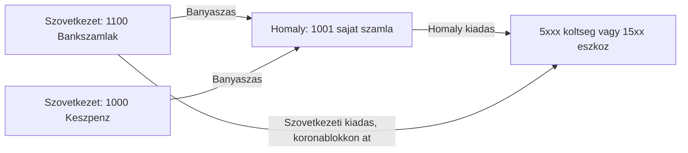

## Honnan jön a pénz

Kívülről érkező pénz mindig egy 1-es osztályú eszközszámlára érkezik, tartozik oldalra. Ez többnyire a `1100` Bankszámlák vagy a `1000` Készpénz. A követel oldal mondja meg, miért jött:

| Követel            | Mit jelent                                                    |
| ------------------ | ------------------------------------------------------------- |
| `4000`–`4300`      | bevétel: értékesítés, szolgáltatás, támogatás, kamat          |
| `3000` Alaptőke    | részjegy, tőke                                                |
| `1101` tagi számla | a tag rendezi, amivel tartozott, például az előírt részjegyet |
| `1200` Követelések | korábban megítélt követelés kiegyenlítése                     |

A külső bank, a tag saját bankja a könyvekben nem szerepel.

## Költségek és eszközök számlái

Melyik tétel melyik számlára kerül tartozik oldalra. A követel oldal a fizetés módja: `1100`, `1000`, tagi megelőlegezésnél a tag `1101`-e, Homályban a tag `1001`-je.

| Tétel                                       | Tartozik                                               | Megjegyzés                                                                    |
| ------------------------------------------- | ------------------------------------------------------ | ----------------------------------------------------------------------------- |
| Üzemanyag, utazás                           | `5410` Utazás és üzemanyag                             |                                                                               |
| Lakóépület                                  | `1530` Lakóépületek                                    | eszköz                                                                        |
| Belterületi földterület, lakótelek          | `1520` Belterületi földterületek                       | eszköz                                                                        |
| Mezőgazdasági földterület                   | `1510` Mezőgazdasági földterületek                     | eszköz                                                                        |
| Képzési díj                                 | `5420` Oktatás és képzés                               |                                                                               |
| Vagyonszerzési illeték                      | az ingatlan eszközszámlája: `1510`, `1520` vagy `1530` | aktiválva, az ingatlan értékébe                                               |
| Mezőgazdasági emberi szolgáltatás, kaszálás | `5430` Mezőgazdasági szolgáltatások                    |                                                                               |
| Könyvelési díj                              | `5440` Könyvelési és szakértői díjak                   |                                                                               |
| Banki díjak                                 | `5700` Pénzügyi költségek                              | `5700` ← `1100`                                                               |
| Gépbérlés                                   | `5450` Bérleti díjak                                   |                                                                               |
| Javítási díj                                | `5460` Javítás és karbantartás                         | ha az ingatlanba beépül és értéket növel: az eszközszámla, `1530` vagy `1500` |
| Munkaebéd                                   | `5510` Reprezentáció                                   |                                                                               |
| Hatósági díj                                | `5800` Egyéb költségek                                 |                                                                               |

## Számlatükör-rések

A táblázatok a hiányzó tételeket a javasolt kóddal írják. Ezek a seedben még nincsenek, vagy javítani kell őket.

- `1900` Átvezetés devizanemek között. Ezen a technikai számlán egyensúlyoz külön a forint sor és a korona sor. Még nincs a seedben.
- `EGG` csak az edizone seedben van. A tojásos ügylet ezt a pénznemet használja, mértékegység: egg, kategória: RESOURCES.
- `FRUIT` nincs a kor seedben. Javasolt mértékegység: kg, kategória: RESOURCES.
- `4500` Saját termelésű készletek állományváltozása. A tojás és a gyümölcs keletkezése ide kerül követelként. Korábban ez `4400` volt, de a `4400` a seedben most Előfizetések és tagsági díjak, ezért új, szabad kódot kapott. Az értékesítés bevétele a `4000` marad, és csak az eladáskor.
- A `4400` Előfizetések és tagsági díjak a seedben `equity` típusú. Bevételi számla, javasolt típus: `revenue`.
- A `1530` Lakóépületek leírása a seedben „1520 Lakóépületek számla”. A kód `1530`, a leírásból a `1520` elírás.
- Az `1400` Előlegek a seedben a Terjesztési Igazgatóságon ül. Ingatlan-előlegnél a sor szervezete az ingatlan projektje, `I/4.11.1.1 Lakóterületek` vagy `I/4.11.1.2 Termőterületek`.
- Külön illeték számla nincs és nem is kell: a vagyonszerzési illeték az ingatlan eszközszámlájára aktiválódik.
- A `1101` és `1001` nincs az `accounts.json`-ban: tagonként automatikusan jön létre.
- Az árfolyamot a `currency-rate` adja, a sor nem őrzi meg.

A korábbi rések közül a `KOR` pénznem már a [kor currency-types](../database/seeders/http/kor/data/currency-types.json) fájlban van, a kétszeres `4300` kód pedig megszűnt.

A kincstár a mintákban az `I/3. Pénzügyi Igazgatóság`: a `1000` és a `1100` a seedben ehhez a szervezethez tartozik.

## Közös koronablokk

Pénzeszköz a forint lábon: `1000` Készpénz vagy `1100` Bankszámlák. A korona mindig a `1000`-en jelenik meg. A projektre helyezés két sor, mert egy tranzakciónak egy szervezete van.

A sorrend-diagramokban minden szereplő egy számla, vagy a számla egy szervezeten. A nyíl a követel számlától a tartozik számla felé mutat, ahogy a táblák fejlécében a **Tartozik ← Követel**.

### Kiadás

A forint már a pénzeszközön van. A blokk végén a célszámla tartozik, a pénzeszköz követel. Nettó: a pénzeszköz egyszer csökken, a célszámla egyszer nő. A korona a közbenső projekt-egyenleg.

| Lépés                           | Tartozik ← | Követel    | Pénznem | Szervezet |
| ------------------------------- | ---------- | ---------- | ------- | --------- |
| 1. Forint a tartalékba          | `1900`     | pénzeszköz | HUF     | kincstár  |
| 2. Korona kibocsátás            | `1000`     | `1900`     | KOR     | kincstár  |
| 3. Korona le a kincstárról      | `1900`     | `1000`     | KOR     | kincstár  |
| 4. Korona a projektre           | `1000`     | `1900`     | KOR     | projekt   |
| 5. Korona visszaváltása         | `1900`     | `1000`     | KOR     | projekt   |
| 6. Forint vissza a pénzeszközre | pénzeszköz | `1900`     | HUF     | projekt   |
| 7. Végleges sor                 | célszámla  | pénzeszköz | HUF     | projekt   |

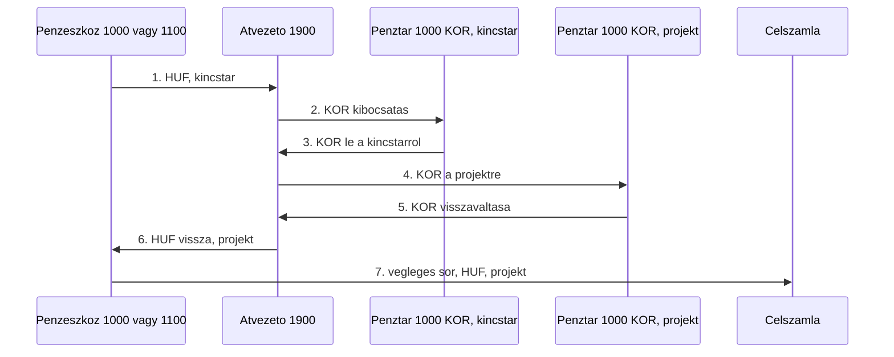

Az 1. és 4. ügylet, valamint a 9. ügylet vételára ezt a teljes blokkot használja. Az 5. és 7. ügylet, valamint a 9. ügylet illetéke a 6. lépésnél megáll: a forint újra a `1100`-on van, a célszámla pedig a szállítói vagy adótartozással és az utalással következik. Ilyenkor a 7. lépés nincs benne a blokkban, különben az eszköz vagy a költség kétszer nőne.

### Bevétel

#### Tagi befizetés a területekre

★ Egyszerű, egysoros:
| credit → | debit |
|----------------------------------|--------------------------------------|
| 1101 XY - Tagi számla | 1510 Mezőgazdasági földterületek |

📋 Teljes folyamat:

| credit / követel / kifizető → | debit / tartozik / költség       | valuta | magyarázat                     |
| ----------------------------- | -------------------------------- | ------ | ------------------------------ |
| 3000 Részjegytőke             | 1101 XY - tagi számla            | HUF    | előírás                        |
| 1101 XY - Tagi számla         | 1000 Bankszámla                  | HUF    | befizetés                      |
| -                             | -                                | -      | -                              |
| 1000 Bankszámla               | 1900 KOR Kincstár                | HUF    | forint fedezetbe               |
| 1900 KOR Kincstár             | 1000 Bankszámla                  | KOR    | korona kibocsátárs             |
| -                             | -                                | -      | -                              |
| 1000 Bankszámla               | 1001 XY - saját számla           | KOR    | stróman                        |
| 1001 XY - saját számla        | 1510 Mezőgazdasági földterületek | KOR    | telek vásárlás                 |
| -                             | -                                | -      | -                              |
|  2300 Adótartozások           | 1510 Mezőgazdasági földterületek | HUF    | illeték előírás telek értékébe |
| 1100 Bankszámlák              | 2300 Adótartozások               | HUF    | illeték utalása a NAV-nak      |

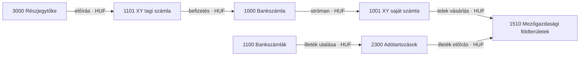

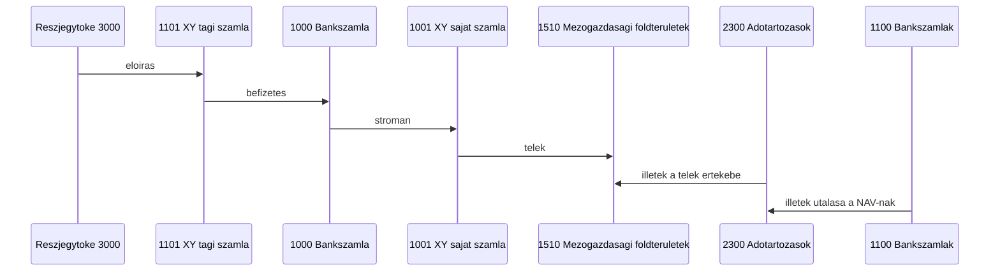

#### Bányászás

★ Egyszerű, egysoros:
| credit → | debit |
|----------------------------------|--------------------------------------|
| 1000 Bankszámla | 1001 XY - saját számla |

#### Szintetikus :

A végleges számla a blokk után kerül követelre. Az első forint pár (beérkezés, majd átváltás) a visszaváltás előtt összeadva nulláz. A korona közben a projekten van. Nettó: a pénzeszköz nő, a végleges számla követel oldala nő.

| Lépés                             | Tartozik ← | Követel                | Pénznem | Szervezet |
| --------------------------------- | ---------- | ---------------------- | ------- | --------- |
| 1. Beérkezés                      | pénzeszköz | `1900`                 | HUF     | kincstár  |
| 2. Forint a tartalékba            | `1900`     | pénzeszköz             | HUF     | kincstár  |
| 3. Korona kibocsátás              | `1000`     | `1900`                 | KOR     | kincstár  |
| 4. Korona le a kincstárról        | `1900`     | `1000`                 | KOR     | kincstár  |
| 5. Korona a projektre             | `1000`     | `1900`                 | KOR     | projekt   |
| 6. Korona visszaváltása           | `1900`     | `1000`                 | KOR     | projekt   |
| 7. Forint a projekt pénzeszközére | pénzeszköz | `1900`                 | HUF     | projekt   |
| 8. Végleges sor                   | `1900`     | bevétel vagy követelés | HUF     | projekt   |

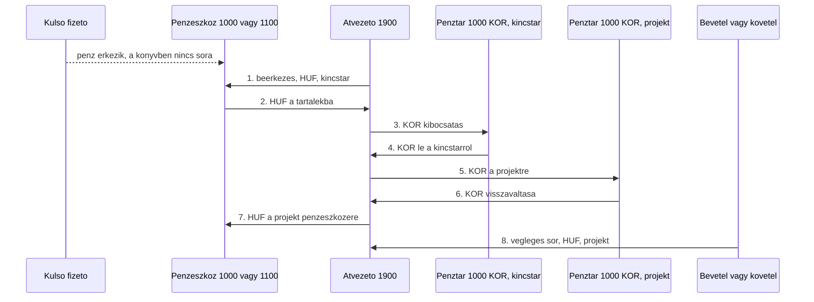

A 2., 3. és 6. ügylet ezt a blokkot használja. A beérkezés típusa készpénznél Készpénz, banknál Utalás. A 8. lépés típusa Átvezetés.

## Ügylet 1 — hirtelen készpénzes projektköltség

Egy tag kívülről, a saját bankjából utalja be az egyszeri hozzájárulást. A hozzájárulás a tag `1101`-es tagi számláján megy át. A szövetkezet a banki összeget készpénzbe veszi, az koronára vált, a projektre kerül, majd visszaváltás után anyagköltségként kifizetésre megy.

Egyszerűsített mezők: dátum, tag, összeg forintban, projekt, költség számla (például `5000`, `5410`, `5430` vagy `5800`), leírás, opcionális nyugta. A tagot a tagi számlája azonosítja. Az árfolyam a `currency-rate` törzsből jön.

Minta: 10 000 Ft, 1 korona = 100 Ft, tehát 100 korona. Tag: `kovács.erika`. Projekt: `I/4.12.1.1.1 Szávai Márton gyümölcsfaliget`. Költség: `5000` Anyagköltség.

A 10 000 Ft kívülről, egyszeri tagi hozzájárulásként érkezik. Előbb az előírás: a tag tartozik a hozzájárulással, ez a `1101` tartozik és a `3000` Alaptőke követel. Utána a befizetés: a tag a saját bankjából utal, a pénz a `1100`-ra érkezik, a követel oldal a `1101`, ez rendezi az előírást. A külső bank a könyvekben nem szerepel. Az alaptőke egyenlege ezután végig 10 000 Ft marad.

A következő sor már nem befizetés. A bankról levett készpénz a `1000` pénztárba kerül, hogy a költség készpénzben kifizethető legyen. A követel oldal itt a `1100`, az alaptőke nem ismétlődik.

| Lépés                     | Tartozik ←                        | Követel                           | Összeg | Pénznem | Szervezet                     | Típus     |
| ------------------------- | --------------------------------- | --------------------------------- | ------ | ------- | ----------------------------- | --------- |
| Hozzájárulás előírása     | `1101` kovács.erika - tagi számla | `3000` Alaptőke                   | 10 000 | HUF     | I/3. Pénzügyi Igazgatóság     | Átvezetés |
| Bejövő tagi utalás        | `1100` Bankszámlák                | `1101` kovács.erika - tagi számla | 10 000 | HUF     | I/3. Pénzügyi Igazgatóság     | Utalás    |
| Készpénzfelvétel          | `1000` Készpénz                   | `1100` Bankszámlák                | 10 000 | HUF     | I/3. Pénzügyi Igazgatóság     | Készpénz  |
| Forint a tartalékba       | `1900`                            | `1000`                            | 10 000 | HUF     | I/3. Pénzügyi Igazgatóság     | Átvezetés |
| Korona kibocsátás         | `1000`                            | `1900`                            | 100    | KOR     | I/3. Pénzügyi Igazgatóság     | Átvezetés |
| Korona le a kincstárról   | `1900`                            | `1000`                            | 100    | KOR     | I/3. Pénzügyi Igazgatóság     | Átvezetés |
| Korona a projektre        | `1000`                            | `1900`                            | 100    | KOR     | Szávai Márton gyümölcsfaliget | Átvezetés |
| Korona visszaváltása      | `1900`                            | `1000`                            | 100    | KOR     | Szávai Márton gyümölcsfaliget | Átvezetés |
| Forint vissza a pénztárba | `1000`                            | `1900`                            | 10 000 | HUF     | Szávai Márton gyümölcsfaliget | Átvezetés |
| Anyagköltség              | `5000` Anyagköltség               | `1000`                            | 10 000 | HUF     | Szávai Márton gyümölcsfaliget | Készpénz  |

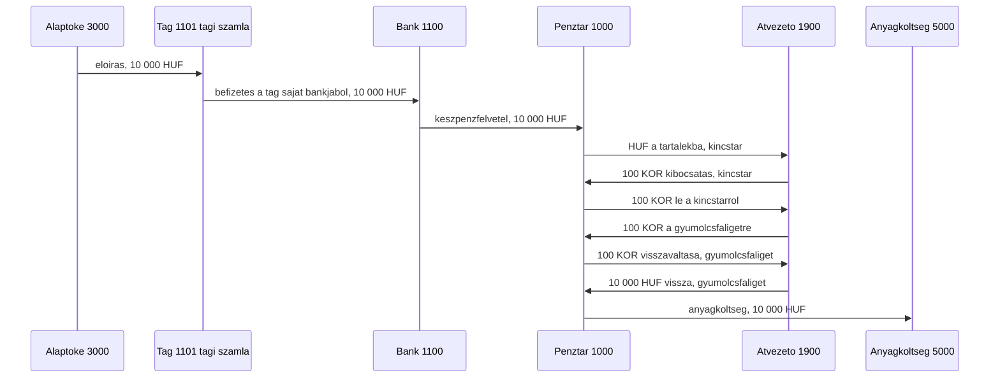

A készpénzfelvétel utáni hét sor a kiadás-blokk. Zárás után a `1101` nulla, a bank és a kincstári készpénz forintban nulla, a projekt készpénze forintban nulla, a `5000` tartozik egyenlege 10 000 Ft, a `3000` követel egyenlege 10 000 Ft. Koronaegyenleg nem marad.

Seedből hiányzik: `1900`. A 100 Ft/korona árfolyam nincs a tranzakción.

## Ügylet 2 — tojás keletkezése és eladása

Tojás jelenik meg egy ólban, készletre kerül, majd eladáskor a darab kimegy a készletből, a forint pedig a koronablokkon át értékesítési bevétel lesz.

Egyszerűsített mezők: dátum, ól (szervezet), darabszám, eladási forint, leírás.

A szervezet az `I/4.12.1.2 Állattenyésztés` gyereke. A seedben ilyen ól még nincs; a juhnyáj mutatja a fa mintáját. A minta szervezete: Tojóól.

Minta: 30 tojás keletkezik, mind a 30 elkelt 6 000 Ft-ért (60 korona).

| Lépés            | Tartozik ←                               | Követel                  | Összeg | Pénznem | Szervezet             | Típus                          |
| ---------------- | ---------------------------------------- | ------------------------ | ------ | ------- | --------------------- | ------------------------------ |
| Keletkezés       | `1300` Készletek                         | `4500`                   | 30     | EGG     | Tojóól                | Átvezetés                      |
| Bevétel-blokk    | a közös bevétel-blokk, pénzeszköz `1000` | végleges követel: `4000` | 6 000  | HUF     | kincstár, majd Tojóól | Készpénz, a záró sor Átvezetés |
| Készletcsökkenés | `5600` Értékesítési költségek            | `1300` Készletek         | 30     | EGG     | Tojóól                | Átvezetés                      |

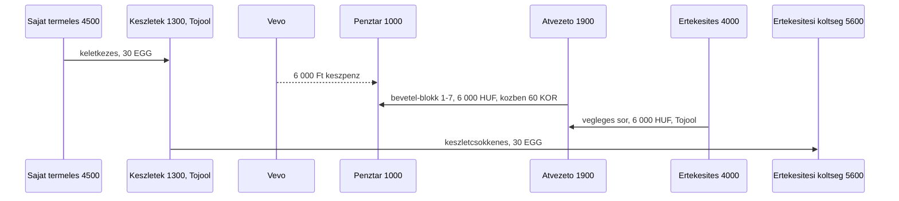

A bevétel-blokk sorai a közös tábla szerintiek, 6 000 Ft és 60 korona összeggel. A végleges sor: tartozik `1900` 6 000 HUF, követel `4000` Értékesítés bevétele, szervezet a Tojóól.

A darabszámla és a forint bevétel külön pénznem. A tojásnak ebben a modellben nincs forint önköltsége. Eladás után az ól `1300` tojás-egyenlege nulla.

Seedből hiányzik: `EGG`, `4500`, `1900`, és a Tojóól szervezeti csomópont.

## Ügylet 3 — gyümölcs szürete és piaci eladása

A gyümölcsfaligetben leszüretelt mennyiség készletre kerül. A piacra vitt rész kimegy a készletből, a befolyt forint a bevétel-blokkon át a `4000`-re kerül. A raktáron hagyott kiló a `1300`-on marad.

Egyszerűsített mezők: dátum, leszüretelt kg, eladott kg, forint bevétel, leírás.

Szervezet: `I/4.12.1.1.1 Szávai Márton gyümölcsfaliget`. Mértékegység: kg (`FRUIT`).

Minta: 80 kg szüret, ebből 50 kg eladás 25 000 Ft-ért (250 korona). Raktáron marad 30 kg.

| Lépés            | Tartozik ←                               | Követel                  | Összeg | Pénznem | Szervezet                        | Típus                          |
| ---------------- | ---------------------------------------- | ------------------------ | ------ | ------- | -------------------------------- | ------------------------------ |
| Szüret           | `1300` Készletek                         | `4500`                   | 80     | FRUIT   | Szávai Márton gyümölcsfaliget    | Átvezetés                      |
| Bevétel-blokk    | a közös bevétel-blokk, pénzeszköz `1000` | végleges követel: `4000` | 25 000 | HUF     | kincstár, majd a gyümölcsfaliget | Készpénz, a záró sor Átvezetés |
| Készletcsökkenés | `5600` Értékesítési költségek            | `1300` Készletek         | 50     | FRUIT   | Szávai Márton gyümölcsfaliget    | Átvezetés                      |

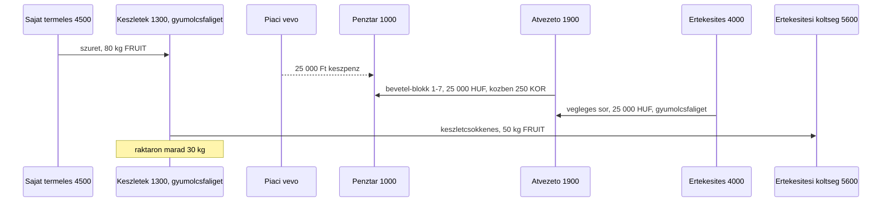

A végleges sor: tartozik `1900` 25 000 HUF, követel `4000`, szervezet a gyümölcsfaliget. A `1300` egyenlege ennél a szervezetnél 30 kg. Forint önköltség nincs.

Seedből hiányzik: `FRUIT`, `4500`, `1900`.

## Ügylet 4 — ingatlan szerzése

Telek vagy épület vásárlása foglalóval, majd a fennmaradó vételár bankból. Mindkét pénzmozgás teljes kiadás-blokk. A foglaló beszámítása a vételárba pénzmozgás nélküli sor.

Egyszerűsített mezők: dátum, foglaló, fennmaradó vételár, ingatlan számla, leírás.

Az ingatlan számla a fajta szerint: `1510` Mezőgazdasági földterületek, `1520` Belterületi földterületek, `1530` Lakóépületek. A minta egy lakóház, `1530`. Szervezet: `I/4.11.1.1 Lakóterületek`. Pénzeszköz: `1100` Bankszámlák. A vagyonszerzési illeték az ingatlan értékébe kerül, a [9. ügylet](#ügylet-9--tagi-befizetésből-lakótelek) szerint.

Minta: 2 000 000 Ft foglaló (20 000 korona), 8 000 000 Ft fennmaradó rész (80 000 korona).

| Lépés                         | Tartozik ←                                        | Követel         | Összeg    | Pénznem | Szervezet                    | Típus                                         |
| ----------------------------- | ------------------------------------------------- | --------------- | --------- | ------- | ---------------------------- | --------------------------------------------- |
| Kiadás-blokk, foglaló         | a közös kiadás-blokk 7. sora: `1400` Előlegek     | `1100`          | 2 000 000 | HUF     | kincstár, majd Lakóterületek | Utalás a forint lábon, a korona láb Átvezetés |
| Kiadás-blokk, fennmaradó rész | a közös kiadás-blokk 7. sora: `1530` Lakóépületek | `1100`          | 8 000 000 | HUF     | kincstár, majd Lakóterületek | Utalás a forint lábon, a korona láb Átvezetés |
| Beszámítás                    | `1530` Lakóépületek                               | `1400` Előlegek | 2 000 000 | HUF     | I/4.11.1.1 Lakóterületek     | Átvezetés                                     |

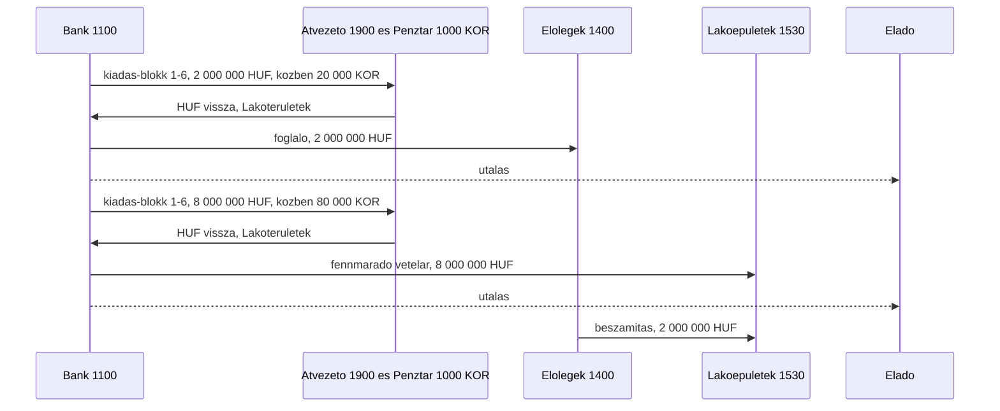

A `1530` egyenlege 10 000 000 Ft. Az `1400` nullázódik. Hitelből vett ingatlannál a fennmaradó rész követelje a `2200` Hosszú lejáratú kötelezettségek lenne. Ez az ügylet bankos vétel.

Seedből hiányzik: `1900`.

## Ügylet 5 — felújítás

Értéknövelő felújítás: a kivitelezés az épület értékébe kerül. A korona-szakasz a forintot visszateszi a `1100`-ra. Utána jön a szállítói számla a `1500`-ra, majd az utalás.

Egyszerűsített mezők: dátum, hely (szervezet), kivitelezői összeg, leírás.

Minta: 1 500 000 Ft (15 000 korona). Szervezet: `I/4.12.1.2 Állattenyésztés`, egy ól felújítása. Pénzeszköz: `1100`. Lakóháznál a tartozik a `1530` Lakóépületek.

| Lépés          | Tartozik ←                              | Követel                     | Összeg    | Pénznem         | Szervezet                         | Típus     |
| -------------- | --------------------------------------- | --------------------------- | --------- | --------------- | --------------------------------- | --------- |
| Korona-szakasz | a kiadás-blokk 1–6. lépése, a 7. nélkül | a forint újra a `1100`-on   | 1 500 000 | HUF, közben KOR | kincstár, majd az állattenyésztés | Átvezetés |
| Aktiválás      | `1500` Tárgyi eszközök                  | `2000` Szállítói tartozások | 1 500 000 | HUF             | I/4.12.1.2 Állattenyésztés        | Átvezetés |
| Utalás         | `2000` Szállítói tartozások             | `1100` Bankszámlák          | 1 500 000 | HUF             | I/4.12.1.2 Állattenyésztés        | Utalás    |

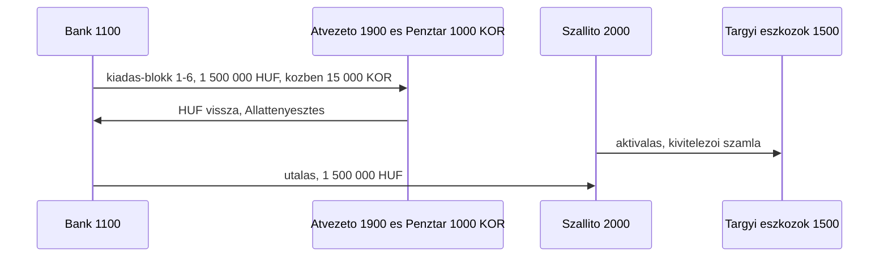

Zárás után a `1500` 1 500 000 Ft-tal nő, a `2000` nulla, a bank ennyivel csökkent. A `5300` Értékcsökkenés későbbi, időszakos sor, ennek az ügyletnek nem lépése.

Karbantartásnál és javításnál az aktiválás tartozikja a `5460` Javítás és karbantartás, és a `1500` kimarad. Az ugyanaz a korona-szakasz és ugyanaz az utalás. Ha a javítás beépül az ingatlanba és értéket növel, akkor aktiválás.

Seedből hiányzik: `1900`.

## Ügylet 6 — területalapú agrár támogatás

Működési, területalapú támogatás egy támogatott földterületre. A megítéléskor keletkezik az egyéb bevétel és a követelés. A kincstári jóváírás a bankra érkezik, bevétel-blokkon megy át, és a követelést zárja. A `4200` a jóváíráskor nem ismétlődik. Értékesítés nincs, a `4000` kimarad.

Egyszerűsített mezők: dátum, támogatott terület (szervezet), megítélt összeg, leírás.

A seedben nincs külön támogatási bevétel számla, ezért a bevétel a `4200` Egyéb bevételek. Szervezet: `I/4.11.1.2 Termőterületek`, a támogatott földterület projektje. Pénzeszköz: `1100`.

Minta: 400 000 Ft (4 000 korona).

| Lépés                     | Tartozik ←         | Követel                | Összeg  | Pénznem | Szervezet                 | Típus     |
| ------------------------- | ------------------ | ---------------------- | ------- | ------- | ------------------------- | --------- |
| Megítélés                 | `1200` Követelések | `4200` Egyéb bevételek | 400 000 | HUF     | I/4.11.1.2 Termőterületek | Átvezetés |
| Kincstári jóváírás        | `1100` Bankszámlák | `1900`                 | 400 000 | HUF     | I/3. Pénzügyi Igazgatóság | Utalás    |
| Forint a tartalékba       | `1900`             | `1100`                 | 400 000 | HUF     | I/3. Pénzügyi Igazgatóság | Átvezetés |
| Korona kibocsátás         | `1000`             | `1900`                 | 4 000   | KOR     | I/3. Pénzügyi Igazgatóság | Átvezetés |
| Korona le a kincstárról   | `1900`             | `1000`                 | 4 000   | KOR     | I/3. Pénzügyi Igazgatóság | Átvezetés |
| Korona a projektre        | `1000`             | `1900`                 | 4 000   | KOR     | I/4.11.1.2 Termőterületek | Átvezetés |
| Korona visszaváltása      | `1900`             | `1000`                 | 4 000   | KOR     | I/4.11.1.2 Termőterületek | Átvezetés |
| Forint a projekt bankjára | `1100`             | `1900`                 | 400 000 | HUF     | I/4.11.1.2 Termőterületek | Átvezetés |
| Követelés zárása          | `1900`             | `1200` Követelések     | 400 000 | HUF     | I/4.11.1.2 Termőterületek | Átvezetés |

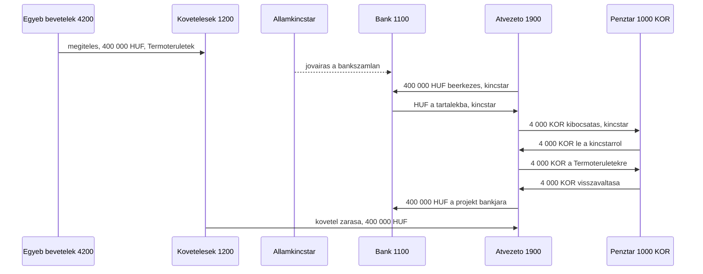

Zárás:

| Számla                 | Tartozik       | Követel        | Egyenleg         |
| ---------------------- | -------------- | -------------- | ---------------- |
| `1100` Bankszámlák     | 800 000        | 400 000        | 400 000 tartozik |
| `1900` HUF             | 800 000        | 800 000        | 0                |
| `1900` és `1000` KOR   | 8 000 és 8 000 | 8 000 és 8 000 | 0                |
| `1200` Követelések     | 400 000        | 400 000        | 0                |
| `4200` Egyéb bevételek | 0              | 400 000        | 400 000 követel  |

A bank 400 000 Ft-tal nő, a `4200` követel egyenlege 400 000 Ft, a `1200` nulla, korona nem marad.

Ha a támogatás előzetes megítélés nélkül érkezik, a megítélés sora elmarad, és a záró sor követelje közvetlenül a `4200`: `1900` ← `4200`. A bank és a `4200` egyenlege ugyanaz.

A beruházási támogatás nem bevétel, hanem az eszközhöz kötött halasztott tétel, és nem ennek az ügyletnek a része.

Seedből hiányzik: `1900`.

## Ügylet 7 — adminisztráció

Külső könyvelői vagy ügyintézői számla. A korona-szakasz a forintot visszateszi a bankra, utána jön a költség számla és az utalás.

Egyszerűsített mezők: dátum, összeg, leírás.

Szervezet: `I/3. Pénzügyi Igazgatóság`. Pénzeszköz: `1100`. A `5440` Könyvelési és szakértői díjak a seedben is ezen a szervezeten ül.

Minta: 80 000 Ft (800 korona).

| Lépés          | Tartozik ←                              | Követel                     | Összeg | Pénznem         | Szervezet                                | Típus     |
| -------------- | --------------------------------------- | --------------------------- | ------ | --------------- | ---------------------------------------- | --------- |
| Korona-szakasz | a kiadás-blokk 1–6. lépése, a 7. nélkül | a forint újra a `1100`-on   | 80 000 | HUF, közben KOR | kincstár, majd I/3. Pénzügyi Igazgatóság | Átvezetés |
| Számla         | `5440` Könyvelési és szakértői díjak    | `2000` Szállítói tartozások | 80 000 | HUF             | I/3. Pénzügyi Igazgatóság                | Átvezetés |
| Utalás         | `2000` Szállítói tartozások             | `1100` Bankszámlák          | 80 000 | HUF             | I/3. Pénzügyi Igazgatóság                | Utalás    |

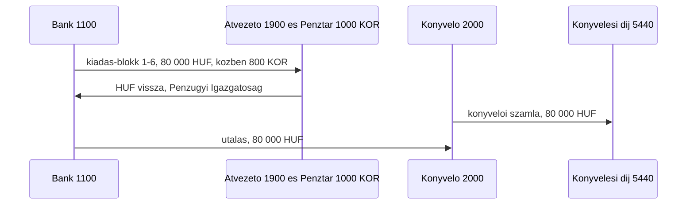

Hatósági díj ugyanígy könyvelődik, a számla tartozikja a `5800` Egyéb költségek. A banki díj nem kap szállítói számlát: a bank levonja, a sor `5700` ← `1100`. A kidolgozott ügylet a könyvelői számla.

Seedből hiányzik: `1900`.

## Ügylet 8 — bányászás

A bányászás a hivatalos Szövetkezet rendszerből, a `1100` bankról vagy a `1000` pénztárból készpénzt visz át a Homály rendszerbe, egy tag `1001` saját számlájára. Kiadásnak látszik, mert a pénz kimegy a szövetkezet számláiról, de nem költség: két főkönyv közötti átvezetés. A bányászás sorában nincs `5xxx` számla. A költség később, Homályban keletkezik, amikor a tag a `1001`-ről fizet.

Egyszerűsített mezők: dátum, tag, összeg, honnan (`1100` vagy `1000`), leírás.

A tranzakciótípus `Bányászás`. A sor Homály, mert az egyik oldala `1001`. Mivel két pénzeszköz között mozog, nem megy át a koronablokkon, ugyanúgy, mint a készpénzfelvétel.

Minta: 50 000 Ft a bankról `kovács.erika` saját számlájára. Utána Homályban 12 000 Ft munkaebéd és 8 000 Ft üzemanyag a gyümölcsfaligetnél.

| Lépés                    | Tartozik ←                         | Követel                            | Összeg | Pénznem | Szervezet                     | Típus     |
| ------------------------ | ---------------------------------- | ---------------------------------- | ------ | ------- | ----------------------------- | --------- |
| Bányászás                | `1001` kovács.erika - saját számla | `1100` Bankszámlák                 | 50 000 | HUF     | I/3. Pénzügyi Igazgatóság     | Bányászás |
| Homály kiadás: munkaebéd | `5510` Reprezentáció               | `1001` kovács.erika - saját számla | 12 000 | HUF     | Szávai Márton gyümölcsfaliget | Készpénz  |
| Homály kiadás: üzemanyag | `5410` Utazás és üzemanyag         | `1001` kovács.erika - saját számla | 8 000  | HUF     | Szávai Márton gyümölcsfaliget | Készpénz  |

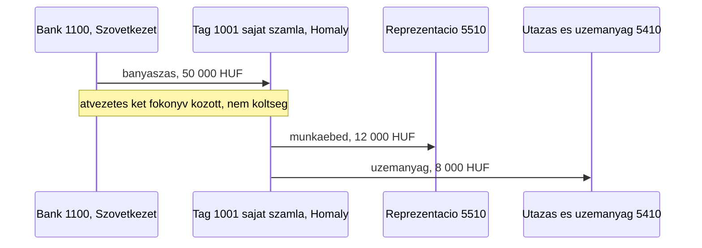

Zárás után a bank 50 000 Ft-tal kevesebb, a tag `1001`-jén 30 000 Ft marad, ez a nála lévő Homály készpénz. A költség 20 000 Ft, a bányászott 50 000 Ft-ból csak ennyi. Ha a tag a maradékot visszaadja a pénztárba, a sor `1000` ← `1001`, típus Átvezetés.

Javaslat, egyeztetendő: a Homály kiadás nem megy át a koronablokkon, mert a blokk a szövetkezeti pénztár `1000`-én és a `1900`-on fut.

Seedből hiányzik: semmi. A `1001` tagonként automatikusan jön létre, a `Bányászás` típus a [transaction-types](../database/seeders/http/kor/data/transaction-types.json) fájlban van.

## Ügylet 9 — tagi befizetésből lakótelek

Egy tag részjegyet fizet be a saját bankjából. A részjegy a `1101` tagi számláján megy át: előbb az előírás, aztán a befizetés. A pénzből a szövetkezet lakótelket vesz, a vagyonszerzési illetéket pedig a telek értékébe aktiválja.

Egyszerűsített mezők: dátum, tag, befizetett összeg, vételár, illeték, leírás.

Minta: `kovács.erika` 2 080 000 Ft részjegyet fizet. A telek vételára 2 000 000 Ft (20 000 korona), a vagyonszerzési illeték 80 000 Ft (800 korona). Számla: `1520` Belterületi földterületek, mert a lakótelek belterületi föld. Szervezet: `I/4.11.1.1 Lakóterületek`. Pénzeszköz: `1100`.

A vételár teljes kiadás-blokk, a végleges sor `1520` ← `1100`. Az illetéket a NAV határozattal veti ki: az aktiválás `1520` ← `2300` Adótartozások. Utána a korona-szakasz a 6. lépésig, és az utalás `2300` ← `1100`.

| #   | Lépés                   | Tartozik ←                        | Követel                           | Összeg    | Pénznem | Szervezet                 | Típus     |
| --- | ----------------------- | --------------------------------- | --------------------------------- | --------- | ------- | ------------------------- | --------- |
| 1   | Részjegy előírása       | `1101` kovács.erika - tagi számla | `3000` Alaptőke                   | 2 080 000 | HUF     | I/3. Pénzügyi Igazgatóság | Átvezetés |
| 2   | Bejövő tagi utalás      | `1100` Bankszámlák                | `1101` kovács.erika - tagi számla | 2 080 000 | HUF     | I/3. Pénzügyi Igazgatóság | Utalás    |
| 3   | Forint a tartalékba     | `1900`                            | `1100`                            | 2 000 000 | HUF     | I/3. Pénzügyi Igazgatóság | Átvezetés |
| 4   | Korona kibocsátás       | `1000`                            | `1900`                            | 20 000    | KOR     | I/3. Pénzügyi Igazgatóság | Átvezetés |
| 5   | Korona le a kincstárról | `1900`                            | `1000`                            | 20 000    | KOR     | I/3. Pénzügyi Igazgatóság | Átvezetés |
| 6   | Korona a projektre      | `1000`                            | `1900`                            | 20 000    | KOR     | I/4.11.1.1 Lakóterületek  | Átvezetés |
| 7   | Korona visszaváltása    | `1900`                            | `1000`                            | 20 000    | KOR     | I/4.11.1.1 Lakóterületek  | Átvezetés |
| 8   | Forint vissza a bankra  | `1100`                            | `1900`                            | 2 000 000 | HUF     | I/4.11.1.1 Lakóterületek  | Átvezetés |
| 9   | Telek vételára          | `1520` Belterületi földterületek  | `1100` Bankszámlák                | 2 000 000 | HUF     | I/4.11.1.1 Lakóterületek  | Utalás    |
| 10  | Illeték aktiválása      | `1520` Belterületi földterületek  | `2300` Adótartozások              | 80 000    | HUF     | I/4.11.1.1 Lakóterületek  | Átvezetés |
| 11  | Forint a tartalékba     | `1900`                            | `1100`                            | 80 000    | HUF     | I/3. Pénzügyi Igazgatóság | Átvezetés |
| 12  | Korona kibocsátás       | `1000`                            | `1900`                            | 800       | KOR     | I/3. Pénzügyi Igazgatóság | Átvezetés |
| 13  | Korona le a kincstárról | `1900`                            | `1000`                            | 800       | KOR     | I/3. Pénzügyi Igazgatóság | Átvezetés |
| 14  | Korona a projektre      | `1000`                            | `1900`                            | 800       | KOR     | I/4.11.1.1 Lakóterületek  | Átvezetés |
| 15  | Korona visszaváltása    | `1900`                            | `1000`                            | 800       | KOR     | I/4.11.1.1 Lakóterületek  | Átvezetés |
| 16  | Forint vissza a bankra  | `1100`                            | `1900`                            | 80 000    | HUF     | I/4.11.1.1 Lakóterületek  | Átvezetés |
| 17  | Illeték utalása         | `2300` Adótartozások              | `1100` Bankszámlák                | 80 000    | HUF     | I/4.11.1.1 Lakóterületek  | Utalás    |

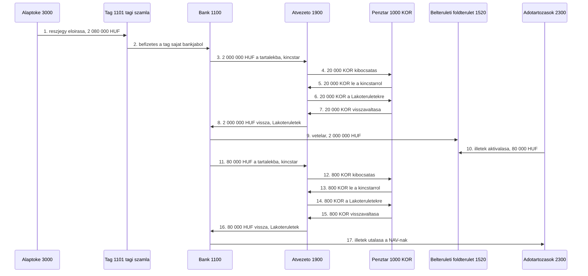

Zárás:

| Számla                            | Tartozik                  | Követel                      | Egyenleg           |
| --------------------------------- | ------------------------- | ---------------------------- | ------------------ |
| `3000` Alaptőke                   | 0                         | 2 080 000                    | 2 080 000 követel  |
| `1101` kovács.erika - tagi számla | 2 080 000                 | 2 080 000                    | 0                  |
| `1100` Bankszámlák                | 4 160 000 (2., 8., 16.)   | 4 160 000 (3., 9., 11., 17.) | 0                  |
| `1900` HUF                        | 2 080 000 (3., 11.)       | 2 080 000 (8., 16.)          | 0                  |
| `1900` KOR                        | 41 600 (5., 7., 13., 15.) | 41 600 (4., 6., 12., 14.)    | 0                  |
| `1000` KOR                        | 41 600 (4., 6., 12., 14.) | 41 600 (5., 7., 13., 15.)    | 0                  |
| `2300` Adótartozások              | 80 000                    | 80 000                       | 0                  |
| `1520` Belterületi földterületek  | 2 080 000                 | 0                            | 2 080 000 tartozik |

A telek 2 080 000 Ft értéken áll a könyvekben, ebből 80 000 Ft az aktivált illeték. Ezzel szemben 2 080 000 Ft alaptőke áll. A tag `1101`-e nulla, mert az előírt részjegyet befizette. A bank, a `1900` és a korona nullára zár.

Mezőgazdasági földnél ugyanez a lánc, a számla `1510` Mezőgazdasági földterületek, a szervezet `I/4.11.1.2 Termőterületek`.

Seedből hiányzik: `1900`.

## Ügylet konfigurálása Strapi-ban

Ez javaslat a későbbi egyszerűsített űrlaphoz. A collection és a resolver még nincs a kódban. A v1 képernyő ettől nem változik, és a `dataentry` továbbra sem publikál.

A `transaction-type` címke marad (Készpénz, Utalás, Átvezetés, Barter, Jutalék, Elrendelt, Bányászás). A lépéssort egy külön collection írja le, kódban szállítva, draft nélkül. A belső neve `posting-workflow`. A Strapi Adminban és a backoffice-ban a megjelenő név Ügylet.

### Ki mit csinál

A könyvelő az ügyletet egyszer állítja össze a Strapi Adminban. A rögzítő utána már csak a rövid űrlapot látja. A resolver a mentett lépésekből draft tranzakciókat ír. Az `editor` a láncot ellenőrzi és publikálja.

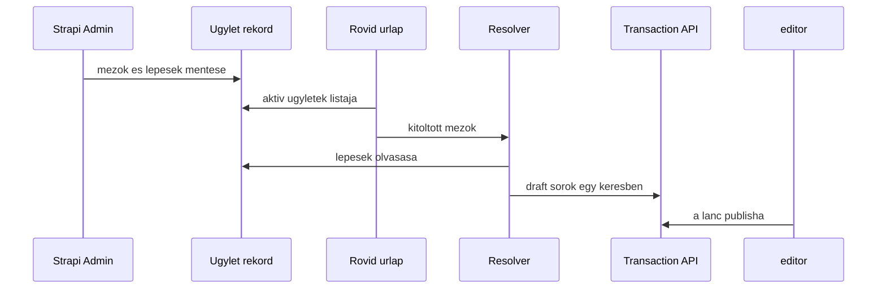

### Mit tárol egy ügylet

Egy rekord azonosítóból, névből, aktív jelzőből, beviteli mezőkből és lépésekből áll. A számla, a pénznem, a tranzakciótípus és a szervezet mind meglévő rekord, legördülőből. Az összegnek két módja van: a beviteli mező másolata, vagy átváltás a `currency-rate` szerint a bizonylat napján. Szabad képlet nincs.

A beviteli mezők ismétlődő komponens, `posting.input`: kulcs, címke, fajta. Minden mező ugyanazt az alakot követi, ezért ide nem dynamic zone kell.

A lépések dynamic zone, a Strapi 5.58 blokklistája. A szerkesztő az „Add a component” listából tesz fel blokkot, és húzással rendezi. Három komponens van, bármilyen sorrendben, többször is:

- `posting.line`: egy tartozik/követel sor. A számla lehet rögzített rekord, a beviteli mező kulcsa, vagy egy tag mező `1101`-es tagi, illetve `1001`-es saját számlája. Mellette az összeg módja, a pénznem, a szervezet és a tranzakciótípus.
- `posting.korona-kiadas`: a kiadás-blokk. Az admin a pénzeszközt és a projekt mezőjét választja.
- `posting.korona-bevetel`: a bevétel-blokk. Az admin a pénzeszközt és a végleges követel számlát választja.

A `1900`-as sorok nem admin-blokk. A resolver a blokk `__component` értékét olvassa, és a koronablokkot a [közös koronablokk](#közös-koronablokk) tábláiból bontja ki.

Új ügylet a meglévő három blokkból admin adat. Negyedik blokkfajta új komponens, tehát kódváltozás, ugyanazon a határon, mint amikor az összeg sem másolat, sem árfolyam.

Az 1. ügylet adminrekordja így nézne ki.

Beviteli mezők, ezekből áll a rövid űrlap:

| Kulcs         | Címke az űrlapon | Fajta                                 |
| ------------- | ---------------- | ------------------------------------- |
| `date`        | Dátum            | dátum                                 |
| `member`      | Tag              | tag                                   |
| `amount`      | Összeg forintban | szám                                  |
| `project`     | Projekt          | szervezet                             |
| `expense`     | Költség számla   | számla                                |
| `description` | Leírás           | szöveg                                |
| `receipt`     | Nyugta           | opcionális fájl, a meglévő receipt út |

Lépések, ezekből lesznek a tranzakciók:

| Sorrend | Komponens                                    | Tartozik ←                           | Követel                        | Összeg                                    | Szervezet           |
| ------- | -------------------------------------------- | ------------------------------------ | ------------------------------ | ----------------------------------------- | ------------------- |
| 1       | `posting.line`, típus Átvezetés, pénznem HUF | `member` tagi számlája, `1101`       | `3000` rögzített               | `amount`                                  | kincstár, rögzített |
| 2       | `posting.line`, típus Utalás, pénznem HUF    | `1100` rögzített                     | `member` tagi számlája, `1101` | `amount`                                  | kincstár, rögzített |
| 3       | `posting.line`, típus Készpénz, pénznem HUF  | `1000` rögzített                     | `1100` rögzített               | `amount`                                  | kincstár, rögzített |
| 4       | `posting.korona-kiadas`, pénzeszköz `1000`   | a végleges sor tartozikja: `expense` | a pénzeszköz                   | `amount`, a korona lábat az árfolyam adja | `project`           |

Az első három blokk `posting.line`. A negyedik `posting.korona-kiadas`: a kiadás-blokk mind a hét sora, a végleges tartozik a rögzítő által választott költség számla.

### Mit lát a rögzítő

Az űrlap a beviteli mezőkből készül. Az 1. ügyletnél a rögzítő ennyit tölt ki, számlakódot és korona-sort nem választ:

```text
Ügylet: Hirtelen készpénzes projektköltség

Dátum            2026-10-14
Tag              kovács.erika
Összeg forintban 10 000
Projekt          Szávai Márton gyümölcsfaliget
Költség számla   5000 Anyagköltség
Leírás           egyszeri tagi hozzájárulás, majd anyag
Nyugta           opcionális
```

A feliratok a két katalógusba kerülnek: hu `Ügylet |||| Ügyletek`, en `Deal |||| Deals`. Az új ügylet gomb magyarul Új ügylet, angolul New deal. A mostani tranzakció-képernyők szövege változatlan, azok továbbra is egy sort szerkesztenek.

### Hogyan lesznek belőle sorok

A resolver minden ügyletre ugyanaz a kód. A kitöltött mezőket és a mentett lépéseket olvassa, az árfolyamot a bizonylat napjára kéri, majd egy kérésben draft tranzakciókat ír. Minden sor `related_transaction` mezője az előző sorra mutat, így a lánc egy ügylet marad.

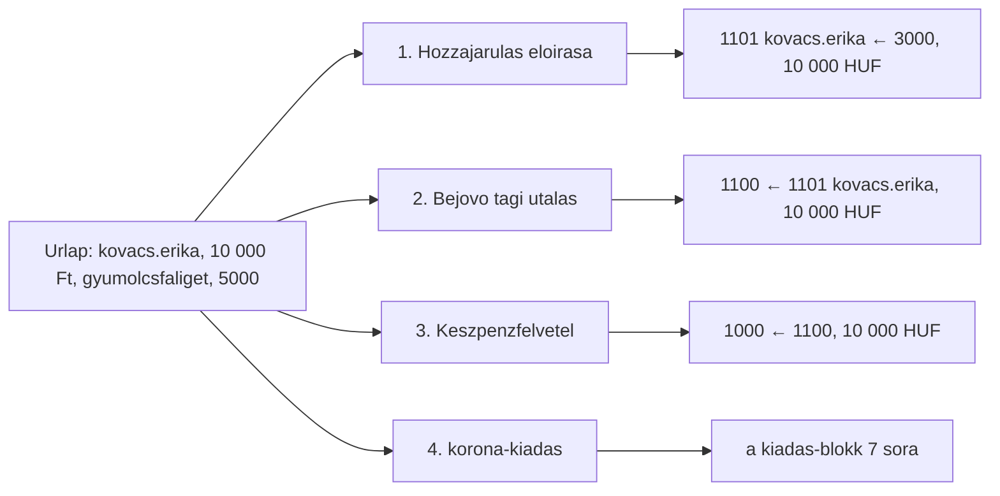

A 10 000 Ft-os mintánál, 1 korona = 100 Ft árfolyammal, a resolver az [1. ügylet tábláját](#ügylet-1--hirtelen-készpénzes-projektköltség) írja ki: az előírást, a bejövő tagi utalást, a készpénzfelvételt, majd a hét kiadás-blokk sort. A nyugta, ha van, a költség sorhoz kapcsolódik.

A `korona-kiadas` egy admin-lépés, a könyvekben hét tranzakció. A bontás a közös tábla szerint megy, a pénzeszköz és a projekt a lépés paramétere:

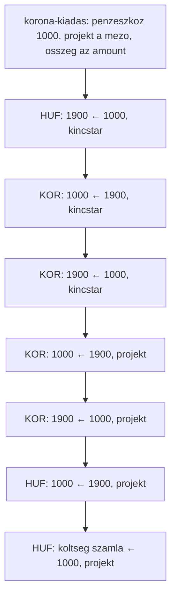

A `korona-bevetel` ugyanígy egy lépés, és a [bevétel-blokk](#bevétel) nyolc sorára bomlik. A végleges követel a lépésen megadott számla, az 1. ügyletben ilyen lépés nincs.

Új ügyletfajta, például a könyvelői számla, admin adat: új `posting.input` mezők és a három meglévő blokk új sorrendje. Negyedik blokk, vagy olyan összeg, amit sem másolni, sem árfolyammal váltani nem lehet, már kódváltozás.
